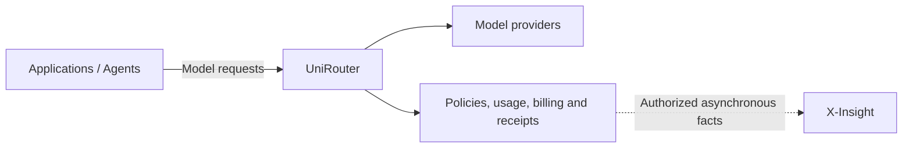

# UniRouter

**Model execution, policy and accountable usage for enterprise AI.**

[Foigent](https://github.com/foigent) · [简体中文](README.zh-CN.md) · [Why UniRouter](docs/community/why-unirouter.md) ·
[Getting started](docs/community/getting-started.md) ·
[Architecture](docs/community/architecture.md) · [Contributing](CONTRIBUTING.md) ·
[Roadmap](ROADMAP.md) · [License](LICENSE)

UniRouter (UR) gives applications and agents a shared model endpoint and an
administration console. It brings model access policies, routing, budgets,
usage, billing and execution receipts together, so operators can inspect how a
request was handled and what its charges are based on.

> **Public source, installer preview:** the Apache-2.0 source is available.
> Fresh Linux amd64 installation and maintenance removal of the commercial
> License passed in disposable GitHub environments. Official signed downloads
> remain pending. See [release readiness](docs/community/release-readiness.md)
> for evidence, contributor CI status and the remaining distribution work.

English is the primary language for public documentation and project updates;
[Simplified Chinese](README.zh-CN.md) is the secondary language. Contributions
and questions in either language are welcome. See the
[language policy](CONTRIBUTING.md#language).

## What you can do

- Connect applications to compatible model endpoints and manage provider
  connections, credentials, execution profiles and qualified releases.
- Control access by organization, project and role, with model policies,
  budgets, rate limits and revocation.
- Inspect routing decisions, failures, usage provenance, billing state and
  request-local execution receipts.
- Keep provider-reported usage, estimates, customer charges and supplier-cost
  evidence distinguishable.
- Export approved execution facts for asynchronous investigation, including
  integration with X-Insight.

Endpoint and parameter support depends on the selected provider, execution
profile, qualification evidence and active release. A compatible URL is not a
promise that every provider supports every operation. See the
[API contract](docs/tech-ref/05-openapi-spec.yaml).

## Start here

Choose the path that matches your task:

| Goal | Start with |
| --- | --- |
| Understand the motivation and design choices | [Why UniRouter](docs/community/why-unirouter.md) |
| Examine selected gateway implementations | [Source-based design comparison](docs/community/gateway-design-comparison.md) |
| Understand the product and its boundaries | [Architecture and X-Insight](docs/community/architecture.md) |
| Install and make a first request | [Getting started](docs/community/getting-started.md) |
| Preview simplified Linux/ECS installation | [Linux installer](docs/community/install-linux.md) |
| Combine execution facts with X-Insight | [Integration entry and current limits](docs/community/getting-started.md#optional-x-insight-integration) |
| Understand data capture and outbound connections | [Data handling](docs/community/data-handling.md) |
| Build, test or contribute | [Contributing](CONTRIBUTING.md) and [contribution map](docs/community/contribution-map.md) |
| Inspect implementation and historical evidence | [Documentation index](docs/README.md) |

The first-use walkthrough follows one request from model setup and access
policy to response, usage and receipt. It uses your selected provider and
credentials; real requests and qualification probes may incur provider charges.
Source development and signed release installation have distinct procedures.

## How it fits together

UniRouter owns model execution, routing, policy, usage and economic facts,
including its customer ledger.
Use it independently for model access and accountable execution. X-Insight is
an independent evidence and investigation product: it associates source facts
and supports analysis and review. Combine them when you need to investigate
UniRouter execution alongside other authorized sources. X-Insight receives
facts asynchronously and does not sit in the synchronous model request path.

The [Foigent overview](https://github.com/foigent) is the product selection entry.
X-Insight's source is preparing for publication; this page links only to public
materials. Follow the [existing integration entry](docs/community/getting-started.md#optional-x-insight-integration)
for contracts, recorded combinations and remaining public-onboarding work.
Shared protocol and Integration Control repositories provide infrastructure
for the products and their verification; they are not additional end-user
products to choose or assemble.

An execution receipt makes recorded decisions inspectable. It does not prove
that a model answer is correct or that a business task succeeded; those claims
need evidence from their own sources.

## Contribute

Documentation, reproducible bug reports, tests, adapters and usability
improvements are welcome. Start with the [contribution map](docs/community/contribution-map.md),
discuss substantial changes in an issue, and follow the [contribution guide](CONTRIBUTING.md).
Contributions use Apache-2.0 and the Developer Certificate of Origin (DCO).

Use [Discussions](https://github.com/foigent/unirouter/discussions) for questions,
ideas and integrations, and [Issues](https://github.com/foigent/unirouter/issues)
for reproducible bugs and scoped proposals. The [starter tasks](docs/community/starter-issues.md)
include concrete entry points and acceptance criteria. See [Security](SECURITY.md) for sensitive reports and
[Code of Conduct](CODE_OF_CONDUCT.md) for participation expectations.

## License and product scope

UniRouter is a complete open-source product under [Apache-2.0](LICENSE).
The accepted direction for UniRouter and X-Insight is to open-source both
complete products under Apache-2.0, without a community/commercial edition split.
Foigent has no current plan for a commercial product. Each project's publication
and release status is tracked independently.

Runtime commercial activation has been retired in the accepted UniRouter
source and verified in disposable fresh-install and maintenance-upgrade tests.
Product authentication, tenant isolation, budgets, financial and audit integrity,
release verification and data protection remain. Existing deployments need
their own supported upgrade; official signed downloads are still pending.
See [release readiness](docs/community/release-readiness.md) for the evidence.

Third-party components retain their own licenses and notices; Foigent attribution
is preserved. See [licensing and product scope](docs/community/commercial-boundaries.md)
for contribution terms and permitted third-party commercial use.
