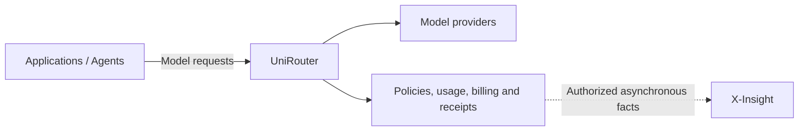

# UniRouter

**Model execution, policy and accountable usage for enterprise AI.**

[简体中文](README.zh-CN.md) · [Getting started](docs/community/getting-started.md) ·
[Architecture](docs/community/architecture.md) · [Contributing](CONTRIBUTING.md) ·
[Roadmap](ROADMAP.md) · [License](LICENSE)

UniRouter gives applications and agents a shared model endpoint and an
administration console. It brings model access policies, routing, budgets,
usage, billing and execution receipts together, so operators can inspect how a
request was handled and what its charges are based on.

> **Open-source preparation:** this branch is a local candidate. The public
> release, license-free installation acceptance and external-fork CI are not yet
> complete. See [release readiness](docs/community/release-readiness.md) before
> treating these instructions as a published, supported installation.

English is the primary language for public documentation and project updates;
[Simplified Chinese](README.zh-CN.md) is the secondary language. Contributions
and questions in either language are welcome. See the
[language policy](CONTRIBUTING.md#language).

## What you can do

- Connect applications to compatible model endpoints and manage provider
  connections, credentials, execution profiles and qualified releases.
- Control access by organization, project and role, with model policies,
  budgets, rate limits and revocation.
- Inspect routing decisions, failures, usage provenance, billing state and
  request-local execution receipts.
- Keep provider-reported usage, estimates, customer charges and supplier-cost
  evidence distinguishable.
- Export approved execution facts for asynchronous investigation, including
  integration with X-Insight.

Endpoint and parameter support depends on the selected provider, execution
profile, qualification evidence and active release. A compatible URL is not a
promise that every provider supports every operation. See the
[API contract](docs/tech-ref/05-openapi-spec.yaml).

## Start here

Choose the path that matches your task:

| Goal | Start with |
| --- | --- |
| Understand the product and its boundaries | [Architecture and X-Insight](docs/community/architecture.md) |
| Install and make a first request | [Getting started](docs/community/getting-started.md) |
| Preview simplified Linux/ECS installation | [Linux installer](docs/community/install-linux.md) |
| Understand data capture and outbound connections | [Data handling](docs/community/data-handling.md) |
| Build, test or contribute | [Contributing](CONTRIBUTING.md) and [contribution map](docs/community/contribution-map.md) |
| Inspect implementation and historical evidence | [Documentation index](docs/README.md) |

The first-use walkthrough follows one request from model setup and access
policy to response, usage and receipt. It uses your selected provider and
credentials; real requests and qualification probes may incur provider charges.
Source development and signed release installation have distinct procedures.

## How it fits together

UniRouter owns model-call decisions and its customer ledger. X-Insight is an
independent evidence and investigation product: it associates source facts and
helps users examine related activity. It is optional and does not sit in the
synchronous model request path. Other applications can use UniRouter without
X-Insight. Integration availability is described separately from product
direction.

An execution receipt makes recorded decisions inspectable. It does not prove
that a model answer is correct or that a business task succeeded; those claims
need evidence from their own sources.

## Contribute

Documentation, reproducible bug reports, tests, adapters and usability
improvements are welcome. Start with the [contribution map](docs/community/contribution-map.md),
discuss substantial changes in an issue, and follow the [contribution guide](CONTRIBUTING.md).
Contributions use Apache-2.0 and the Developer Certificate of Origin (DCO).

Use [Issues](https://github.com/foigent/unirouter/issues) for reproducible bugs
and scoped proposals. See [Security](SECURITY.md) for sensitive reports and
[Code of Conduct](CODE_OF_CONDUCT.md) for participation expectations.

## License and commercial services

UniRouter project code is licensed under [Apache-2.0](LICENSE). Third-party
components retain their own licenses and notices. The copyright attribution
retains the repository's existing Foigent attribution.

The accepted product direction removes runtime commercial activation
requirements from the open core. [Release readiness](docs/community/release-readiness.md)
tracks implementation and validation; changing the source license alone does
not remove an installed version's runtime checks.

Commercial support, private deployment, managed services and independently
licensed future additions may be offered separately. See
[commercial boundaries](docs/community/commercial-boundaries.md). No service
availability or SLA is promised by this source release.
