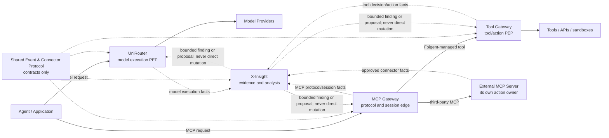

# UniRouter PRD8：企业 AI 模型执行可信控制面边界封板

> Version: 1.2
> Date: 2026-08-02
> Status: Product boundary frozen; product-local UI/architecture and bounded runtime controls implemented locally
> Forward-planning authority: this document supersedes PRD7 for new product
> ownership decisions. PRD7 acceptance records and exact evidence snapshots
> remain immutable history. The Product Owner authorized the product-local
> enterprise organization, finance, and UI migration on 2026-08-01. On
> 2026-08-02 the Product Owner separately authorized PR/CI and release to the
> existing UniRouter environment after verification. Live directory/ERP
> integrations, new credentials and real Provider test traffic remain gated.

## 1. 结论先行

PRD8 不再给 UniRouter 继续叠加“所有 AI 能力”。它把 PRD7 已实现的本地资产按
事实所有者、分析所有者、最终执行者和 UI Host 重新归位，并冻结以下产品定位：

> **UniRouter 是企业 AI 模型执行与经济真值的可信控制面。**

UniRouter 负责模型请求的接入、模型与 Provider 路由、模型访问策略、限额、
Guardrail、重试/故障转移、用量、成本、计费终态、模型执行 Receipt 以及自身
Source 事实。它不是跨产品调查平台、通用工具执行器、MCP Server Host，也不是
共享高权限插件运行时。

以下能力从 UniRouter 的长期产品范围中移出：

- 跨来源 Case、Finding、异常聚类、根因/因果假设、Evidence Pack 和深度调查，
  归 X-Insight；
- 工具目录、工具级授权、Connected Account、OAuth 凭据代理、审批、沙箱、
  工具执行和副作用 Receipt，归 Tool Gateway；
- MCP Server 注册/聚合、Transport、协议版本、Capability、Session、MCP OAuth、
  方法/Tool 可见性和协议遥测，归 MCP Gateway；
- Event Envelope、Connector Manifest、Cursor/Checkpoint、Replay、Provenance、
  Capture Gap、Golden fixtures 和 Conformance，归共享协议权威；
- 跨产品 IAM、签发根和统一授权真值不进入本 PRD；各产品继续拥有自身 IAM，
  未来 X-IAM 仍需独立产品决策。

在 PRD8 写入前，`docs/PRD-Phase7.md` 是仓库最新已接受合同。PRD8 封板后，
PRD7 变为“已完成的 repository-local 实现和证据基线”，不再决定新增能力的
产品所有权。

## 2. 本次封板的事实边界

- UniRouter 当前分支上的 PRD7 B0–B14 已按各自声明完成 Local 验证；这不等于
  CI、Target、真实 Provider、External integration 或 Production 验证。
- 2026-08-01 的封板本身只改变前向产品归属、命名、菜单暴露和后续投资方向，
  不删除或回退代码。后续经单独授权的产品实现新增企业组织/财务数据面、受控
  路由发布和模型调用授权，但仍保持既有请求记录、计费终态、Outbox、Feed、
  Source bytes/hash、Cursor 和凭据语义兼容。
- X-Insight live main 已具有 execution search/detail、Investigation、Chronology、
  Proof、Evidence citation、provenance 和 Capture Gap 投影。其本地未合并候选还
  覆盖 Case、Finding、Evidence Pack、Connector Trust 和多类 Discovery
  hypothesis；这些候选只用于确认产品边界，不被写成已发布能力。
- 当前没有已接受的 Foigent Tool Gateway 或 MCP Gateway 运行时。PRD8 冻结它们
  的责任边界，不虚构已实现产品，也不授权创建仓库、部署或凭据。
- completed-execution Feed 继续作为首个 Reference Connector；现有端点、DTO、
  凭据语义、事件身份、Source bytes/hash、数据结果、页面与 Cursor 行为保持兼容。

逐项处置和当前证据等级以
[`ops/PRD8-BOUNDARY-MATRIX.md`](ops/PRD8-BOUNDARY-MATRIX.md) 为准。

## 3. 五个权威边界

| Product/authority | Owns | Must not own |
|---|---|---|
| **UniRouter** | Model admission, provider selection, routing/failover, model policies, model credentials, rate/budget, usage, customer ledger, captured supplier-cost evidence, provider cost reconciliation records, settlement/finality, model jobs and source Receipts | Supplier raw billing truth, Tool catalog/execution, MCP sessions, cross-source Case/Discovery, shared Connector runtime |
| **X-Insight** | Connector-specific normalization/projection, EvidenceStore, provenance/gap rows, investigation Read API/UI, Case/Finding/Compare/Discovery, asynchronous risk and change proposals | Model/tool request hot path, current authorization truth, route/ledger mutation, credentials or side effects |
| **Tool Gateway** | Protocol-neutral tool identity/catalog/version, delegated actor, tool authorization, credential references, approval, sandbox/executor, idempotency, side-effect finality and tool Receipt | Model routing/billing, MCP protocol sessions, cross-product investigation or business workflow planning |
| **MCP Gateway** | MCP Server registry/federation, transport/version/capability negotiation, Session and affinity, namespace/conflict, MCP OAuth/audience, method/tool ACL, protocol errors and telemetry | General tool credential vault, tool business implementation, model routing, cross-product analytics |
| **Shared protocol** | Event Envelope, Connector Manifest, lifecycle/error/replay/convergence, Cursor/Checkpoint interfaces, canonicalization/hash, provenance/gap semantics, Golden fixtures and Conformance | Network, database, scheduler, credentials, projection, UI, IAM, routing, billing or execution |

### 3.1 Tool Gateway 与 MCP Gateway 的关系

两者是两个独立产品域，可以共享协议类型和部署基础设施，但不能共享一个默认
高权限进程：

1. Foigent 管理的工具通过 MCP 暴露时，MCP Gateway 只负责 MCP 边缘协议，
   真实授权、凭据和执行交给 Tool Gateway。
2. 第三方 MCP Server 可以保留自己的执行环境；MCP Gateway 负责入口身份、
   Server/Tool 可见性、Session 和代理策略，不强迫它进入 Tool Gateway。
3. Tool Gateway 可同时提供 REST/OpenAPI/function-call 等非 MCP 入口；MCP 不是
   Tool Gateway 的内部领域模型。
4. 模型请求不能因 Tool Gateway 故障而整体失败；工具调用在 Tool Gateway
   不可用时不能绕过它执行。

## 4. 统一责任链

每个未来功能必须同时声明以下 Owner，缺一项不得进入实现范围：

| Responsibility | Definition |
|---|---|
| Fact Owner | 直接观察并持久化来源事实的唯一权威 |
| Analysis Owner | 从事实生成 projection、hypothesis、Finding 或 proposal 的权威 |
| Enforcement Owner | 在最终动作发生前做本地决策并实施的 PEP |
| UI Host | 承载完整工作流的产品；其他产品最多展示摘要和受控跳转 |

冻结规则：

1. 同一个事实只有一个权威写入者；其他产品只能投影、引用或明确提出建议。
2. X-Insight 输出必须区分 direct fact、deterministic derivation、hypothesis 和 Gap；
   没有 Evidence 的 LLM 根因不得显示为事实。
3. X-Insight 不进入模型或工具请求的同步关键路径。需要风险输入时，动作 Owner
   只消费有 Audience、scope、TTL、version 和 provenance 的有界断言；缺失不能
   被解释为安全。
4. 最终 PEP 位于真实动作所有者：模型动作在 UniRouter，工具副作用在 Tool
   Gateway/资源 Owner，MCP 协议入口在 MCP Gateway。
5. 一项能力的 Audience 是硬边界。`unirouter-model-gateway` capability 不能授权
   tool call、MCP Session、数据库写入或导出。
6. 每个产品独立拥有数据库、凭据、网络策略、Checkpoint、部署和回滚。共享 SDK
   是纯库，不是沙箱、Daemon、Broker 或动态插件 Loader。

## 5. PRD7 能力的前向处置

### 5.1 UniRouter 产品核心继续保留

- P7-F01 的单次模型执行 Receipt 与本地 Operational Inspector；
- P7-F03 模型 Provider Conformance Pack；
- P7-F04 保留离线 Pack/config diff，并已实现 UniRouter 本地激活前确定性门禁：
  每个候选绑定 Provider Pack 精确版本与 Manifest SHA，验证和后续阶段在 Pin 漂移
  时 fail closed；
- P7-F05 Source 侧 OTel/OpenInference 元数据 Export；
- P7-F06 中 UniRouter 自身模型 Provider/Connector Secret reference；
- P7-F07 模型 exact response cache；
- P7-F08 模型 Responses、rerank、image 等 Endpoint Profile；
- P7-F09 客户账、捕获的供应商 COGS evidence 与最终对账记录；供应商仍拥有原始
  账单事实；
- P7-F10 保留同源离线路由/策略模拟，并已实现仅覆盖通道准入、优先级与权重的
  有界发布生命周期：draft → validated → shadow → canary（最高 50%）→ active，
  使用稳定请求身份做确定性分流，支持回滚且同一模型最多一个 canary；
- P7-F11 UniRouter 自身 org/project/member 生命周期；
- P7-F13 UniRouter 自身模型执行决定的签名 Receipt；
- P7-F19 模型 Provider 的异步生成任务，但仅按独立 Endpoint Profile 扩展。

### 5.2 保留底层能力，但收窄名称和产品承诺

- P7-F02 是全产品的 Inspector/Deep-link UX 规范，不再算独立收费能力。
- P7-F12 改为 **Model Call Authorization（模型调用授权）**：当前运行时层只针对
  API Key、项目、人员和 Agent 主体约束环境、模型与 Endpoint；显式拒绝优先，
  不同主体的允许范围求交集，并支持有效期、激活、修订和撤销。它只减权，不声称
  Tool/MCP/企业 IAM 权限；历史 Agent Trust 夹具保留为独立离线证据。
- P7-F14 不再称 UniRouter “Governance Digital Twin”；只保留
  **Route & Policy Change Preview** 作为 F10 的组成部分。
- P7-F15 只在单次 Receipt 展示 UniRouter 自身 provenance/gaps；跨来源 Passport、
  Evidence Pack 和 Unprovable Action Map 归 X-Insight。
- P7-F17 当前只保留离线风险断言验证与 shadow 证据；未来 downscope、canary 和
  最终模型路由执行仍由 UniRouter 拥有但尚未实现。风险发现、校准、原因和跨执行
  分析归 X-Insight。
- P7-F18 当前只保留离线 proposal/simulation 与人工审阅停止点；未来 UniRouter
  才拥有“模型路由/策略 proposal”的收件、accept/reject、rollout 和 rollback，
  当前尚未实现；proposal 生成主体归 X-Insight。

### 5.3 从 UniRouter 产品范围移出

- P7-F16 第二异构 Connector 是共享协议与消费产品的一致性证明，不是 UniRouter
  用户功能，也不得注册为 UniRouter 通用 Connector Runtime。
- 跨模型、Tool、MCP 的 Case、Finding、Discovery、异常聚类、因果图、Evidence
  Pack 和长期影响分析归 X-Insight。
- Tool catalog、Tool OAuth、Connected Account、Tool approval、Sandbox、Tool
  execution/result cache 归 Tool Gateway。
- MCP Server、Transport、Session、Capability、Resources/Prompts/Tools federation、
  MCP OAuth 和协议转换归 MCP Gateway。

## 6. UI 信息架构封板

PRD8 冻结产品所有权和菜单暴露。2026-08-01 的后续授权允许按
[`docs/architecture/PRD8-ENTERPRISE-ORG-FINANCE-UI-MIGRATION-20260801.md`](architecture/PRD8-ENTERPRISE-ORG-FINANCE-UI-MIGRATION-20260801.md)
实施产品本地 UI/架构迁移；2026-08-02 的独立交付授权进一步允许在完整验证后
执行 PR/CI 和既定 UniRouter 环境发布，但不授权真实目录/ERP、新凭据或真实
Provider 测试流量。

### 6.1 全局布局

- Desktop 左栏使用同一列同时显示一级分组和全部二级菜单，不使用“先切一级、再
  展开二级”的双重切换。
- 不在页面顶部再增加一条“首页/用量/异常/调查”的横向主导航；它与左栏重复且
  压缩内容区。
- 桌面端保留一条轻量固定工具栏，只承载全局搜索、环境、通知和账户；它不是主
  导航，不复制左栏入口，也不承载页面内业务操作。
- 当前上下文的只读 Inspector 在桌面默认常驻右侧，无需第二次点击；复杂调查通过
  明确的“进入 X-Insight 调查工作区”进入独立大画布。
- 其他产品尚未实现的完整工作区不以 disabled/coming soon 方式占据 UniRouter
  一级或二级菜单；可以在 Integration 页说明边界和连接状态。UniRouter 自有的
  “模型调用授权”已经接入真实产品本地策略与请求 PEP，不再显示“规划中”；历史
  离线 Agent Trust 证据放在页内独立 Tab，不伪装为运行时授权。

### 6.2 UniRouter 菜单归并

| Current surface | V8 navigation disposition |
|---|---|
| `变更防火墙` | 并入“模型治理 → 变更与发布”；保留离线 Pack/config diff 与 route/policy preview，并提供 Provider Pack 精确 Pin、受控 canary/promotion/rollback 的产品本地运行时发布面 |
| `风险与控制建议` | 退出主导航；当前保留离线证据，未来才可成为模型治理中的 proposal inbox，以及 Receipt 中的只读风险摘要/调查跳转 |
| `成员生命周期` | 并入“组织与成员”；不再作为独立二级菜单 |
| `项目与成员` + `用户管理` | 合并为“组织与成员”；当前默认进入可用的本地账号管理，企业目录投影、项目成员和离线生命周期证据使用页内 Tab，不复制菜单 |
| `Agent 信任防火墙` | 改名“模型调用授权”，并入访问与安全；运行时策略只约束 UniRouter 模型调用，历史 Agent Trust 证据页内保留，任何 Tool/MCP 权限仍不属于这里 |
| `来源与缺口 Passport` | 退出主导航；UniRouter Source provenance 留在 Receipt，跨源 Passport 进入 X-Insight |
| `资金账户` | 改名“预算与成本中心”；现有 wallet 只作为请求级结算兼容内核，不再宣称企业现金或总账 |
| `模型计费` | 改名“费率与计价”；当前基础价格/组织倍率是兼容能力，未来升级为版本化 Rate Card |
| `财务真值` | 改名“分摊与对账”；UniRouter 保留账本/供应商对账，跨期异常和原因进入 X-Insight |
| `图像任务` | 改名“模型任务”；Image V1 是任务类型，不是单独业务域；未来 audio/video 必须分别有 Endpoint Profile |
| `X-Insight 数据交换控制` | 保留在“系统与集成”；只管理 outbound enable/pause、Source identity、交付/回执/Gap 和受控 deep link |

UniRouter 不新增“Tool Center”“MCP Servers”“跨产品调查”“Cases”“Findings”或
“Discovery”菜单。

### 6.3 授权迁移后的目标菜单

以下是当前授权迁移采用的完整信息架构。菜单归并与兼容路由已经在产品工作树中
实施；各页面的运行时能力仍以“页面负责内容”和实施状态说明为准，不能因菜单
出现就推断后端已实现。桌面端在同一左栏中展示这些一级分组及其全部二级菜单；
不设置折叠式一级切换器，也不再复制一条顶部主导航。

| 一级分组 | 固定二级菜单 | 页面负责内容 |
|---|---|---|
| 平台总览 | 无二级菜单，直接进入 | 整体用量/成本、模型健康、异常与风险摘要、待处理动作；摘要可进入对应详情或 X-Insight 调查，不复制完整工作区 |
| 模型接入 | 上游通道 | Provider、模型 Endpoint、可用状态和 UniRouter 路由入口；不注册 Tool/MCP Server |
| 模型接入 | 模型治理 | 模型目录/准入、路由与策略、离线 Change Preview，以及仅覆盖通道准入/优先级/权重的确定性发布、Provider Pack Pin、canary/promotion/rollback；X-Insight Finding proposal inbox 仍未实现 |
| 模型接入 | 供应商凭证 | 仅管理模型 Provider 的 Secret reference、版本和轮换状态；不显示明文，不接管 Tool OAuth |
| 模型接入 | 连通性检测 | 对已配置模型 Endpoint 做受控探测和协议检查；不承担跨产品调查 |
| 访问与安全 | 访问凭证 | UniRouter API Key 与本产品访问凭证生命周期 |
| 访问与安全 | 组织与成员 | 当前创建/停用本地账号、分配产品角色和项目成员；真实企业目录连接延后到客户 POC，届时只保存版本化投影、人员/账号绑定和同步状态，不另造 HCM 真值 |
| 访问与安全 | 模型调用授权 | API Key、项目、人员和 Agent 主体对环境、模型/别名和 Endpoint 的产品本地调用授权；显式拒绝优先、允许范围按主体求交、支持有效期/激活/修订/撤销；不包含 Tool/MCP 权限，预算/并发仍在共享限额 |
| 访问与安全 | 共享限额 | 组织、部门、项目、成员、Agent 维度的模型 RPM/TPM/并发/预算策略及有效值 |
| 访问与安全 | 内容安全 | 模型输入/输出 Guardrail、敏感内容默认脱敏和有权开启原文查看；不开启工具副作用审批 |
| 访问与安全 | 审计日志 | UniRouter 管理动作、策略变更和访问记录；跨来源 Evidence/Case 进入 X-Insight |
| 监控与用量 | 请求日志 | 单次模型请求列表、Receipt 和常驻右侧 Inspector，支持受控跳转至 X-Insight 深度调查 |
| 监控与用量 | 模型任务 | Image 等异步模型 Endpoint 任务；未来 audio/video 各自通过独立 Profile 接入，不按媒体类型继续增加平级菜单 |
| 监控与用量 | 用量分析 | 整体、模型、部门、项目和个人的用量/成本切片；跨执行原因分析跳转 X-Insight |
| 监控与用量 | 通知中心 | UniRouter 配额、账务、运行状态和模型策略通知；不作为跨产品 Case 系统 |
| 监控与用量 | 运行状态 | UniRouter 实例、Provider、模型路由和依赖健康；Tool/MCP 运行状态由其产品承载 |
| 成本与财务 | 预算与成本中心 | 法人/部门/成本中心/项目的预算、实际、预测和运行时花费策略绑定；现有 wallet/冻结/释放只作为兼容结算内核，不等同企业现金或总账 |
| 成本与财务 | 费率与计价 | Provider 标价、合同成本、有效供应商成本和内部 showback/chargeback Rate Card；当前基础价格和组织倍率保留兼容 |
| 成本与财务 | 分摊与对账 | 请求级账本、捕获的供应商成本 evidence、分摊覆盖、未归属/冲突、对账和关账记录；供应商拥有原始账单事实，跨期异常原因分析进入 X-Insight |
| 系统与集成 | 商业授权 | UniRouter License 状态与本产品 Feature entitlement |
| 系统与集成 | X-Insight 数据交换 | outbound enable/pause、Source identity、凭据元数据、交付/回执/Gap 和受控 deep link；不嵌入调查工作区 |
| 系统与集成 | API 文档 | UniRouter 模型网关与管理 API；不混入 Tool/MCP Gateway API |

## 7. 数据与集成合同

1. UniRouter 继续发布自己拥有的模型执行 Source 事实；当前
   `model.request.completed`/completed-execution Feed 身份和兼容行为不变。
2. 未来 Tool Gateway 必须定义自己的 versioned `tool.executed` Payload Schema；
   不能把工具事实塞入 UniRouter 的模型完成事件。
3. 未来 MCP Gateway 的 Session/Capability/transport 事件由 MCP Domain Owner 定义；
   PRD8 不预先发明事件名或字段。
4. Connector 只翻译和交付完成事实，不执行工具、不授权、不规划工作流、不覆盖
   来源终态。
5. X-Insight 为每个 Connector 保留独立 Projection binding、Checkpoint/runtime
   隔离和 Read model；它不生成 UniRouter Source bytes，也不覆盖账本。
6. 新共享语义只能进入唯一共享协议权威；产品仓库只 pin immutable version +
   digest，不保存可编辑副本。

## 8. 市场和研究证据

本轮只采用官方文档、官方仓库、标准和论文一手来源；产品功能是已验证事实，
“对 Foigent 的启示”是本 PRD 的架构判断。

### 8.1 主流产品/项目对照

| Product/project | Verified capability | Boundary implication |
|---|---|---|
| [Amazon Bedrock AgentCore Gateway](https://docs.aws.amazon.com/bedrock-agentcore/latest/devguide/gateway.html) | OpenAPI/Lambda/MCP target，inbound/outbound auth、credential exchange、tool search 和审计 | Tool access 需要独立 authorizer、credential provider 和 target；即使商业上统一售卖，内部权威仍应分离 |
| [Docker MCP Gateway](https://docs.docker.com/ai/mcp-catalog-and-toolkit/mcp-gateway/) | MCP Server lifecycle、隔离容器、凭据注入、资源/网络限制和 call tracing | MCP Server 是需隔离运行的程序，不能进入 UniRouter Provider 进程 |
| [Microsoft MCP Gateway](https://github.com/microsoft/mcp-gateway) | Kubernetes 中 session-aware/stateful routing 和 MCP Server lifecycle | Session affinity、resume 和 server lifecycle 是 MCP Runtime 责任，不是模型路由 |
| [IBM ContextForge](https://github.com/IBM/mcp-context-forge) | MCP/A2A/REST/gRPC federation、registry、protocol translation、auth、rate limit 和 OTel | Federation 与工具业务实现可分层；其通用插件面不构成共享高权限运行时的理由 |
| [Google Apigee MCP](https://docs.cloud.google.com/apigee/docs/api-platform/apigee-mcp/manage-mcp-tool-access) | 从 JSON-RPC body 识别 operation，执行 per-tool auth、quota 和 visibility filtering | MCP Gateway 必须理解方法和 Tool identity，不能只是 HTTP 反向代理 |
| [Cloudflare MCP Server Portals](https://developers.cloudflare.com/cloudflare-one/access-controls/ai-controls/mcp-portals/) | 多 Server 单入口、用户/服务身份、upstream OAuth、Tool visibility、日志和 DLP | MCP 入口身份、上游凭据和 Tool 可见性必须分开；直接上游旁路需单独封堵 |
| [Kong MCP Gateway](https://developer.konghq.com/cookbooks/secure-external-mcp-gateway/) | 区分企业内部与第三方 SaaS MCP 的身份/Token 所有者 | internal identity 与 external delegated OAuth 是不同信任链，不能复用模型 Provider Key |

### 8.2 标准与前沿研究约束

- [MCP architecture](https://modelcontextprotocol.io/docs/2026-07-28/learn/architecture)
  明确 MCP 只规定 context exchange 协议，不规定应用如何使用 LLM 或管理上下文；
  因此 MCP Gateway 不应吞并模型或业务逻辑。
- [MCP Security Best Practices](https://modelcontextprotocol.io/docs/2026-07-28/tutorials/security/security_best_practices)
  覆盖 confused deputy、token passthrough、SSRF、session hijacking 和本地代码执行；
  这些控制必须位于 MCP/Tool 数据面，而不是靠提示词或 X-Insight 建议。
- [AgentDojo, NeurIPS 2024](https://proceedings.neurips.cc/paper_files/paper/2024/hash/97091a5177d8dc64b1da8bf3e1f6fb54-Abstract-Datasets_and_Benchmarks_Track.html)
  用 97 个真实任务和 629 个安全用例验证了不可信 Tool output 的间接 Prompt
  Injection 风险，支持逐调用授权、输出隔离和安全回放。
- [ToolEmu, ICLR 2024](https://proceedings.iclr.cc/paper_files/paper/2024/hash/7274ed909a312d4d869cc328ad1c5f04-Abstract-Conference.html)
  用 36 个高风险 Toolkits 和 144 个用例证明发布前沙箱/模拟评测可发现长尾风险；
  它支持 Tool Gateway 的离线安全 Conformance，不支持让模型自行批准执行。
- [Scalable LLM Agent Tool Access in the Cloud](https://arxiv.org/abs/2607.15593)
  将 legacy integration、MCP variant、access control、tool recommendation 和
  session-aware routing 下沉到 Gateway，支持把工具数据面从模型网关拆开。

## 9. 兼容、迁移和弃用

### 9.1 立即生效的文档语义

- PRD8 是新增能力和 UI 所有权的唯一前向产品合同。
- PRD7、PRD7 Acceptance Matrix、Implementation Plan 和所有 evidence 保持原样，
  继续证明对应 repository-local 资产确实存在并通过当时的测试。
- 上述不可变性约束的是精确历史文档、commit/tree 和 evidence；当前代码、测试和
  路由只能在另行授权且保留兼容/迁移证据的批次中演进。
- “存在代码/fixture/offline preview”不再自动等于“UniRouter 正式产品能力”。

### 9.2 后续实施批次必须做到

1. 先写 UI/route migration plan，再改菜单；不在本次文档封板中删除路由或代码。
2. 现有 bookmark/API 在弃用窗口内可兼容，但入口命名和主导航必须按第 6 节收敛。
3. Offline preview 页面在迁移前必须清楚标注 `offline_lab_only`，不得与实时控制页
   使用同等“Firewall/Truth/Runtime”承诺。
4. X-Insight deep link 只有在跨产品身份、tenant/project binding、目标 URL 和访问
   控制合同冻结后才能称为可用；此前只显示 Integration 状态。
5. 任何来自 X-Insight 的 finding/proposal 进入 UniRouter 前必须定义签名或可信
   transport、Audience、scope、TTL、version、replay/conflict 和 fail-safe 语义。
6. Tool/MCP Gateway 的未来实现不得复用 UniRouter Provider credential、DB、
   Agent capability Audience 或请求处理进程。

### 9.3 状态分类

后续矩阵统一使用：

- `product_core`
- `product_local_supporting_component`
- `cross_product_integration`
- `shared_contract_evidence`
- `offline_lab_only`
- `external_owner`
- `not_implemented`
- `target_or_runtime_unverified`

## 10. 明确非目标

- 不在 UniRouter 建 Tool Gateway、MCP Gateway、X-IAM 或 X-Insight 子系统；
- 不建设统一高权限插件进程、共享数据库、公共代码执行平台或插件市场；
- 不把 Connector SDK 变成 UniRouter routing、billing、IAM 或 credential 插件点；
- 不复制 X-Insight 的 Case、Finding、Discovery、Evidence Pack 或跨来源调查 UI；
- 不由 X-Insight 自动修改 route、policy、wallet、ledger、Tool ACL 或 MCP Session；
- 不把 Tool/MCP 事实压入 `model.request.completed`；
- 不把当前 GPT Image V1 宣称成完整图片理解、编辑、音频、视频或多模态工作流；
- 不引入 Kafka、NATS、CDC、动态 Loader 或公共 Broker；
- PRD8 产品合同本身不隐式授权部署、流量、真实目录/ERP 凭据、生产数据库、
  Cursor/Checkpoint、push、PR、merge 或 release；本轮 PR/CI 与既定环境发布由
  Product Owner 于 2026-08-02 单独授权，且不得借此扩大到真实目录/ERP、新凭据、
  Provider 测试流量或 Cursor/Checkpoint 操作。

## 11. 后续决策门

本次封板不需要新的技术选择。以下决定只在对应产品进入实现时再由 User 决定：

| Gate | Future decision | PRD8 default until decided |
|---|---|---|
| V8-D01 | Tool Gateway 首版 build / reuse / defer，以及托管沙箱与外部 executor 比例 | Separate Tool Gateway domain; no UniRouter implementation |
| V8-D02 | MCP Gateway build / reuse / defer 与首个 transport/deployment shape | Separate MCP Gateway domain; no UniRouter implementation |
| V8-D03 | 跨产品 IAM/SSO、Agent delegation 和 Audience exchange | Product-local IAM only; no cross-audience reuse |
| V8-D04 | X-Insight finding/proposal 到动作 Owner 的签名、TTL 和 rollout contract | Read-only summary only; no enforcement |
| V8-D05 | UI 菜单迁移、兼容 URL 和弃用窗口 | 已授权本地迁移；旧 URL 保留 redirect/compatibility，不删除 API |
| V8-D06 | 客户 POC 的首个真实企业目录目标和字段权限映射 | POC 前继续使用当前本地账号、角色和项目成员能力；不接真实目录或凭据 |
| V8-D07 | 客户是否需要 ERP-backed chargeback 及首个 ERP | 先做 showback（只展示和归属成本，不生成会计扣款）；POC 前不接 ERP、不生成总账分录 |

## 11.1 UI 完成后的第一工程批次

`UI-PERF-1` 已在当前本地产品工作树完成，不与后续业务功能并行稀释：

- 当前基线为 Vite production build 单入口 JavaScript `2,235.70 kB`
  minified / `625.78 kB` gzip，并触发 `>500 kB` 警告；
- 首先进行路由级 `React.lazy`/dynamic import，确保非当前页面不会进入首屏入口包；
- 再基于构建分析决定稳定 vendor chunk，不为消除警告机械拆包；
- 记录登录页、平台总览和“组织与成员”三条首屏路径的请求数、入口 JS 和加载失败回退；
- 验收要求是初始路由 JavaScript gzip 相比上述基线显著下降，同时全量前端测试、
  production build、路由/RBAC 和真实登录视觉回归全部通过；
- 本批次只改变前端加载边界，不改变 API、授权、请求执行、计费、Outbox、Feed 或
  Cursor 语义。

当前本地证据：生产入口 JavaScript 为 `275.35 kB` minified / `87.11 kB`
gzip，相对基线 gzip 下降约 86.1%；最大 minified JavaScript chunk 为
`376.63 kB` / `100.87 kB` gzip，最大 gzip JavaScript payload 为 `103.75 kB`，
已无 500 kB 警告。全量前端 50/50 文件、347/347 测试、type-check、production
build 和 1440/1024/768 本地合成 API 浏览器 smoke 通过；Target 验收必须在对应
证据实际执行后才能声明，本地合成 API smoke 不等同
Target、Production 或真实企业目录/财务环境验证。

构建 Manifest 的初始静态依赖预算如下。这里统计的是各入口及其静态 import 闭包中的
生成资产数量和体积，用来做可复现的回归门槛；它不是浏览器在缓存、HTTP/2 合并、预加载
或后续交互影响下的实际网络请求数。

| 首屏路径 | JS 资产 | JS gzip | CSS 资产 | CSS gzip |
|---|---:|---:|---:|---:|
| 登录页 | 20 | 359.47 kB | 10 | 56.44 kB |
| 平台总览 | 26 | 348.75 kB | 11 | 37.85 kB |
| 组织与成员（默认账号页） | 34 | 442.67 kB | 18 | 69.07 kB |

“组织与成员”的项目与成员生命周期标签继续二次按需加载，不进入默认账号页的上述静态
依赖闭包。当前测量不支持再强制合成一个全局 vendor 包：它会增大登录等冷路径的共同依赖，
因此保持 Vite 基于动态 import 的自动分块。

## 11.2 企业组织与财务本地实现状态

在不选择真实客户 HCM/IdP/ERP、不接入外部凭据和不改变请求结算路径的前提下，
`DOMAIN-0`、`ORG-1`、`ORG-2`、`FIN-1`、`FIN-2`、`FIN-3` 已在当前产品工作树
完成并通过 Local 验证：

- 企业目录已具备来源健康、有效期组织树、HCM people、IdP account binding、
  replay/conflict/gap 证据与只减权不增权的本地 IAM convergence；
- 企业财务已具备财务期间、成本中心、report-only 预算、五层 Rate Card、不可变
  计价证据、完整 Source 分摊、关账门禁以及调整/冲销流水；
- 预算不自动成为请求阻断策略，企业 Rate Card 尚未接入请求结算，分摊不创建客户
  欠款，ERP/GL 导出保持 `not_configured`；
- 完整 Go、PostgreSQL integration、race、vet、前端、type-check、build 和
  1440/1024/768 浏览器验收均通过；
- 精确 Local 证据见
  `docs/ops/evidence/PRD8-enterprise-org-finance-local-closeout-20260802.md`。

下一步不是继续猜测通用 Connector，而是等待 V8-D06 的真实目录目标；只有客户明确
需要 chargeback 时才进入 V8-D07 的 ERP/GL 适配。本状态不授权真实目录/ERP、
新凭据、Provider 测试流量或 Cursor/Checkpoint 操作；PR/CI 与既定环境发布只依据
2026-08-02 的独立交付授权执行并单独记录证据。

## 11.3 Provider 激活、渐进发布与模型调用授权本地实现状态

`P7-F04`、`P7-F10` 和收窄后的 `P7-F12` 已在当前产品工作树完成产品本地运行时
实现并通过 Local 验证：

- 迁移 `000052` 持久化不可变候选、Provider Pack Pin、阶段事件和每模型稳定/灰度
  Slot；发布生命周期为 draft → validated → shadow → canary → active/rolled_back，
  采用 CAS 修订与确定性请求分流，canary 上限 50%，同一模型只有一个 canary；
- 运行时覆盖仅能改变通道 admission、priority 和 weight；凭据、Endpoint、重试、
  熔断、IAM、计费和模型映射不在热发布面。通道紧急 disabled 始终优先，已被发布
  引用的 active 通道不能绕过发布面直接修改或直接激活；
- 迁移 `000053` 与 Model Call Authorization PEP 支持 API Key、项目、人员和 Agent
  四类主体，以及环境、模型和 Endpoint Scope；显式 deny 优先，allow 组按主体求交，
  无匹配策略时保持既有权限，任何策略都不能扩大基础 API Key、项目或 Agent 能力；
- 决策把发布 Release/Stage/Assignment 和授权 Reason/Policy refs 写入已有 Trace
  元数据白名单；请求记录、结算、Outbox、Feed、Source hash 与 Cursor 身份不变；
- 完整 Go、race、vet、前端 50/50 文件与 347/347 测试、type-check、production
  build、1440/1024/768 浏览器响应式检查以及包含 `000047`–`000053` 的隔离
  PostgreSQL 集成均已通过 Local 验证。

这些结果仍不把 P7-F17 风险输入或 P7-F18 Finding→proposal 自动化写成已实现：
两者继续停在只读离线证据与人工审阅边界。精确命令和结果见
`docs/ops/evidence/PRD8-P7F04-P7F10-P7F12-runtime-controls-local-20260802.md`。

## 12. 封板声明

PRD8 冻结产品边界；实现状态只以第 11.1、11.2、11.3 节列明的精确证据为准，
不得外推为 Target、Production 或外部集成已经完成：

- UniRouter 的差异化核心是可证明的模型执行决定与经济终态；
- X-Insight 的差异化核心是证据托管、跨来源调查与有界分析；
- Tool Gateway 的差异化核心是最小权限工具副作用控制；
- MCP Gateway 的差异化核心是安全、兼容、可治理的 MCP 协议边缘；
- 共享 Event & Connector Platform 只统一合同和一致性，不统一高权限运行时。

任何新功能在进入 UniRouter 前，必须先通过第 4 节四 Owner 分类。无法明确归属或
需要跨产品共享执行权限的能力，默认不进入 UniRouter。
