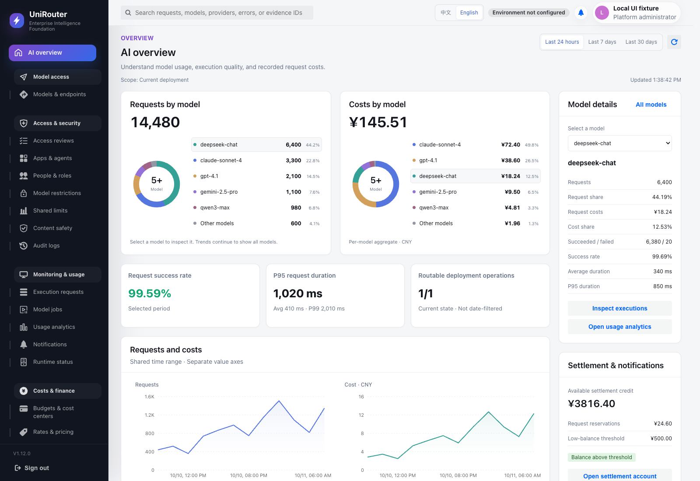

# UI workspace iteration — 2026-10-11

## Scope and status

The owner accepted the bilingual workspace design and asked to begin formal
iteration. The final local implementation candidate is based on public main
`300592e36c28e8836e37c1a2085401b8701d29d6`, product candidate 1.12.0/M126.
The original checkout and its unrelated dirty changes were preserved. The
earlier candidate remains in `bilingual-ui-refresh`; final work is in the
attached `bilingual-ui-main` worktree on `codex/bilingual-workspace-ui-main`.
No commit, push, release,
deployment, real account mutation or provider request was performed.

Implemented: shared workspace surfaces, bilingual navigation/application shell,
sign-in, account preferences, loading/error states, and the customer overview.
The overview contains exact model request/cost composition, independent request
and cost trend axes, a model inspector, current deployment availability,
settlement/notification actions, and recent requests. Existing authorization
determines every action; no preview role switch is shipped.

The continuation also migrates model onboarding (individual and batch), client
setup, qualification/probes, release authoring/lifecycle, catalog/aliases/model
sets/project assignments, request optimization, execution diagnostics, request
receipts and usage analytics. Existing API identities, scopes, financial facts,
credential handling and mutation permissions remain authoritative.

The remaining console workspaces now use the same content hierarchy and
Chinese/English product labels: asynchronous jobs, notifications, runtime
status, access/applications/people/projects, policy/safety/audit, financial
workspaces/reconciliation, deployment/integrations, the developer workspace
and API reference. Source evidence, customer-entered names, identifiers and
raw server details retain their original values. Local frontend implementation
and validation are complete. The dashboard PostgreSQL integration gap was closed
on the next continuation with an isolated PostgreSQL 16 instance, as recorded
below. This is not Target or Production acceptance.

### Final main integration and English default

Main advanced from `69d1ef75` to `300592e3` with the community bootstrap's
1.11.0. A separate clean managed worktree received the bounded UI patch and
its new files without resetting or stashing either existing checkout. The five
overlapping version/record files were merged explicitly: 1.12.0 metadata,
the complete main 1.11.0 changelog section, and both UI and installer execution
records. All 13 other upstream-changed files are byte-identical to main. The
three dashboard source/test hashes below remain unchanged, so their existing
PostgreSQL evidence still applies; no database, runtime or migration was repeated.

English is the bootstrap default for absent, empty, invalid or unreadable
storage; explicit `zh-CN` and `en-US` preferences are retained. The HTML language,
document title, login and Semi/date-fns locale agree. External removal, clear
or invalid preferences return to English while preserving selected identities,
filters and exact money drafts, with no repeated read or mutation. Existing
Chinese page fixtures now choose Chinese explicitly. Ten new regressions cover
these startup, exception and storage-event behaviors.

The touched integration entry names Foigent, UniRouter and X-Insight consistently:
UniRouter owns execution, usage and cost facts; X-Insight asynchronously receives
explicitly authorized facts and independently manages evidence. Completed-request
metadata, source categories and content copies retain separate authority. Setup
requires a deployed trusted peer, project access and confirmation in both
systems; the page does not imply a public hosted X-Insight or an established
connection. These are display changes, with no integration protocol or authority
change.

## Continued workspace implementation

- Request filters move above a wider list with request/time, model/provider,
  HTTP status, latency and exact recorded cost. The permanent inspector retains
  decision, routing, safety, settlement and provenance tabs. All exact identifier
  filters remain available in advanced filters. Debounced edits retain changes
  to multiple fields, clearing resets both inputs and query, and stale list/trace
  results cannot replace current evidence.
- Usage analytics places scoped metrics first and keeps common filters visible.
  Advanced filters and methodology are expandable. The existing backend groups
  are explicitly described as request-ranked top 50; summary and CSV scope
  continue to include the complete matching query. Missing/loading statistics
  do not masquerade as zero. Start/end dates have visible bilingual labels.
- Model views have separate execution, catalog and diagnostic navigation.
  Onboarding distinguishes provider limits, reviewed executable limits and
  request defaults, with detailed source contracts and pricing evidence retained
  in labeled original-language disclosures. User names, IDs, protocol enums,
  server errors and source evidence are not translated as product labels.
- Catalog columns combine related facts, retain full capability lists in a
  disclosure, and label page-local lifecycle counts separately from the total
  matching record count. Unavailable counts display a dash. All catalog,
  qualification, release and request-optimization actions keep their prior
  contracts and confirmation paths.
- Open-source readiness (`commercial_license_not_required`) is omitted from the
  primary diagnostic axes; legacy license blockers remain visible when returned
  by a compatible older server. Unselected deployment IDs remain empty in forms
  instead of displaying the internal zero sentinel. No backend License change.
- Sidebar language and close controls remain usable on phones. A verified
  overlay specificity bug was fixed; the drawer has a visible close button,
  expanded state, and Escape dismissal. Desktop navigation is preserved.
- Monitoring uses current status, common filters and grouped event/request
  facts before details. Media-job queries reject stale responses. Access and
  people workspaces retain selected identities, key facts and unsaved drafts
  across language changes without another read or mutation.
- Audit combines event/time, scope, actor/source and target into four columns;
  exact resource/request identifiers remain in advanced filters. Project tables
  remove unnecessary horizontal width. Security, trust, provenance, limits,
  guardrails and governance simulation preserve their existing action boundaries.
- Finance defaults to the customer pricing workspace when customer scope is
  available, with explicit base-pricing links retained. Reconciliation places
  request filters, metrics and records before resolution/allocation actions and
  rejects stale results. Missing reconciliation or optimization summaries stay
  unavailable rather than appearing as zero cost or zero savings. Exact money
  drafts and pricing approval/activation contracts are unchanged.
- Deployment, data exchange and X-Insight panels share responsive surfaces.
  Translated duration/size labels preserve the underlying unit values and
  seconds/bytes payloads. Setup, source, content, delegation and recovery retain
  the original confirmation, credential and authority boundaries.
- The developer workspace separates access, request activity and setup. Its
  fallback count is explicitly the loaded recent sample. The API reference
  groups method/path and supports searching the permitted endpoint directory.
  Copyable protocol examples and customer identities remain original data.

## Continued i18n pre-coding review

The same independent read-only reviewer `/root/ui_architecture_review` inspected
the new, bounded proposal to replace runtime catalog aggregation with synchronous
core registration and page-module registration of domain dictionaries. This is a
new shared-loading change, not a repeated closing review of the overview patch.
Its reviewed object was the explicit proposal in this task and current imports
in `main.tsx`, `i18n/catalog.ts`, `i18n/index.tsx` and `utils/displayLabels.ts`.

Required dispositions, implemented:

- Keep the registry independent of React/pages; use only type imports to combine
  message keys, and explicit static dependencies before each page renders.
- Resolve three existing conflicting keys (`成功 / 失败`, `更新时间`, `读取失败`)
  to their existing core values. Same-value registration is idempotent; conflicts
  are rejected before any entry in the batch is written.
- Move shared usage labels to core so direct visits cannot depend on a previously
  opened page. Use own-property lookup and return unknown text unchanged.
- Test English direct page imports in both model/log visitation orders, atomic
  conflict handling, and switching language without resetting forms/queries or
  repeating reads/mutations. No test preloads all dictionaries to make this pass.

The reviewer rejected a larger conversion to per-component translators as
unnecessary and deferred remote catalogs, unloading and new loading states.
Built assets confirm domain phrases are absent from `index-*.js` and present in
their page/shared-domain chunks. No bundle budget was relaxed.

## Independent review and dispositions

Reviewer: `/root/ui_architecture_review`, read-only, under AGENTS section 4.

The pre-coding review rejected using `/usage/analytics` for full cost
composition: its top-50 request-ranked groups, model fallback and time boundary
would not establish a complete matching cost denominator. The adopted change
adds exact `cost_micros` strings to the existing unlimited dashboard query,
preserving its organization, `[start,end)` window and model identity. Financial
settlement, runtime routing, migrations and License retirement were unchanged.

The single closing review was bound to patch SHA256
`f43654409b19eeab4f721720302cfb3174fd2310d58f674a243b93975ec9a582`
(159857 bytes; `/private/tmp/ur-ui-iteration-review.patch`).

- `validated_required`, adopted: missing entire `model_distribution` must not
  become a false zero. The candidate now preserves available summary totals,
  labels composition unavailable, and distinguishes absent fields from a real
  empty array. Added Chinese/English regression for nonzero summary with missing
  distribution; the post-review suite passed.
- `validated_required`, adopted: keep PostgreSQL integration, browser, Local,
  CI and Production evidence distinct. See validation below.
- `valid_deferred` in the first review, resolved in the continuation: the known-product-label translator used `in` and could match
  prototype property names such as `constructor`. Normal catalog labels do not
  trigger this. The independent registry now uses own-property lookup, with
  regressions for `constructor`, `toString` and `__proto__`.
- `rejected`: expanding this iteration into financial, routing authority or
  another commercial License migration. Existing contracts remain authoritative.

Browser inspection additionally repaired English menu width (Semi item width
plus outer margins caused clipping), full model-name wrapping on narrow screens,
and excessive composition-card height. These changes affect presentation only.

## Validation

Final local validation (supersedes earlier frontend coverage/build figures):

- Full frontend regression: **100 files / 905 tests passed**. Unexpected stderr,
  React act warnings and Semi Form warnings were zero under the existing ratchet;
  the existing findDOMNode allowance remained 9/10. The final run includes cold
  page/catalog imports, language changes without repeated requests or lost
  drafts, exact pricing/unit payloads, missing-summary states and stale-query
  handling, plus English bootstrap and preference fallback. Log:
  `/private/tmp/ur-ui-main-tests.log`.
- Final browser readback caught three API directory group headings whose
  original internal identifiers were Chinese. Explicit display mappings now
  translate them; project-role options also use the shared readable role labels.
  The final adjustment passed **19 API-reference/catalog tests** with no
  unexpected warnings (`/private/tmp/ur-api-label-tests.log`).
- Final `npm run build` passed TypeScript, toolchain, API contract, React
  compatibility and bundle checks. **100 JS assets; largest 371438 bytes**, limit
  460800. No budget or warning threshold was relaxed. Log:
  `/private/tmp/ur-ui-main-build-final.log`. Release metadata is consistent at 1.12.0;
  the upstream 1.11.0 installer entry is retained.
- Final real Chrome checks confirmed a fresh English login/overview, restored
  explicit Chinese/English preferences and external remove/clear/invalid events.
  Login drafts survived with zero additional API reads. The actual Semi calendar
  changed English/Chinese weekdays and month/date labels while retaining its
  selected range, with zero additional audit reads. A discovered 568px dual-month
  popup overflow was repaired using the component's `dropdownClassName`: months
  stack in a bounded, scrollable popup on phones and retain the 568px side-by-side
  desktop layout. Both calendar languages, overview and integration views keep
  document/body width at 390px. The final layout change passed 16 focused
  audit/default-locale tests and the final production build. Logs:
  `/private/tmp/ur-ui-default-readback.log`,
  `/private/tmp/ur-ui-final-calendar-and-integrations.log`,
  `/private/tmp/ur-ui-calendar-tests.log`.
- The final integration fixture displayed the trusted-peer unavailable state
  with no external links. Desktop/mobile screenshots and visible-text checks
  confirmed the touched Foigent/UniRouter/X-Insight descriptions. This did not
  connect to a real X-Insight instance or exercise an integration protocol.
- Built UI was inspected in real Chrome with intercepted synthetic responses,
  never real API/provider traffic. Chinese/English request lists and usage,
  English model targets/catalog/forms, and 390px request, usage, catalog-form
  and diagnostic views were inspected. Final representative checks also cover
  applications, people, audit, pricing, integrations, developer, API reference,
  media and X-Insight; X-Insight was inspected in both languages. At the 390px
  viewport, document and body widths remain 390px; wide evidence tables retain
  internal scrolling. Mobile language switching and drawer dismissal were
  exercised. Screenshots remain local ignored artifacts under `output/playwright/`.
- Product-authored JSX/attribute text and static catalog dependencies were
  checked for untranslated Chinese and cold-import gaps. Known product labels
  use own-property lookups; unknown enums, names and evidence are not rewritten.
  English readback across 27 navigation entries found Chinese only in the
  language selector and original fixture names. This checks visible text under
  the fixture roles, including authorized redirects, rather than every possible
  detail/form state. Log: `/private/tmp/ur-ui-locale-readback.log`.
- The frontend continuation added no further backend change. Its initial IPC
  inspection still found 32 shared-memory segments; no shared resources, other
  processes or host settings were changed. The later PostgreSQL run below closes
  that environment gap without changing the tested implementation.

### PostgreSQL integration gap closed — 2026-10-11 12:57 CST

Read-only inspection found 31 shared-memory segments against the existing
`kern.sysv.shmmni=32` limit. That changed precondition allowed a fresh PostgreSQL
16.14 cluster under `/private/tmp/ur-ui-pg16-tQdZPd`; no old IPC segments were
removed and the running PostgreSQL 18 and other project's PostgreSQL 16 were
not reused or stopped. The fixture accepted connections only through its private
Unix socket (`listen_addresses` empty), with a synthetic local database role.
Its exact data directory, role and `server_version_num=160014` were read back
before the test run.

Using the already installed Go 1.25.12 toolchain, the following required-mode
run passed without skips: `go test -tags=integration ./internal/admin -run
'^TestDashboard' -count=1 -v`. `TEST_DATABASE_URL` explicitly selected the private
socket and `REQUIRE_TEST_DATABASE=1` enforced PostgreSQL 16 before writes. The
repository's existing test harness installed the exact M126 artifact schema and
created isolated template/clone databases.

- **10 top-level tests passed**, including three PostgreSQL integration tests
  and both zero-wallet role subcases; package execution took 4.173 seconds.
- The new distribution test proves all 62 model groups are included, costs above
  JavaScript's safe-integer boundary remain exact, another organization is
  excluded, blank resolved models use the existing requested-model fallback,
  and the interval includes its start but excludes its end.
- Existing canonical deployment/operation health and legacy-history separation,
  zero-wallet handler behavior, summary windows and exact serialization passed.
- After harness cleanup, only `postgres`, `template0` and `template1` remained.
  The task-owned server was stopped through `pg_ctl`, and status confirmed
  `no server running`. Its generated cluster data was removed; initialization,
  server and test logs were retained. No host parameters, other services or
  user data changed.

Full log: `/private/tmp/ur-ui-pg16-tQdZPd/dashboard-pg16-tests.log`. Tested source
SHA256 values (unchanged by the final main/locale integration):

```text
bbd88d07953390adec2ab9d62df0e162f9554423663ddc155ab4b83a01a7218a  internal/admin/dashboard_handlers.go
d32cd089766baa0118b935a09e6175a1c74865bb3e991a223a4a13ecc2e47c0f  internal/admin/dashboard_model_cost_integration_test.go
03390d813c9617edcde14bb8735d8cc4ee31d2d3d7a8cacf608b0b6c7a1ced0d  internal/admin/dashboard_model_cost_test.go
```

Initial overview validation:

- Full frontend suite: 98 files / 864 tests passed with the existing warning
  ratchet. Final shared password-control/locale changes passed 77 targeted tests.
  The subsequent review correction passed 39 tests, including the new missing
  distribution case (32 overview, 4 composition, 3 locale tests).
- Final frontend build includes TypeScript, toolchain, API contract and React
  compatibility checks. Bundle budget passed: 93 JavaScript assets; largest
  371438 bytes against 460800 bytes. Node 24.19.0 / npm 11.17.0 were reused.
- `go test ./internal/admin -run TestDashboard -count=1` passed, including exact
  serialization above JavaScript's safe-integer boundary. Integration-tagged
  admin tests compiled with `-run '^$'`; this did not execute database tests.
- Added PostgreSQL integration coverage for 62 model groups, exact large costs,
  organization isolation, model fallback and inclusive-start/exclusive-end
  boundaries. **Initially not executed:** isolated PostgreSQL 16 initialization failed at
  `shmget` with `No space left on device`, specifically shared-memory IDs/limit,
  not disk space. No other process resources or host settings were modified.
- Real Chrome rendered the built application against locally intercepted
  synthetic API responses. Desktop Chinese/English, selected-model persistence,
  mobile navigation/language access, and 390px layout were inspected. These are
  UI fixture checks, not live backend/provider acceptance. Screenshots are local
  ignored artifacts under `output/playwright/overview-{zh,en,mobile-en}.png`.
- Release metadata consistency passed for 1.11.0. CI, Docker build, Target and
  Production were not run in this task.

The previously blocked dashboard PostgreSQL run has now passed. All current
console workspaces are included in this local UI/i18n
candidate; automated tests and representative browser fixture checks do not
claim every role/action combination was exercised against a live backend.
No commit, push, CI, release or deployment was performed. 经验文件无需变化。

## Approved PR and CI batch

On 2026-10-11 the owner explicitly approved the two bounded UR candidates
entering PR and existing CI: “批准两批进入 PR 和 CI（推荐）”. This UI batch
may commit with DCO sign-off, push to `foigent/unirouter`, create its independent
PR and run existing checks without changing budgets, required checks or branch
protection. Merge, official release, deployment and paid provider calls remain
excluded. Local validation statements above retain their cutoff.

The current remote main was confirmed at `300592e3` before submission. The
existing three real-backend browser journeys now assert the fresh English login
and select Chinese explicitly for their business assertions. The model journey
uses the current exact probe title and explicit probe/lifecycle action labels;
readiness asserts that the retired commercial axis and repair link are absent.
All role, credential, tenant, egress, financial and lifecycle acceptance paths
remain. These scripts passed Node syntax checks; their real-backend execution
is delegated to the existing `PR4 Browser E2E` job, not claimed from syntax checks.

The PR preview uses only synthetic fixture data:



### First PR browser result and correction

PR 451 / run `38119862748` tested head `500ed966`. Frontend Build passed;
the real access/credential/readiness and source-budget browser journeys passed.
Model onboarding created the intended exact deployment, then stopped before
the probe POST: Semi's default `aria-label="confirm"` overrode the displayed
localized action name. The dialog title and visible action were correct, with
no browser errors. The correction supplies the component's supported
`okButtonProps` aria-label for exact probes and model lifecycle confirmations,
matching their existing visible localized action text. Request payloads,
confirmation handlers and server contracts are unchanged. This is a new UI
candidate revision, not a passed browser result or a reason to reduce the job.

The 52 targeted model tests and production build passed for the accessible-name
correction. A real Semi dialog with synthetic local data exposed
`发起精确探测` / `Run exact probe` as the actual accessible button names. No probe
confirmation was submitted. The English dialog also exposed Semi's Chinese
default cancel label: static dialogs do not inherit the page LocaleProvider.
The follow-up explicitly localizes cancel labels in all 15 remaining existing
confirmations, and the 10 default confirmation labels. It changes only visible
text, retaining existing accessible `confirm`/`cancel` defaults outside the
three model actions and all mutation/permission/CAS handlers. Full frontend
regression and build are rerun for this expanded text correction.

Final local correction checks passed: 100 frontend files / 905 tests;
unexpected stderr, React act and Semi Form warnings remained zero;
the production build retained 100 JavaScript assets and a 371,438-byte largest
asset within the 460,800-byte limit. A fresh English synthetic browser dialog
showed `Cancel` and `Run exact probe`, with the latter's matching aria-label.
The browser and task preview were closed without submitting a probe. Backend
sources are unchanged and the existing PostgreSQL dashboard evidence is retained.

Run `38121001430` at `d792ecdd` passed Change Routing, Frontend Build and
all three real-backend browser acceptances. The completed first run's backend
failure identified this batch's dashboard OpenAPI flow-style `org_id`
description without quotes. Docker stopped at its existing routed prerequisite
guard because the required backend/browser checks had not all passed; this was
not an image build failure. The next revision quotes only that description,
preserving parameter meaning and schema. All 12 existing `TestOpenAPI*` checks
passed locally with the installed Go 1.25.12 toolchain (1.472s). The unchanged
frontend and PostgreSQL evidence is retained; final exact-head CI is required.
