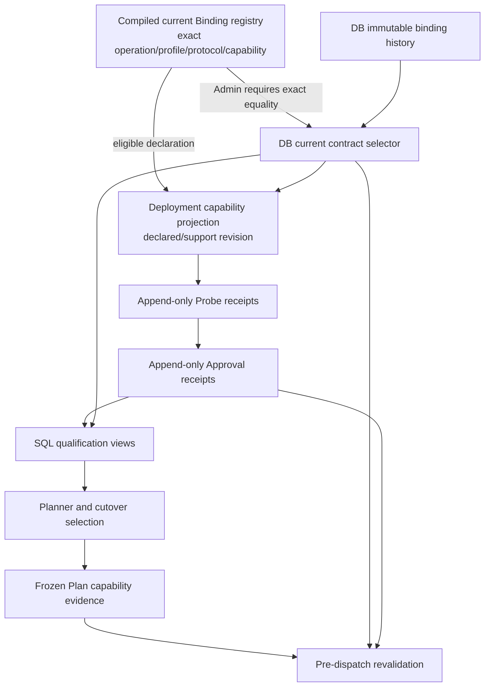

# Capability Contract Publication Cost Audit — 2026-08-30

> Status: completed read-only architecture audit; implementation not authorized.
>
> Audit source: `main@2df63120db2d31cd7a3d637b6191b61b0a61d24d`
> (`tree cac6d5538662ede4171897583e07ee49d3350ff8`).
>
> Evidence window: Kimi K2.6 M95 through M100. The deployed development/test
> closeout remains `1.2.20/M100`; this document changes no runtime, schema,
> Target, Profile, Release, pricing, qualification or provider state.

## 1. Decision

The M95–M100 sequence proves a publication-cost problem, not a failure of the
capability evidence model. Exact Profile/protocol/capability identities,
append-only Probe and Approval evidence, receipt-aware qualification and
pre-dispatch revalidation remain required.

The approved result of this audit is:

- **Adopt as the default future candidate:** one immutable artifact declaration
  of static capability-contract history and current selectors, followed by a
  single-owner, explicit, transactional publication into the existing database
  query projection.
- **Reject for V1:** removing the database projection and making Planner,
  revalidation, SQL qualification and offline administration resolve static
  contracts directly from process memory.
- **Reject:** backend-startup upsert or synchronization, global artifact/database
  digest equality, and automatic promotion of compiled candidates to current.
- **Defer pending a separately approved implementation:** manifest encoding,
  publication command, digest storage, receipt representation and any schema
  change. This audit does not authorize a Manifest, publisher, registry or
  migration.
- **Keep separate:** Probe/runtime delivery parser consolidation. A third
  provider-specific full envelope parser is an independent stop condition, not
  part of this publication audit.

The gate applies before any normal change that creates or advances a static
Probe-contract binding/current projection, regardless of provider. Documentation,
Profile-difference analysis, manual-review pricing drafts and sanitized fixtures
may be prepared separately, but cannot acquire runtime authority in this audit.

## 2. Measured cost

### 2.1 Delivery magnitude

The six migration pairs contain 1,602 SQL lines:

| Migration | Purpose | Binding rows introduced | Current rows affected | Up / down lines |
|---|---|---:|---:|---:|
| M95 | Initial K2.6 Chat Core publication | 6 | 6 created | 126 / 112 |
| M96 | Streaming empty-reasoning interpretation v2 | 1 | 1 advanced | 106 / 166 |
| M97 | Streaming terminal-choice usage interpretation v3 | 1 | 1 advanced | 103 / 166 |
| M98 | Detailed non-stream usage/cache interpretation v2 | 5 | 5 advanced | 121 / 175 |
| M99 | Function-tools delivery/usage interpretation v3 | 3 | 3 advanced | 109 / 155 |
| M100 | Function-tool child-index normalizer interpretation v4 | 3 | 3 advanced | 108 / 155 |
| **Total** |  | **19 historical binding rows** | **6 final current tuples** | **673 / 929** |

The pre-M95 source `283031f44628e5dda0daa567d33d97df3715c968` to
the M100 PR head `e7ca4b9e4003743f7fe3b97ee69cdf05f061667a` spans
65 changed files and a net `+5,694/-140`. This is a delivery-magnitude measure,
not a claim that every line is duplicate publication code; it includes required
adapter, Probe, diagnostic, test and documentation work.

Across the six primary model-change commits, every change touched 32–39 files.
Their cumulative activity was `+5,684/-434`. Repeated publication surfaces
included migration SQL, migration integration tests, schema/version constants,
bootstrap fixed counts, OpenAPI projections, frontend metadata and status docs.

### 2.2 Conservative repetition measure

Ignoring blank lines and without normalizing identifiers or versions:

- the six up migrations contain 607 nonblank line occurrences; 47 distinct
  lines occur identically in all six and 60 occur in at least five;
- the six down migrations contain 842 nonblank line occurrences; 53 distinct
  lines occur identically in all six and 87 occur in at least five;
- every up migration repeats the same advisory lock and table-lock boundary;
- the six up migrations perform 18 trigger drops and 18 trigger recreations;
- M96–M100 repeat current-pointer advancement and declared deployment-projection
  updates with different exact tuple/version values;
- the fresh-bootstrap contract currently propagates fixed aggregate counts of
  76 historical bindings and 51 current bindings, plus version-specific Kimi
  assertions.

This understates structural duplication because otherwise identical statements
with different Profile, capability, contract version or migration IDs do not
count as equal lines.

### 2.3 Necessary semantics versus avoidable publication work

The following work is necessary and must not be removed merely to reduce line
count:

- append the new exact Probe interpretation rather than rewrite old evidence;
- advance the exact current selector only from its expected predecessor;
- make old Probe/Approval evidence stale without mutating it;
- update only `declared` deployment projections, never live or approved receipts;
- refuse downgrade before mutation when the predecessor cannot interpret
  retained evidence or projection identity;
- lock publication and validate complete, all-or-nothing results.

The avoidable cost is expressing these same invariants through hand-written,
model-specific SQL and repeating their fixed counts and identities across many
surfaces. M96–M100 were also amplified because valid provider wire shapes were
discovered only after a formal Target publication.

## 3. Current authority flow

The current architecture intentionally requires compiled and database facts to
agree:

Current responsibilities are:

| Authority | Current role |
|---|---|
| Compiled `modelcapabilityqualification.Binding` registry | Resolves the current exact executable Probe contract. It does not retain the complete M95–M100 binding history. |
| `model_capability_probe_contract_bindings` | Immutable historical static binding rows. |
| `model_capability_current_probe_contracts` | Environment-level exact current selector used by Admin, Planner, qualification and revalidation. |
| `model_deployment_capabilities` | Deployment support/declared projection and support revision; not sufficient routing authority. |
| Probe and Approval tables | Append-only dynamic execution and administrator-decision evidence. |
| Qualification views | Join current static selectors with exact dynamic receipts and configuration revisions. |
| Plan/attempt evidence | Freezes the selected qualified capability evidence for execution and revalidation. |

Concrete consumers prevent an immediate “database stores dynamic facts only”
change:

- `internal/modelrouting/sql_loader.go` joins current contract and preferred
  qualification for new Plans;
- `internal/modelexecution/revalidate.go` reloads the current contract and
  validates the Approval already bound to the Plan;
- `internal/admin/model_application_contract.go` requires compiled and database
  bindings to match before materializing declared capabilities;
- `internal/admin/model_capability_qualification_handlers.go` uses the database
  current/binding rows for Probe snapshots and qualification views;
- database triggers and views validate receipt identities without access to Go
  process memory.

## 4. Candidate comparison

### 4.1 Candidate A — artifact declaration with database materialization

This is the default minimum candidate for a later implementation decision.

Potential shape:

1. An immutable artifact declaration contains append-only static binding
   history plus explicit current selectors. It cannot derive current from
   “latest version”.
2. A single authorized publication owner validates an exact artifact identity
   and performs one explicit database transaction.
3. Publication appends missing historical bindings, advances only expected
   current selectors, evaluates existing Probe/Approval impact and updates only
   eligible declared deployment projections.
4. The existing database projection remains the runtime transactional query
   authority for Planner, SQL qualification, offline administration and
   pre-dispatch revalidation.
5. Backend startup only checks compatibility; it never inserts, updates or
   silently synchronizes contracts.

Advantages:

- preserves the existing SQL qualification and revalidation model;
- keeps database-side trigger validation and offline evidence explanation;
- supports one transaction and one deployment owner;
- can reduce repeated hand-written tuple publication without weakening evidence.

Unresolved costs which require separate approval:

- manifest format/canonicalization and whether the existing Go registry can be
  evolved without creating a second declaration source;
- publisher command, dry-run, locking and authorization lifecycle;
- how publication identity is represented without unnecessary schema fields;
- old-binary rollback and mixed-artifact compatibility policy;
- how deterministic generated output is reviewed and tested.

### 4.2 Candidate B — compiled-only static resolution

This candidate would remove database static selectors and make runtime code join
compiled contracts with dynamic evidence.

It is rejected for V1 because it would require coordinated changes to database
triggers, qualification views, Planner, revalidation, Admin/offline queries,
multi-version deployment compatibility and rollback. It also risks replacing
one repeated publication mechanism with several Go/SQL hybrid resolvers.

Candidate B may be reconsidered only if later measurement proves that the
database materialization itself—not hand-written publication—is the dominant
unavoidable cost.

## 5. Integrity rules for any future implementation

This audit approves these invariants, not a storage design:

1. Every executable database current projection references one exact published
   static-contract identity.
2. The running artifact must support every database projection it may execute.
3. A database projection absent from the artifact, or an exact identity whose
   content does not match, fails closed for startup compatibility and/or the
   affected exact tuple according to the existing deployment policy.
4. The artifact may contain additional historical or inactive candidates; they
   do not cause a global mismatch and cannot become current without publication.
5. Dynamic evidence remains bound to the exact static identity that interpreted
   it and is never reinterpreted by a newer contract.
6. Whether that binding is represented by the existing tuple, a projection
   digest, a manifest digest or a combination remains undecided.
7. Global artifact/database digest equality is not required and would be
   incorrect when the artifact contains inactive or historical declarations.
8. Publication is never a per-backend startup side effect. Failure leaves zero
   partial writes.

## 6. Scope controls and emergency exception

### Normal gate

Before a normal delivery creates a new static binding or advances a current
Probe contract, this audit's implementation decision must be revisited and
explicitly approved. Merely completing this audit does not authorize code,
schema, registry, publisher, Target or release work.

K2.7/K3 and other models may separately prepare only:

- official-source evidence;
- Profile differences and disposition candidates;
- manual-review pricing drafts;
- sanitized local fixtures and a bounded live-test proposal.

That preparation must not update a current Profile pointer, publish a binding,
create a migration, Release, Deployment, Probe or Approval, or infer executable
support from provider documentation.

### Emergency exception

A reproducible security, financial or deployed/live correctness blocker may use
the current supported publication path only under an existing incident authority
or explicit user approval. The exception:

- restores previously approved behavior and does not add a new capability;
- uses the smallest supported patch/publication path;
- does not introduce a Manifest, publisher, registry or state machine;
- retains the required regression, gate, CI, deployment and Target evidence;
- is recorded as audit input but is not precedent for normal publication.

A provider field discovered during ordinary adaptation, an optional compatibility
improvement or an unimplemented feature is not automatically an emergency.

## 7. Separate parser stop condition

Kimi Probe and Gateway delivery still contain separate envelope parsers. Existing
cross-delivery fixtures and public SDK evidence are sufficient for the closed
K2.6 milestone. Before another provider adds a third provider-specific full
envelope parser, work must stop for a separate delivery-shape decision.

That future decision may extract a low-level structural decoder/validator, but
it is not authorized here and must not be folded into static publication work.

## 8. Final disposition

| Item | Disposition |
|---|---|
| Publication cost audit | `completed` |
| M95–M100 historical migrations and evidence | retain; do not rewrite or collapse |
| Compiled declaration → controlled database materialization | preferred candidate; implementation approval required |
| Runtime compiled-only static authority | rejected for V1 |
| Backend-startup synchronization | rejected |
| Global artifact/database digest equality | rejected |
| Mandatory new digest field on every receipt | rejected pending evidence/storage design |
| Manifest/publisher/schema/runtime implementation | not authorized |
| Probe/runtime parser consolidation | independent `valid_deferred` stop condition |
| Grouped capability approval | unchanged `valid_deferred` |

The next authorized decision point occurs only when a normal delivery needs to
publish or advance a static capability contract, or when a third full provider
envelope parser would otherwise be introduced. Until then, this document is an
analysis artifact and not a runtime, requirement, release, evidence or backlog
authority.
