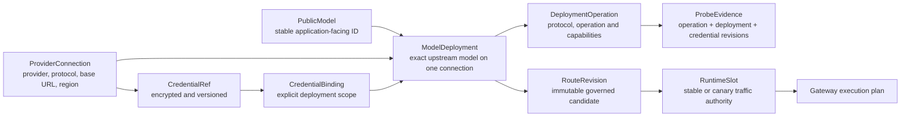

# UniRouter Model Execution Target

> Status: accepted implementation target for the P0-P5 model-execution migration.
> Scope: the supported single-customer on-premises product.
> Change rule: this document, `SYSTEM-FACT-MAP.md`, the OpenAPI contract and the
> golden-journey tests must change in the same batch when an authority below changes.

## 1. Outcome

Applications call one stable public model identity. A public model may be served
by several independently testable provider deployments. Credentials belong to a
provider connection and may be explicitly bound to more than one deployment.
Only a stable or canary runtime slot can place a deployment on the live route.

The normal operator path is:

1. create or reuse a provider connection;
2. select the exact upstream model or deployment ID;
3. bind it to a new or existing public model;
4. run a live, operation-specific probe;
5. author one atomic sealed release from the server-provided baseline and exact
   deployment/operation choices;
6. execute the server-described first activation, canary, promotion or rollback.

Readiness is an explanation of those authorities. It is not another lifecycle.

### Startup and cutover authority

Same-schema planned shutdown owns an explicit process instance and synchronized
HTTP admission/drain boundary. Readiness includes exact schema-ledger digest,
state, active handler count and effective request/drain deadlines. Ingress must
withdraw a backend from every managed upstream and observe old Nginx workers
exit before signaling it. The supported directory carrier keeps atomic file
updates visible inside Nginx; installing it on the old single-file deployment
is a bootstrap boundary. A slow old proxy connection aborts the bounded rollout
without stopping the backend. Direct debug-port clients are outside this
ingress continuity contract. Accepted handlers retain terminal dependencies;
only after their completion/cancellation may settlement/outbox services stop.
This slice does not authorize online schema/Publication changes or add fleet
compatibility leases. Model Slot remains independent from runtime generation.

`MODEL_ROUTE_AUTHORITY` selects process behavior but is never accepted as proof
that database state is ready. An operator prepares `verify` for one explicit
customer with `uniroute model-route-authority apply --customer-org-id <id>` and
can repeat the read-only proof with `check`. Apply reconciles legacy projections
and seals each eligible current v1 stable and canary compatibility manifest; it
never changes the environment, promotes or rolls back a release, publishes a v2
release or moves a slot. A deployment-global assignment lock rejects apply
before projection writes once any v2 stable/canary is current, including a
verify process left running during cutover. Apply is rejected in `legacy` and
`canonical` before database access. Canonical preparation is read-only `check`,
so a reverse
legacy projection cannot resume a paused connection, revive a credential or
overwrite canonical configuration.

Before serving in verify/canonical, the process checks the union of configured
live legacy models and current stable/canary slots in one read-only Repeatable
Read transaction. Verify requires complete legacy/canonical parity. Canonical
requires a sealed native v2 authority and supports a parentless initial v2
activation without legacy provenance. Both reject structural exclusions even
when another route is healthy. A v1 compatibility release must also construct
both published project-default paid envelopes, Chat Completions and Embeddings,
on every selectable adapter; a chat-only adapter blocks verify startup instead
of failing on first embeddings traffic. Operational disable, cooldown and breaker state
remain stronger than a release without being mistaken for projection drift.
The binary and ordinary Compose default to canonical authority and no
compatibility. Explicit legacy/verify startup remains available only for the
bounded bootstrap/cutover path and requires the separate compatibility flag.
The formal customer fresh-install sample uses that pair only while traffic is
isolated and the first customer/release/slot is being authored; it must pass the
read-only authority check and restart in canonical mode before serving traffic.

Exactly 19 legacy mutations are permanently retired in every process mode:
four channel writes, four channel-key writes, three model-endpoint lifecycle
writes and eight v1 runtime-change writes. Their routes authenticate and enforce
platform RBAC, then return one stable
`410 legacy_model_mutation_retired` before License admission, body parsing,
secret access or any retirement-handler/business-data query. Authentication and
customer/RBAC context may still read their own security state; the
compatibility flag is not a write-back door. Legacy GET surfaces remain only
for history/migration diagnostics, and canonical deployment/probe/release
writes remain supported. Draining old binaries is still an orchestration
responsibility; no environment value or database check proves that a separate
old process has exited.

The executable schema ceiling is `000084`. After either normal migration or
`SKIP_MIGRATION`, the backend requires the complete ordered database migration
ledger to equal the binary artifact ledger before customer-baseline
initialization or HTTP bind. Missing, extra, future, duplicate, reordered and
empty ledgers fail closed. Ceiling changes are consequently non-rolling: an M83
stable and M84 canary cannot both be ready on one database. Drain and stop the
old fleet, let one migration owner advance the database to M84, then start M84
stable/canary; a secondary may skip migrations only when the database is already
exact M84. M81 adds an explicit versioned execution-profile identity to every
model. Historical rows migrate to `unverified.chat@1.0.0`; migration never guesses
a tokenizer, context limit or provider contract from a mutable model name. A
reviewed profile freezes tokenizer, reasoning, cache-usage and protocol identities
plus provider maxima, while customer context/output policy may only narrow those
limits. M82 extends the existing Release authority rather than creating another
lifecycle: every canonical v2 Release pins the exact execution-profile identity
and public context/output limits effective when it was authored. Canonical
Planner uses the selected stable/canary Release pins, not the mutable registry
row, and includes them in the plan snapshot hash. Editing a model profile only
changes a future Release; live traffic changes after the normal canary/promotion
workflow. The exact release and lifecycle inspection projections expose the
pins, while the versioned v1 authoring receipt body remains unchanged. Runtime
safety may narrow a pinned upper bound, but cannot widen it. Pricing is not part
of the Release pin: Billing Freeze independently fixes the applicable price
version because price and capability evolve separately. M82 down rejects later
migrations and any durable Release whose pins would change under M81 mutable
lookup semantics. M83 leaves Release and traffic authority unchanged and adds
durable exact non-token Rate Card rationals plus reserved/actual meter evidence
to Freeze, observations, finalization and call logs. Its guarded down rejects
later migrations or any durable M83 meter evidence.

M80 terminalizes cost-observation provider reconciliation with an
append-only zero-charge receipt and never with a wallet transaction. M79 retains the signed License v1
field name `active_channels` but counts enabled `provider_connections`. Up and
down take the model-execution migration advisory lock, the canonical/legacy
resource plus migration-ledger relation locks, the `active_channels` advisory
lock, and then the entitlement relation lock. This split matches the opposite
activation and renewal acquisition paths without a cycle. Down fails before
trigger mutation if a later migration exists, any enabled connection lacks an
exact active legacy projection, or the restored active-channel count exceeds
the signed limit; it restores the M59 count function/trigger but never drops
canonical connections, deployments, bindings or evidence.

Non-legacy mode also exposes two minimal safety contractions after JWT and
organization-admin authorization, without a Gateway License gate. Connection
pause changes only `ProviderConnection.admin_state`; verify mirrors only legacy
channel status and preserves every sibling deployment axis. Credential revoke
is irreversible: it retires the binding, increments its state revision once,
clears cooldown and scrubs ciphertext while retaining identity and evidence
links; verify performs the equivalent legacy-key terminal transition in the
same transaction. Both actions revalidate the sole active customer root, the
active actor's canonical `organization_role`, exact revisions and ownership in
the write transaction, and commit their audit record atomically.

Pause is intentionally revision-preserving because it is a fail-closed safety
contraction. The inverse transition is not symmetric in canonical authority: a
future resume from `disabled` to `enabled` must advance the resource
configuration revision and therefore obtain a new manifest/probe evidence
chain. Before any v2 release is current, verify preparation may still mirror a
legacy status-only resume at the unchanged routing epoch; strict parity makes a
unilateral canonical resume unusable. There is no direct canonical resume
writer in this contract.

## 2. Canonical entities



### PublicModel

- Owns the stable ID used by applications and project model sets.
- Owns display metadata and customer-governance lifecycle.
- Does not own a provider URL, secret or upstream model ID.
- Equivalent display spellings are aliases, not separate activated identities.

### ProviderConnection

- Owns provider identity, protocol profile, base URL, region/configuration and
  the connection-wide administrative availability switch.
- Does not own a comma-separated model list.
- May be reused by multiple ModelDeployments.

### CredentialRef and CredentialBinding

- The secret is accepted once, encrypted and never returned.
- A credential can be reused only through an explicit binding.
- Rotation proves the replacement against a selected deployment and operation
  before the active binding changes.
- Credential state and revision are independent from connection and deployment
  revisions.

### ModelDeployment

- Owns one exact tuple: public model, provider connection and upstream model ID.
- Has a persistent server-generated identity; display names are never identity.
- Owns operation declarations, verified capabilities, deployment revision and
  the per-upstream-model circuit state.
- A removed deployment is retired rather than silently reused by an old route.

### RouteRevision and RuntimeSlot

- RouteRevision is immutable release evidence.
- RuntimeSlot is the only current stable/canary traffic authority.
- Emergency connection/credential disable remains stronger than a release.
- Historical releases remain audit evidence and do not count as current models.

## 3. Operation and protocol contract

Operations are explicit, versioned contracts. They are not inferred from a
model name or from a generic `text`/`multimodal` tag.

Initial operation identifiers are:

- `openai.chat_completions.v1`;
- `openai.responses.v1`;
- `anthropic.messages.v1`;
- `openai.embeddings.v1`.

Additional image, audio, file and asynchronous operations require their own
contract, admission fields, metering and conformance fixtures before exposure.

Capabilities such as tools, parallel tool calls, JSON Schema, vision, audio,
reasoning and streaming carry an evidence state:

- `declared`;
- `provider_documented`;
- `live_probed`;
- `conformance_verified`;
- `production_approved`.

An application request can select only deployments whose operation and required
capabilities are eligible. The gateway must not send a known-incompatible
payload merely to return the provider's error.

## 4. Request execution invariant

```mermaid
sequenceDiagram
  participant C as Client
  participant I as Protocol ingress
  participant A as Admission
  participant R as Route planner
  participant B as Billing
  participant P as Provider adapter
  participant E as Evidence
  C->>I: standard protocol request
  I->>I: parse a bounded routing/metering envelope; retain the lossless body
  I->>A: caller, public model, operation and required capabilities
  A->>R: authorized request
  R->>R: resolve slot and eligible deployment/credential revisions
  R->>P: validate and prepare each candidate (no network)
  P-->>R: bounded executable request or local rejection
  R->>B: freeze immutable price and admission snapshot
  B-->>R: approved reservation or fail-closed rejection
  R->>E: revalidate route, claim lease and persist provider-attempt receipt atomically
  R->>P: same-protocol pass-through or versioned typed transform
  P-->>R: response, stream events and provider usage
  R->>B: settle or observe at the terminal boundary
  R->>E: immutable route, policy, price and attempt evidence
  R-->>C: protocol-compatible response
```

Rules:

1. Every public endpoint uses the same authorization, model-scope, License,
   Guardrail, routing, billing and evidence boundaries.
2. Same-protocol forwarding preserves unknown fields and changes only fields
   that UniRouter owns, such as the mapped model ID.
3. Cross-protocol conversion is explicit and versioned; unsupported semantics
   fail before provider dispatch.
4. Pass-through is never blind: the bounded envelope is still inspected for
   authorization, policy, metering and capability requirements.
5. A request with no locally executable route fails before financial state is
   frozen. Pure validation and request preparation never send provider traffic.
6. After Freeze, route-authority revalidation, half-open lease claim and the
   immutable provider-attempt receipt share one database transaction. Its
   commit is the only authority to send provider traffic. Each external
   authorization invocation owns one ephemeral dispatch capability; only its
   SHA-256 digest is durable, same-owner transaction replay is safe, and a new
   owner cannot redispatch an existing attempt. Any ambiguous commit result is
   recovered once with the same prepared request and raw owner; no recovery
   path generates replacement authority.
7. Every started provider attempt reaches one terminal state. An ambiguous
   outcome is retained for reconciliation and never authorizes blind failover.
8. Success, provider failure, credential auth failure and rate limiting claim
   one attempt-level health outcome in the same transaction as their exact
   breaker/credential projection. An undispatched release instead moves the
   attempt to the financially resolved `released_undispatched` terminal state;
   it is valid for healthy and half-open routes and does not depend on current
   route availability. A still-live exact half-open token is cleared in the
   same transaction, while disable, revision drift or lease expiry is a safe
   projection no-op and cannot roll back the receipt terminal. Exact replay is
   a no-op; a conflicting outcome fails closed. Accepted response headers are
   not a streaming terminal: they may renew an existing lease, but they can no
   longer claim an undispatched release. Every terminal health claim is
   accepted only from its matching durable billing state and failure kind.

Exact Response Cache v1 remains bound to legacy channel/key epochs. Canonical
routes therefore bypass it safely (IDs stay zero) until a deployment/binding-
aware cache identity is released. A cache hit still uses the route plan fixed
before Freeze, but sends no provider traffic and creates no dispatch receipt;
it is not a bypass around provider pre-dispatch authority.

Administrative cost/readiness projections make this boundary explicit as
`response_cache_runtime=canonical_bypass`. Existing call-log cost/cache facts
remain historical financial evidence and are never rewritten merely because
the current canonical route bypasses cache reads and writes.

Chat and Embeddings also apply deterministic execution limits before Freeze.
The estimator covers the complete supported request envelope rather than only
message text: Chat tools, function arguments and structured controls are
included, and Embeddings accepts only the four bounded string/token-ID input
shapes. Unknown or non-text semantics that cannot be bounded are rejected
before Planner, Freeze or provider dispatch. An explicit Chat output ceiling
above `PublicOutputLimit` is rejected, and the estimated Chat input plus
reserved output or Embeddings input must fit both the public context limit and
at least one candidate's `MaxContext`. A candidate that cannot fit is excluded
locally; if every candidate is excluded for this reason the client receives a
topology-neutral 400 limit error.

`DefaultMaxOutput` remains a default, not a hard request maximum. For a
canonical or verify route with no client ceiling, the executor reserves the
immutable `PublicOutputLimit` and injects that same limit only through an exact
supported protocol-profile/adapter field. The intentional pre-catalog legacy
wire contract instead uses its versioned 1000-token compatibility ceiling and
is authorized only by `ExecutionContractSource=legacy_adapter`; the legacy
probe profile is evidence, never wire authority. A reasoning or other wire
profile whose output-limit field is not known requires an explicit client
ceiling and otherwise fails before Freeze. The pre-catalog legacy state has no
public registry limit, so it continues to use the legacy channel `MaxContext`
as its context bound; verify/canonical always require the public limit as well.

## 5. Product surfaces

### Models and Endpoints

The primary operational page owns public-model and deployment lifecycle:

- list public models and their current stable/canary state;
- add a deployment using a new or reused provider connection;
- record four explicit positive execution limits—public-model `context_length`
  and `output_limit`, plus deployment `max_context` and
  `default_max_output`—instead of creating a route that cannot pass release
  admission. The lower-level API may accept zero as a non-authorable staging
  record, but the ordinary create UI does not;
- fetch/select the exact upstream model when supported;
- run operation-specific live probes in place;
- atomically author a sealed candidate from server-provided options;
- first activation, canary, promote, rollback and emergency pause through
  server action descriptors and durable receipts;
- show one authoritative explanation when a deployment is not callable.

It does not ask users to invent release refs, database IDs, CAS revisions or raw
capability JSON. The release workspace may show server-generated receipt and
release identities as audit/recovery evidence after the ordinary action.

### Provider Connections

This page owns provider accounts and credentials:

- connection identity, protocol, base URL and region;
- encrypted credentials and explicit deployment bindings;
- prove-and-rotate, revoke and connection health;
- affected deployments before a destructive or availability-changing action.

It never drops the operator from a selected deployment into an ambiguous global
credential list.

### Advanced Governance

This role- and License-gated page owns catalog metadata, project visibility,
advanced narrowing policy, route/release history and evidence. Caller Readiness
is available here as an advanced diagnostic, while connection diagnosis remains
inside the selected deployment.

The cross-surface administrative identity contract is:

- Readiness response contract `unirouter.model-readiness.v2`; connection mode
  requires `deployment_id`, both modes report the endpoint-derived
  `model_operation_id`, and caller mode explains the canonical Planner/current
  application projection.
- Dashboard current health and window statistics use
  `deployment_id + model_operation_id` and call-log
  `route_deployment_id + route_model_operation_id`. Legacy `route_channel_id`
  remains historical display evidence only.
- `GET /api/v1/model-endpoints` remains a read-compatible
  `unirouter.model-endpoints.canonical-compat.v3` projection built only from
  canonical application/deployment authorities. Its zero-valued legacy identity
  fields cannot be used as current route identity.

## 6. Migration stages and gates

### P0 - Lossless Chat Completions ingress

- Accept string and structured message content without losing provider fields.
- Normalize `max_tokens` and `max_completion_tokens` for admission and reject
  contradictory values.
- Preserve tools, tool choice, parallel tools, response format, stream options
  and provider extensions.
- Add official-SDK and captured Agent payload conformance tests.

Gate: no change to authorization, Guardrail, billing terminality, routing or
provider-attempt ordering.

### P1 - Canonical resources

- Add persistent provider connection, deployment, credential-binding,
  operation and probe identities.
- Backfill every existing configured channel/model deterministically.
- Keep legacy reads available while the new projection is compared.

Gate: every legacy row is mapped once or the migration fails; no ambiguous
identity is guessed.

### P2 - Routing authority cutover

- Build routes from canonical deployments and explicit credential bindings.
- Keep runtime slots/releases as traffic authority.
- Compare old and new route plans before switching; mismatch fails closed.
- Persist the selected deployment identity in per-request evidence.

Gate: model page, canonical Planner projection, Dashboard, Readiness and live
Gateway select the same deployment/operation set for the same snapshot.

### P3 - Versioned operations

- Add operation registry and capability filtering.
- Add Responses and Anthropic Messages only through the common execution
  invariant; do not create bypass handlers.
- Extend Provider Pack fixtures to each advertised provider/operation pair.

Gate: every advertised operation has positive, unsupported-capability,
authorization, billing and streaming/error tests.

### P4 - UI convergence

- Move the golden path to Models and Endpoints plus Provider Connections.
- Keep diagnosis in the selected context and eliminate identifier re-entry.
- Separate safe read/emergency actions from commercial feature activation.
- Keep Advanced Governance out of the ordinary first-use path.

Gate: the complete operator and project-user journeys pass against a real local
backend with no browser console errors or unexplained dead controls.

### P5 - Compatibility retirement

- Remove legacy Chat/Embeddings dispatch fallback, production legacy mutation
  callers, duplicate current-health/readiness authority and retired pages only
  after canonical parity and rollback gates.
- Keep authenticated legacy reads only where immutable history or explicit
  compatibility diagnosis still requires them; never present them as current
  canonical health, readiness, License usage or route authority.
- Return one stable 410 for all retired mutation routes in every authority mode;
  compatibility mode must not restore their handler/SQL writers.
- Retain immutable historical releases and evidence.
- Update reset/bootstrap, schema authority, OpenAPI, runbooks and release
  lifecycle inventory for every removed or renamed object.

Gate: repository search finds no production writer or current-state consumer of
a retired authority; retained reads are explicitly historical, selected CI has
no stale legacy-success fixture, and rollback evidence exists for the preceding
supported release.

## 7. Cross-layer acceptance matrix

- OpenAI SDK: non-stream, stream, tools, tool choice, parallel tools, JSON
  Schema, structured content, image input and stream usage.
- Agent: exact captured standard payload, standard Base URL/API key only, no
  product-specific client patch.
- Multiple deployments: official and aggregator endpoints behind one public
  model, deterministic capability filtering, canary and rollback.
- Credentials: reuse, explicit binding, failed rotation leaves old route intact,
  revocation invalidates probes and routing.
- Access: allowed project credential succeeds; wrong user/project/model/operation
  fails before provider dispatch.
- Finance: canonical execution declares cache bypass while immutable historical
  cache/cost facts, input/output and time-band prices remain attributable;
  observation mode charges zero without bypassing cost evidence.
- Evidence: selected deployment, connection, credential revision, route release,
  operation, price and provider attempt are attributable without display-name
  joins.
- Projection parity: Gateway, Models and Endpoints, Dashboard and Readiness agree.
- Operations: reset/bootstrap, downgrade/rollback, image/release retention and
  Target health checks understand the canonical resources.

## 8. Deliberate non-goals

- no multi-customer selector in the on-premises UI;
- no automatic activation of provider prices or capability claims;
- no Kubernetes/CRD control plane;
- no client- or Agent-specific protocol fork;
- no rewrite of financial, IAM, Guardrail or evidence systems that already own
  their invariants.
