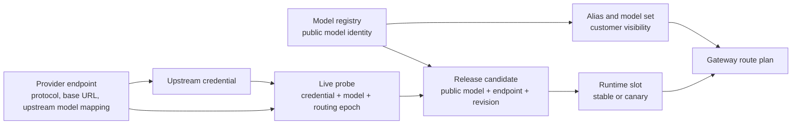
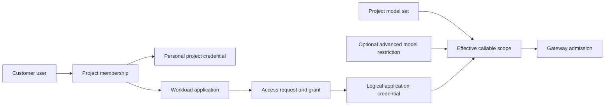
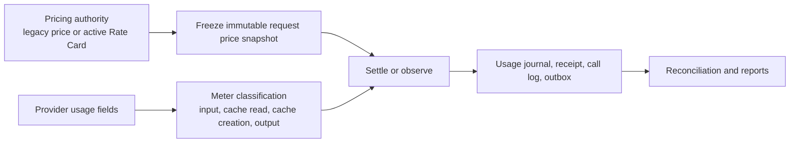

# UniRouter System Fact Map

> Status: canonical current-state map for implementation impact analysis.
> Scope: the supported on-premises topology, where one deployment serves one customer while deployment operators remain a separate identity concern.
> Authority: code and migrations override this map when they disagree; any product change that alters an entity, authority, or consumer must update this file in the same batch.

## 1. Product boundary

UniRouter is a modular monolith with one public gateway and one administration API. It is not a collection of independently deployable services. PostgreSQL owns durable control-plane and evidence state; Redis owns short-lived admission, routing-health, cache, and coordination state.

The supported customer topology is:

- one deployment;
- one customer context;
- multiple customer projects, applications, users, and API keys;
- multiple upstream provider endpoints for the same public model;
- separate deployment-operator identities and customer identities.

`org_id` remains an internal isolation and integrity key. It is not a normal operator-selectable tenant dimension in the single-customer product.

New installations should keep deployment-operator and customer identities in separate organization records. For an upgraded local installation with exactly one active root organization, the customer-context resolver may adopt that sole root as the compatibility customer context even when its historical `org_type` is `partner`. This does not make the deployment-operator role a project member, and customer-facing UI must use the resolved customer context rather than expose a historical technical name such as `Platform Admin`.

## 2. User workspaces

| Workspace | Primary actor | Owns | Does not own |
|---|---|---|---|
| Deployment operations | deployment operator | runtime, License, provider endpoints, upstream credentials, release/routing operations, global safeguards | customer project membership or application credentials |
| Customer administration | customer administrator | people, project membership, model visibility, application access, budgets, usage | host/runtime lifecycle or upstream secret custody |
| Project workspace | project member | project-scoped applications, API keys, permitted model use, usage visibility | provider endpoints, prices, or deployment policy |

The UI may combine these workspaces in one shell, but every page must state which authority it uses. A deployment operator must not silently become a customer project member.

API guidance follows the same ownership boundary. Ordinary project members use the project workspace as the primary API quickstart and can open `/docs#error-<code>` for a gateway error. Project administrators may open the project API reference; organization and deployment management identities see only the control-plane contracts within their own authority. The frontend documentation catalog is a presentation projection, not an authorization boundary: backend route gates remain authoritative, and every new API area is hidden until its audience is explicitly declared.

## 3. Model and routing truth

| Concept | Durable authority | Important projections/consumers |
|---|---|---|
| Public model identity | model registry and aliases | model catalog, project model sets, readiness, `/v1/models` |
| Provider endpoint | `channels` plus explicit public-to-upstream mapping | endpoint UI, probe service, routing candidates |
| Credential | `channel_keys`; plaintext is accepted once and encrypted | probe service and gateway credential selection |
| Connectivity evidence | `channel_model_probes`, bound to credential and routing epoch | endpoint status, release admission, readiness |
| Release history | runtime releases; append-only operational history | release queue, rollback evidence, audit |
| Current traffic authority | runtime stable/canary slots and assignments | gateway route plan, route preview, readiness |
| Endpoint operational state | channel status plus routing epoch | credential mutation guard, routing candidate eligibility |
| Per-request endpoint attribution | immutable `call_logs.route_channel_id` written from the selected gateway route | Dashboard endpoint health, recent requests, audit/operations analysis |

Rules:

1. A public model can have many provider endpoints, including the official provider and aggregators.
2. Provider identity, adapter protocol, public model ID, and upstream model ID are different fields.
3. A successful probe is evidence for one endpoint, one upstream credential, one model mapping, and one routing epoch. It is not a global provider assertion.
4. Historical releases remain visible as audit history, but only the current slot is traffic authority.
5. Readiness is a read-only explanation of existing authorities. It must never introduce another status or require users to re-enter identifiers already known by the selected model/project/application.
6. Endpoint display names are mutable and may repeat. No request, health, or cost projection may infer endpoint identity from `channels.name`; legacy rows without provable route identity remain unattributed.

## 4. Access truth

| Question | Authority |
|---|---|
| Can the user administer a project? | customer role plus project membership role |
| Which models can the project see? | project model-set binding and approved catalog |
| Which models/endpoints can a personal project key call? | key scope and ownership, intersected with project visibility and membership |
| Which models/endpoints can a workload application key call? | access grant and logical credential scope, intersected with project visibility |
| Is a special per-user/model restriction present? | model authorization policy; this narrows access and is not the normal grant path |
| Can a deployment operator call models? | only when separately represented as a customer/project principal; operator status alone is insufficient |

The normal human/developer flow is: create user -> add user to project -> the project user creates a personal project credential in the project workspace. The workload flow is: project administrator creates an Application -> Request -> Grant -> logical credential. The advanced model-authorization surface must not be presented as the base way to grant access.

## 5. Pricing, billing, and evidence truth

| Concept | Authority | Boundary |
|---|---|---|
| Request price | configured pricing mode: legacy model price or active Rate Card | drafts and imported evidence never affect requests |
| Peak/off-peak price | complete UTC daily bands in the active Rate Card | every minute must select exactly one band |
| Cache-hit charging | provider usage fields such as cached input tokens | UniRouter does not infer a cache hit from latency or prompt text |
| Prepaid billing | wallet freeze and settlement records | blocks when required funds/admission are unavailable |
| Cost observation | calculated-cost receipt/journal | does not charge wallet or pretend project budgets are enforced |
| Supplier reconciliation | imported/manual provider evidence and reconciliation records | must be labelled as evidence, not a live integration when no connector is configured |

## 6. Operational and integration truth

| Surface | Observed truth | Desired/registered truth |
|---|---|---|
| Runtime status | current process, PostgreSQL/Redis probes, traffic and host snapshot | none |
| Deployment and network | runtime status can show the actually running instance | manually registered deployment/entry records describe intended or auxiliary topology |
| License | verified license claims and feature gates | no page-local duplicate feature status |
| Integrations | connector-specific live state only after the connector is configured | available integrations and planned integrations must be visually distinct |

A normal “not configured” integration is not a global page error. Connector failures belong inside that connector’s detail surface.

## 7. Write-authority and impact matrix

Use this table before changing any listed concept.

| Change | Required writers/checks | Required consumers to verify |
|---|---|---|
| Add/edit provider endpoint | channel handler, mapping normalization, credential rules, audit | model endpoints, probe, route preview, readiness, Dashboard |
| Rotate upstream credential | live preflight, atomic credential swap, probe evidence, audit, routing invalidation | gateway selection, endpoint detail, credential bulk view, readiness |
| Change public model identity | registry uniqueness/canonicalization, aliases, release conflict checks | catalog, model sets, releases, `/v1/models`, pricing |
| Activate/pause endpoint | routing epoch/CAS and release ownership | route slots, preview, credential mutation rules, Dashboard, readiness |
| Add customer user | canonical customer scope | people, project membership, access requests, audit |
| Grant project access | membership transaction and role validation | project workspace, applications, effective access, audit |
| Issue/rotate application key | access grant and scope snapshot | gateway admission, credential list, usage attribution |
| Enable a person to call models | customer user plus project membership; the person creates the one-time personal secret | project workspace, personal key list, gateway ownership and usage attribution |
| Change price | authority mode, Rate Card maker-checker and immutable schedule | freeze/settle, readiness, cost preview, reports |
| Change License | one verified license authority | navigation, route gates, page availability, runtime status |
| Change deployment record | manual registry only | deployment/network page; never infer live process mutation |
| Change API audience or error documentation | backend route authorization and error registry | project quickstart, direct `/docs#error-*` links, project-admin reference, management reference, navigation |

## 8. Golden journeys

These are cross-layer acceptance contracts, not mock-page demonstrations.

1. **J1 - First usable model:** create provider endpoint -> add credential -> probe selected model -> first activation -> route preview selects endpoint -> real gateway request succeeds -> call log and cost evidence appear.
2. **J2 - Second endpoint for same public model:** add aggregator endpoint with a different upstream model ID -> probe -> canary -> promote or roll back without duplicating the public model.
3. **J3 - Zero-downtime credential rotation:** submit new secret -> prove it against the selected upstream model -> atomically activate it and retire the old secret -> existing route stays callable.
4. **J4 - Customer user access:** create customer user -> add to project -> issue a personal project credential, or create a workload Application/Grant credential -> permitted model succeeds and unpermitted model fails clearly.
5. **J5 - Price authority:** draft complete cache-aware/peak schedule -> independent review -> activate -> calls in representative bands freeze and settle with the selected four meter prices.
6. **J6 - License and integration presentation:** licensed pages load; unavailable features explain the exact missing claim; unconfigured connectors remain local neutral states.
7. **J7 - Deployment operations:** actual runtime is shown from observation; optional registered topology is clearly separate; no form implies it deployed or reconfigured the running service.

## 9. Confirmed debt register

### Closed in the current model-endpoint lifecycle batch

- Active upstream credentials can be rotated without pausing traffic: the replacement is proved against the exact mapped upstream model before an atomic swap, and a failed probe leaves the old credential and route unchanged.
- Customer-facing people and model-endpoint surfaces use the canonical customer context instead of displaying the deployment-operator organization as the customer.
- Model onboarding preserves the selected endpoint context when opening credential management; it no longer drops the operator into an ambiguous global list.
- The ordinary access path is now user -> project membership -> personal project credential, or a project-managed workload application credential. Per-user/model authorization is explicitly an advanced narrowing control.
- Rate Card authoring supports multiple complete UTC daily bands with four explicit cache-aware meter prices; the legacy price form is labelled as a flat compatibility authority.
- Connector state is loaded only inside the selected connector detail; an unconfigured connector is no longer promoted to a global integration-page error.
- Deployment/network separates observed runtime health from manually registered topology, and no registration form claims to deploy or reconfigure the running service.
- Runtime release history has server pagination and current/history separation; revision counters remain internal CAS evidence rather than a user-facing model version.
- This fact map is the canonical entity/authority/consumer impact map, and the codebase map now tracks the current migration ceiling.
- A real-backend browser journey now proves endpoint creation, encrypted credential storage, exact mapped-model probing, first activation, gateway dispatch, usage logging, and audit evidence in one isolated test.
- Dashboard channel health now consumes the canonical model-endpoint operational projection instead of reinterpreting channel, credential and release rows. A key for one configured model cannot make another published model look callable, and stale routing epochs are surfaced consistently across Dashboard, model endpoints and Readiness.
- Gateway call evidence now stores the immutable selected endpoint ID. Dashboard window metrics join that ID instead of the non-unique endpoint display name, so two same-named provider endpoints cannot inherit each other's requests or success rate. Historical evidence is backfilled only from exact provider-attempt identity; ambiguous rows stay unattributed.
- Application identities are generated by the server in the ordinary create flow and shown only as advanced audit evidence. Access-review rows resolve the person or Application display name on the server instead of requiring administrators to interpret database IDs.
- Shared tables and the Application access panel show an explicit loading state until their authoritative requests complete; an in-flight read is no longer presented as an empty credential, Request, or Grant set.

### Closed in the maintenance-debt batch

- The retired `ChannelsPage` compatibility implementation and its isolated test were deleted; `/channels` continues to resolve only to the supported Model Endpoints workspace.
- Model Endpoints is now a page orchestrator with separate create/detail surfaces and presentation helpers. Its API contract has a typed domain module instead of page-local response assertions.
- Model endpoint reads now live in one canonical projection file, while endpoint lifecycle writes remain in their handler. Model-governance registry mutations, catalog reads, and shared scope/scanning helpers are separate review and test seams.
- Dashboard did not retain a second channel/release SQL authority: it consumes the canonical endpoint projection. Readiness route eligibility calls the gateway routing controller, while access, pricing and policy decisions now come from their owning services or bounded read models.
- GitHub-maintained JavaScript actions used by active workflows run on the current Node 24 action generations. Compose no longer declares the obsolete top-level `version` field.
- Commit-addressed release worktrees now have a read-only retention report and an explicit, revalidated apply path. Only old, detached, clean, canonical worktrees absent from running-container and keep-file protection can become candidates; no timer or automatic deletion is installed.
- Development Target backend builds keep the truthful new runtime commit while reusing persistent Go module and build caches. Reusing an old backend image under a new release identity remains forbidden.
- PostgreSQL-backed tests run only in the integration gate and reuse a migrated template per package. The sensitive-word database contract no longer makes the ordinary Go unit gate create and migrate a temporary database; its source-order assertion remains in the unit gate.
- Readiness no longer owns copied pricing, grant/key, registry or model-set admission SQL inside the HTTP handler. Pricing and wallet evidence comes from the billing service used by `Freeze`; credentials are rechecked through the gateway's live access-grant boundary; model authorization alternatives share one bounded policy read; governance and explanatory reads live behind the `modelreadiness` read model.
- Dashboard current/previous window metrics are each read from one organization-scoped PostgreSQL snapshot instead of ten separate aggregate queries. Route availability still comes from the canonical endpoint projection and gateway preview, not from those observation aggregates.
- Provider channels/credentials, model endpoints, runtime routing/releases, Dashboard, enterprise finance and access/Readiness use named typed frontend API modules. The remaining aggregate compatibility calls are explicitly counted by a non-increasing build gate, so a new feature cannot silently add another `any` response seam. The unused legacy channel editor and its duplicate status helpers were removed.
- API documentation is audience-specific: ordinary members receive one project quickstart and common or deep-linked errors, project administrators receive a project-scoped reference, and management identities receive an authority-filtered control-plane reference. Undeclared API areas fail closed in the UI catalog, while direct error links remain compatible and backend authorization remains the only security authority.

### P0 - correctness and access

- No known P0 remains in the model-endpoint lifecycle scope. A newly discovered P0 must include its broken authority or golden-journey invariant rather than being recorded as a page-local symptom.

### P1 - recurring product inconsistency

- Readiness composes model, access, pricing and policy authorities from their owners and remains a read-only explanation rather than a mutable status. Its route axis, Dashboard channel health and model endpoints are locked by shared gateway/projection tests; every future authority change must retain that cross-surface gate.
- Finance and access still contain advanced audit/workflow surfaces. The changed pages now explain and separate them, but a future information-architecture batch may move them out of the ordinary task path; that is not required for the current golden journeys.
- The canonical-customer projection fix is covered on the changed people and endpoint paths. Remaining customer-domain pages stay under the existing access/readiness browser journey and must keep that gate when their scope logic changes.

### P2 - maintainability

- The Model Endpoints workspace and its two backend domains now have meaningful orchestration/read/write seams. Other large files should be split only when a product change needs an independent authority or test seam, not to chase line-count targets.
- The API client has a strict shared transport and named contracts for provider channels/credentials, Model Endpoints, runtime routing/releases, Dashboard, enterprise finance and access. The remaining aggregate compatibility surface is still hand-written and weakly typed, but its exact call ceiling is ratcheted by the build. OpenAPI is route-complete while many response bodies remain generic JSON, so generation must follow authoritative response schemas rather than manufacture `unknown` wrappers.
- Readiness authority duplication is closed for the current model-call path. Its HTTP handler still shapes product explanations, while durable reads and admission decisions remain owned by billing, model governance, access-grant boundary, model authorization, limit policy and gateway routing services.
- A frontend-only release still produces a backend binary bound to the same release commit by design. Persistent BuildKit Go caches reduce the rebuild cost without creating mixed or misleading release identity; independently versioned components would require a separate release-manifest contract and is not being implied here.

Debt is closed only when the affected golden journey and projection checks pass. Moving code into more files without reducing authority duplication does not close architectural debt.

## 10. Change completion checklist

For changes to these flows:

1. identify the durable authority and all writers;
2. verify each projection consumer in the impact matrix;
3. add a negative test for stale revision, wrong scope, or missing evidence as applicable;
4. run the relevant real-backend golden journey;
5. distinguish Local, CI, Target, external-provider, and production evidence;
6. update this map if an entity, authority, or consumer relationship changed.
