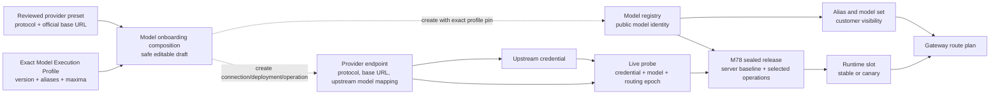
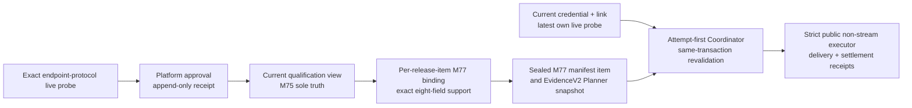
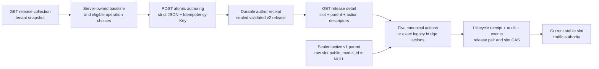
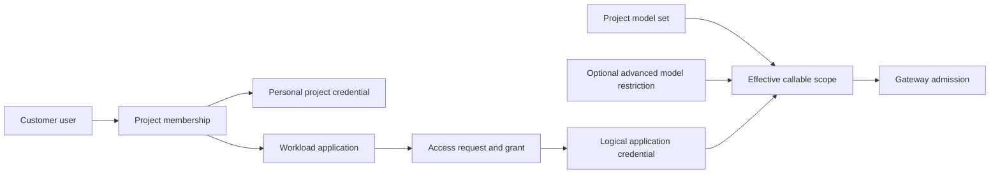
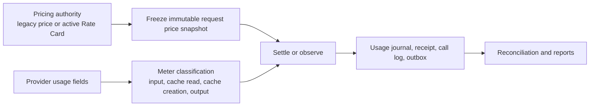

# UniRouter System Fact Map

> Status: canonical current-state map for implementation impact analysis.
> Scope: the supported on-premises topology, where one deployment serves one customer while deployment operators remain a separate identity concern.
> Authority: code and migrations override this map when they disagree; any product change that alters an entity, authority, or consumer must update this file in the same batch.

## 1. Product boundary

UniRouter is a modular monolith with one public gateway and one administration API. It is not a collection of independently deployable services. PostgreSQL owns durable control-plane and evidence state; Redis owns short-lived admission, routing-health, cache, and coordination state.

The executable PostgreSQL compatibility ceiling is `000083`. After running
migrations or honoring `SKIP_MIGRATION`, every backend reads the complete,
ordered migration ledger and requires it to equal the binary artifact ledger
before customer-baseline initialization or HTTP bind; missing, extra, future,
duplicate, reordered and empty ledgers all fail closed. Schema-ceiling changes
are therefore non-rolling: an M82 process and an M83 process cannot be ready
against one shared database. Operators drain and stop the old fleet, let one
migration owner advance the database to M83, and only then start M83
stable/canary. A secondary may use `SKIP_MIGRATION=true` only after the shared
database already has the exact M83 ledger. M78 adds atomic
sealed-release authoring provenance and the explicit v1-to-v2 lifecycle bridge;
M79 moves the commercial `active_channels` count authority to enabled canonical
provider connections. M80 gives cost-observation provider reconciliation an
append-only zero-charge terminal receipt instead of manufacturing a financial
transaction; its terminal transaction and observation receipt identities are
mutually exclusive and database-guarded. M81 records the exact versioned model
execution profile selected by the customer: tokenizer, reasoning, cache-usage and
protocol identities are repository-reviewed evidence, while context/output values
remain customer policy bounded by provider maxima. Historical rows are deliberately
`unverified.chat@1.0.0`; no migration infers authority from a model name. Component
identities have executable contracts rather than provider-name branches. In
particular, `kimi.k3.api@1.5.0` validates the provider-owned
`reasoning_effort=low|high|max` contract without injecting the documented `max`
default, preserves reasoning on assistant tool-call history, and authorizes Kimi's
top-level `usage.cached_tokens` only through the selected cache-usage profile.
Kimi K2.6/K3 Partial Mode, K3 Dynamic Tools, bounded inline media and built-in
web search now have typed request contracts; only their exact executable
profile versions may admit those shapes. M83 extends Freeze, finalization,
observation and call-log evidence with exact non-token Rate Card rationals and
provider-evidenced meter quantities. The first executable unit is a bounded
Kimi `$web_search` call; a missing price, excess quantity or untyped response
fails closed. M82 pins that reviewed
profile identity plus the public context/output limits into each canonical v2
Release. Canonical Planner resolves them from the selected stable/canary Release
and commits them to the snapshot hash, so a registry edit only supplies a future
Release and cannot mutate live execution. Exact release/lifecycle inspection
surfaces expose the pins without changing the v1 authoring-receipt body. Billing
Freeze remains the independent price-version authority. M83 guarded down rejects
later migrations, durable non-token meter evidence or versioned component source
evidence that M82 cannot represent. M82 guarded down rejects
later migrations and any durable Release pin that would be lost under M81's
mutable registry lookup. M79 takes the shared model-execution migration advisory
lock, then the provider-connection/channel/schema relation locks, then the
`active_channels` resource advisory lock, and only then the entitlement-table
lock; this ordering matches both activation and License renewal without a lock
cycle. Its guarded down is permitted only after later migrations are gone and
every enabled canonical connection has one exact active legacy projection whose
count still fits the signed limit. The down restores only the legacy count
trigger/function and retains canonical tables, credentials and history. Neither
migration reinterprets the M77 Responses/Messages public-execution chain, and
legacy tables remain available only for history and explicit compatibility
operation.

The supported customer topology is:

- one deployment;
- one customer context;
- multiple customer projects, applications, users, and API keys;
- multiple upstream provider endpoints for the same public model;
- separate deployment-operator identities and customer identities.

`org_id` remains an internal isolation and integrity key. It is not a normal operator-selectable tenant dimension in the single-customer product.

New installations should keep deployment-operator and customer identities in separate organization records. For an upgraded local installation with exactly one active root organization, the customer-context resolver may adopt that sole root as the compatibility customer context even when its historical `org_type` is `partner`. This does not make the deployment-operator role a project member, and customer-facing UI must use the resolved customer context rather than expose a historical technical name such as `Platform Admin`.

## 2. User workspaces

| Workspace | Primary actor | Owns | Does not own |
|---|---|---|---|
| Deployment operations | deployment operator | runtime, License, provider endpoints, upstream credentials, release/routing operations, global safeguards | customer project membership or application credentials |
| Customer administration | customer administrator | people, project membership, model visibility, application access, budgets, usage | host/runtime lifecycle or upstream secret custody |
| Project workspace | project member | project-scoped applications, API keys, permitted model use, usage visibility | provider endpoints, prices, or deployment policy |

The UI may combine these workspaces in one shell, but every page must state which authority it uses. A deployment operator must not silently become a customer project member.

API guidance follows the same ownership boundary. Ordinary project members use the project workspace as the primary API quickstart and can open `/docs#error-<code>` for a gateway error. Project administrators may open the project API reference; organization and deployment management identities see only the control-plane contracts within their own authority. The frontend documentation catalog is a presentation projection, not an authorization boundary: backend route gates remain authoritative, and every new API area is hidden until its audience is explicitly declared.

## 3. Model and routing truth

| Concept | Durable authority | Important projections/consumers |
|---|---|---|
| Onboarding composition | repository-reviewed provider preset plus an exact Model Execution Profile; the backend validates the profile pair, aliases, operation and effective limits and persists the exact profile pin | “模型接入” form defaults and constrained choices only; it is not a live probe, release, pricing, credential or traffic authority, and omission stays `unverified.chat@1.0.0` |
| Public model identity | model registry and aliases | model catalog, project model sets, readiness, `/v1/models` |
| Provider connection | canonical `provider_connections` plus deployment operation/profile and public-to-upstream mapping | canonical deployment UI, operation probe, Planner candidates, License `active_channels` usage |
| Credential | canonical `provider_credential_bindings` plus exact deployment link; plaintext is accepted once and encrypted | operation probe and Coordinator credential selection |
| Legacy endpoint history | `channels`, `channel_keys` and `channel_model_probes` | read-only migration/audit compatibility and explicit legacy/verify planning; never canonical readiness or current Dashboard authority |
| Canonical operation probe evidence | append-only `model_deployment_probes`, bound to exact deployment, operation, protocol profile, connection/deployment/credential revisions and credential-deployment link epoch | canonical route admission and operation evidence; never capability inference |
| Responses/Messages execution support | immutable M75 binding plus compiled `modelqualification` tuple: operation, public path, protocol profile/version and executor contract | probe availability and structural production qualification; it cannot by itself authorize public dispatch |
| Responses/Messages production qualification | append-only platform approval of one current exact live probe; `model_operation_execution_qualifications` is the only mutable current structural qualification truth | canonical read DTO and M77 public-binding creation; qualification alone is never online/traffic proof |
| Public execution support extension | immutable M77 extension references the exact M75 five-field support tuple and adds delivery, charge and idempotency contract versions | the sole exact eight-field public executor registry lookup |
| Per-item public execution binding | immutable M77 binding freezes customer, public model, deployment, connection, operation/profile, M75 approval structural lineage, approved revisions, origin, release ID/ordinal and exact eight-field support identity | required selected manifest item join in qualification, Planner snapshot and Coordinator revalidation; old sealed M75 items never auto-upgrade |
| Public execution evidence | `executionevidence.EvidenceV2` plus the V2 compact projection and exact provider-attempt columns | Planner snapshot hash, owner-fenced billing attempt, terminal health, call log and trace; V1 digest semantics remain unchanged |
| Release authoring | M78 `model_deployment_release_authoring_receipts`, its exact audit/events and the receipt-linked sealed v2 release/items/bindings | release workspace collection, exact replay and provenance; the command ends at `validated` and never assigns traffic |
| Release history | runtime releases plus append-only operational history; M77 historical sealed v2 rows may have no M78 authoring receipt | release queue, stable-parent lineage, rollback evidence, audit |
| Release lifecycle | M76/M78 immutable lifecycle receipts, frozen qualification/release images and `runtime_change_slots` CAS | seven server-described actions; five canonical actions plus `cutover_legacy` and no-License `rollback_legacy` |
| Current traffic authority | sealed runtime stable/canary slots and assignments | canonical Planner, readiness and release workspace |
| Connection operational state | canonical connection state/revision, credential/link state and latest own operation probe | Planner/Coordinator eligibility, readiness and Dashboard current health |
| Per-request route attribution | immutable execution-evidence projection including `route_deployment_id`, `route_connection_id`, `route_model_operation_id`, credential binding and runtime release | Dashboard canonical health and recent requests; `route_channel_id` remains legacy history only |

Rules:

1. A public model can have many provider endpoints, including the official provider and aggregators.
2. Provider identity, adapter protocol, public model ID, and upstream model ID are different fields.
3. A successful probe is evidence for one endpoint, one upstream credential, one model mapping, and one routing epoch. It is not a global provider assertion.
4. Historical releases remain visible as audit history, but only the current slot is traffic authority.
5. Readiness is a read-only explanation of existing authorities. It must never introduce another status or require users to re-enter identifiers already known by the selected model/project/application.
6. Endpoint display names are mutable and may repeat. No request, health, or cost projection may infer endpoint identity from `channels.name`; legacy rows without provable route identity remain unattributed.
7. A canonical live probe addresses exactly `deployment_id + operation_id + credential_binding_id`. All four supported operations use distinct bounded requests. Responses and Messages additionally resolve their exact endpoint-protocol profile and execute its real network request/response contract; a local conformance fixture is never live evidence. A successful response advances only that operation while tools, vision and every other capability remain unchanged unless separately exercised and evidenced.
8. “模型接入” is the primary product wording. `Canonical Deployment` remains the internal durable identity because routing, release, probe and audit records require `deployment_id + operation_id`; it is not the user task name.
9. A reviewed onboarding template may prefill and constrain provider, model aliases, context/output limits and operation. It must pin the exact Profile version, keep connection naming editable, and never mark the result live-verified or released. Reusing an existing public model treats supplied Profile fields only as exact assertions.

For Responses and Messages, M75 and M77 form this control chain:

The approval receipt freezes the exact probe credential identity and link epoch
and revalidates their currentness when the receipt is appended. Later credential
rotation, revoke, unlink, or cooldown remains a separate operational binding
axis: it requires a current selectable binding and latest own probe at planning
and Coordinator revalidation, but does not rewrite the historical human
approval, M77 structural binding or qualification lineage. Structural authority
still fails closed on customer/release item, connection, deployment, operation,
profile, immutable support, origin or approved-revision drift.

M78 adds the authoring and compatibility-transition control chain without
replacing any M77 public-executor authority above:

- The collection read is the only UI authoring preflight. It returns each
  tenant-owned public model, the exact server-derived `initial`, `stable` or
  `legacy_cutover` baseline, the raw-slot projection after ownership proof,
  eligible deployment/operation selections and existing actionable v2 release
  summaries. Ambiguous identity, a live canary, a retired public model or no
  eligible operation remains visible with an unavailable reason and no usable
  baseline; the client must not invent revisions, hashes, parent IDs, profiles,
  bindings or a release reference.
- `POST /api/v1/model-deployment-releases` is the sole M78 v2 authoring writer.
  One repeatable-read transaction claims a durable receipt, locks the exact
  baseline and selected authority, creates the release/items/public bindings,
  appends create and validate events plus audit, seals the manifest and returns
  a `validated` release. It does not activate, start a canary or move a slot.
  A new commit returns 201 and `Location`; a later exact winner replay returns
  200 with the same `Location`, `X-UniRouter-Idempotency-Replayed: true` and the
  original server operation ID. An ACK-recovery inside the same operation is
  not labelled as a later replay.
- The lifecycle detail exposes either the normal five actions or, for an exact
  sealed v1 stable parent, only `cutover_legacy` and `rollback_legacy`; the UI
  follows these server descriptors. `assigned_public_model_id` is absent/null
  for the raw v1 slot while the logical `public_model_id` remains the owned
  public model. Every write revalidates versions and authority under locks.
- `cutover_legacy` changes a stable slot from raw v1 identity
  (`public_model_id IS NULL`) to canonical v2 identity only when the sealed v2
  target preserves the complete established Gateway operation set—Chat
  Completions and Embeddings—and the two currently executable plans have the
  same secret-free hash. It atomically advances both releases and the slot and
  freezes the two plan hashes in the immutable lifecycle receipt.
- `rollback_legacy` is the inverse emergency contraction. It is available to
  organization write roles without a Gateway License and deliberately ignores
  target v2 route health, qualification and parity; exact target/slot lineage
  plus the retained sealed v1 parent's current executable Chat+Embeddings
  authority still must pass. It atomically restores the raw v1 slot identity
  and retains the immutable evidence chain.
- Collection/detail reads allow `platform_admin`, `org_admin` and `org_viewer`
  without a Gateway License. Authoring, normal expansion and legacy cutover
  allow only `platform_admin`/`org_admin` and require the Gateway feature.
  Canary cancellation and legacy rollback keep the same write RBAC but no
  License gate. Authentication and RBAC run before License admission.
- All authoring and lifecycle request bodies are one strict JSON object no
  larger than 16 KiB. Unknown/duplicate members and trailing values fail before
  durable receipt access. A 409 means the client must refresh server truth; no
  UI action silently retries against a changed baseline.

### Current live Gateway execution boundary

- The binary, ordinary Compose and runtime config default
  `MODEL_ROUTE_AUTHORITY` to exactly `canonical` with
  `MODEL_ROUTE_COMPATIBILITY_ENABLED=false`. There is no automatic fallback.
  `legacy` and `verify` require compatibility to be explicitly enabled. The
  formal customer fresh-install package starts once in `legacy + compatibility`
  only because an empty installation does not yet have a customer root or a
  sealed current slot; it must remain traffic-isolated while the customer and
  first canonical release are authored, then pass the read-only authority check,
  switch to `canonical + false`, and restart before serving traffic.
- For `verify` and `canonical`, process startup performs
  `unirouter.model-route-authority-check.v1` from one Repeatable Read, read-only
  PostgreSQL snapshot before Redis, background workers or HTTP bind. Its
  inventory is the union of live configured legacy model names and every
  current stable/canary slot. A sole root customer, registry/slot identity,
  sealed manifest, operation/profile, connection/deployment revisions,
  credential binding/link and latest own probe must agree. Operational disable,
  cooldown and breaker state may make a route temporarily unroutable; one
  healthy route never hides a structurally stale sibling in the same manifest.
  Because v1 exposes `legacy.any.v1`, verify additionally proves both published
  project-default paid envelopes (Chat Completions and Embeddings) against every
  selectable adapter; a chat-only adapter blocks startup.
- `uniroute model-route-authority apply --customer-org-id <id>` is the only
  explicit compatibility preparation command and is accepted only in `verify`.
  It reuses the idempotent legacy reconcile and seals every current v1 stable
  and canary compatibility manifest before running the same read-only check. It
  does not promote, rollback, switch mode, publish a v2 release or move a slot.
  Reconciliation and v2 lifecycle take release/slot authority locks in one
  fixed order; any current v2 stable/canary makes apply fail before projection
  writes, including from a verify process during a rolling cutover.
  `legacy`/`canonical` apply is rejected before database access; canonical uses
  read-only `check`, so legacy projection cannot overwrite its state. Canonical
  readiness accepts a sealed parentless native v2 assignment; only verify
  requires legacy/canonical parity and a v1 compatibility parent.
- Exactly 19 legacy channel/key, v1 runtime-change and model-endpoint lifecycle
  writes are permanently retired in every authority mode: four channel writes,
  four channel-key writes, three model-endpoint lifecycle writes and eight
  runtime-change writes. Their routes authenticate and enforce platform RBAC,
  then return `410 legacy_model_mutation_retired` before License admission,
  body parsing, secret access or any retirement-handler/business-data query;
  authentication and customer/RBAC context may still read their own security
  state. No compatibility flag re-enables the retired handler or its SQL writer.
  Historical reads remain available, while canonical model-deployment creation,
  probing, release authoring and descriptor-driven lifecycle remain writable. Two
  authenticated organization-admin safety contractions remain available even
  without a valid Gateway License: connection pause changes only the connection
  axis (verify mirrors only legacy channel status), while credential revoke is
  terminal and scrubs canonical and verify-side legacy ciphertext in one
  audited transaction. Each revalidates the sole root customer and active
  authoritative organization role in that same transaction. Fleet drain is
  still a deployment responsibility because the database has no live-process
  registry or writer lease.
- Production startup always injects `modelrouting.Planner` and
  `modelexecution.Coordinator` into Chat Completions and Embeddings, including
  in explicit compatibility modes. Their handlers require that complete runtime
  before guardrail, cache, secret resolution, Freeze or provider I/O and contain
  no legacy Router/attempt fallback. Canonical execution also bypasses the
  legacy response cache. The old Gateway `Router` remains only for explicit
  compatibility and historical consumers; canonical startup rejects async media
  until that separate operation has canonical execution authority.
- In explicit `legacy` mode, Planner reads the existing channel/key and v1
  runtime-slot authorities. The canonical provider-connection, deployment,
  credential-binding and operation rows are a migration/proof projection, not
  the live read authority. `verify` compares the two projections atomically;
  `canonical` selects only the sealed v2 projection.
- Planner fixes one operation- and capability-specific route snapshot and
  locally builds every usable candidate before billing Freeze. After Freeze,
  only an `Applied` Coordinator decision may dispatch provider HTTP; that same
  transaction owns the immutable provider-attempt evidence and health fence.
- Before Freeze, Chat conservatively measures the complete supported envelope
  (including tool/function/structured controls), while Embeddings accepts only
  bounded string or integer token-ID shapes. Unknown semantics fail before
  Planner, Freeze and network. Public context and each candidate's `MaxContext`
  are hard admission evidence. `DefaultMaxOutput` is not a hard maximum:
  omitted canonical/verify output is reserved and injected from the immutable
  public limit only for an exact supported wire profile; the legacy adapter
  contract uses its versioned 1000-token compatibility ceiling. The legacy
  probe profile never authorizes a wire field. The deliberate pre-catalog
  legacy case has no public registry limit and retains the channel `MaxContext`
  as its context bound.
  Commit ambiguity is recovered only with the same ephemeral owner. If local
  processing fails before network dispatch, the owned attempt becomes the
  financially resolved `released_undispatched` terminal even when its route was
  subsequently disabled, revised, or lost a half-open lease.
- `/v1/responses` and `/v1/messages` are registered only for the exact M77
  non-stream text contract. The Gateway runtime fence requires an installed
  public registry and narrow Coordinator; the pre-secret plan fence requires
  the selected item, EvidenceV2 base, profile and all three public contract
  versions to match exactly. Ordinary Coordinator `Authorize` continues to
  reject public evidence; only narrow `AuthorizePublic` can execute the exact
  M77 plan and it revalidates release item, binding, current credential/link and
  latest own probe after opening the owner-fenced attempt and before network.
- The public executor bypasses legacy Router/adapters/response-cache and never
  uses V1 evidence or the old provider-attempt API. It prepares and input-guards
  the provider-independent document, strictly re-prepares any transformation,
  builds all candidates locally, freezes once, dispatches only an `Applied`
  authorization, strictly parses a whitelisted customer body, completes the
  attempt and terminal health, then records delivery before settlement. Guarded
  output retains only canonical usage as provider-liability evidence and is
  never delivered. Retry-authorized known rejection may fall back only after
  durable completion and terminal health; non-retryable or exhausted rejection
  cancels. Transport ambiguity or unusable 2xx remains settlement-pending
  without fallback or cancellation.
- M75 `production_qualified` alone still must not be presented as “online” or
  Production traffic evidence. Online execution additionally requires the
  selected active M77 release item, exact eight-field binding, current
  credential/probe authority, funding, provider outcome, health, guard and
  delivery/settlement terminals for that request.
- The customer-package preflight validates the selected mode and compatibility
  pair but is deliberately not a readiness proof. `verify` preparation is
  explicit and bounded to current v1 assignments; `canonical` is read-only
  `check` only. In both non-legacy modes the backend database startup gate is the
  authority that proves readiness before any listener or worker starts. Draining
  older binaries remains a deployment responsibility; the database intentionally
  retains legacy read evidence and does not pretend to be a live-process lease.

Canonical administrative projections use the same identities as execution:

- `unirouter.model-readiness.v2` derives an exact model operation from the
  selected public endpoint. Connection mode requires `deployment_id` and
  reports `deployment_id + model_operation_id`; caller mode explains the
  canonical Planner/current application projection rather than invoking a
  legacy Router preview.
- Dashboard current health and current-window call facts join canonical
  `route_deployment_id + route_model_operation_id` to the canonical application
  projection. `route_channel_id` is retained and labelled only as historical
  attribution; it cannot create a current health row.
- `GET /api/v1/model-endpoints` is the
  `unirouter.model-endpoints.canonical-compat.v3` selector projection. Its
  legacy-shaped `channel_id` and `routing_epoch` fields are fixed at zero while
  `deployment_id`, `connection_id` and `model_operation_id` carry current
  identity; it reads no legacy current authority and performs no Router preview.
- Canonical cost/readiness responses explicitly report
  `response_cache_runtime=canonical_bypass`. Historical request cost and cache
  facts remain immutable evidence; bypassing future canonical cache reads and
  writes does not rewrite them.

## 4. Access truth

| Question | Authority |
|---|---|
| Can the user administer a project? | customer role plus project membership role |
| Which models can the project see? | project model-set binding and approved catalog |
| Which models/endpoints can a personal project key call? | key scope and ownership, intersected with project visibility and membership |
| Which models/endpoints can a workload application key call? | access grant and logical credential scope, intersected with project visibility |
| Is a special per-user/model restriction present? | model authorization policy; this narrows access and is not the normal grant path |
| Can a deployment operator call models? | only when separately represented as a customer/project principal; operator status alone is insufficient |

The normal human/developer flow is: create user -> add user to project -> the project user creates a personal project credential in the project workspace. The workload flow is: project administrator creates an Application -> Request -> Grant -> logical credential. The advanced model-authorization surface must not be presented as the base way to grant access.

## 5. Pricing, billing, and evidence truth

| Concept | Authority | Boundary |
|---|---|---|
| Request price | configured pricing mode: legacy model price or active Rate Card | drafts and imported evidence never affect requests |
| Peak/off-peak price | complete UTC daily bands in the active Rate Card | every minute must select exactly one band |
| Cache-hit charging | provider usage fields such as cached input tokens | UniRouter does not infer a cache hit from latency or prompt text |
| Prepaid billing | wallet freeze and settlement records | blocks when required funds/admission are unavailable |
| Cost observation | calculated-cost receipt/journal | does not charge wallet or pretend project budgets are enforced |
| Supplier reconciliation | imported/manual provider evidence and reconciliation records | must be labelled as evidence, not a live integration when no connector is configured |

## 6. Operational and integration truth

| Surface | Observed truth | Desired/registered truth |
|---|---|---|
| Runtime status | current process, PostgreSQL/Redis probes, traffic and host snapshot | none |
| Deployment and network | runtime status can show the actually running instance | manually registered deployment/entry records describe intended or auxiliary topology |
| License | verified license claims and feature gates | no page-local duplicate feature status |
| Integrations | connector-specific live state only after the connector is configured | available integrations and planned integrations must be visually distinct |

A normal “not configured” integration is not a global page error. Connector failures belong inside that connector’s detail surface.

## 7. Write-authority and impact matrix

Use this table before changing any listed concept.

| Change | Required writers/checks | Required consumers to verify |
|---|---|---|
| Add provider connection/deployment | canonical deployment create receipt, explicit public/deployment limits, credential binding, operation identity and audit. The ordinary UI requires all four limits to be positive: public `context_length`/`output_limit` and deployment `max_context`/`default_max_output`; the API may retain zero only as non-authorable staging state | model endpoints, release authoring options, operation probe, readiness and License usage |
| Pause/revoke canonical authority | connection safety contraction or terminal credential-binding revoke, exact revision/role proof and audit | Planner/Coordinator selection, endpoint detail, readiness and Dashboard |
| Probe canonical model operation | exact deployment/operation/credential binding, server-side secret resolution, bounded adapter request/response, append-only evidence and atomic audit | operation evidence, canonical route admission, endpoint detail; no capability projection |
| Change public model identity | registry uniqueness/canonicalization, aliases, release conflict checks | catalog, model sets, releases, `/v1/models`, pricing |
| Publish or roll back a deployment | atomic M78 author receipt followed by a server-described lifecycle receipt, release/item/event/audit proof and slot CAS | Planner/Coordinator, release workspace, Dashboard and readiness |
| Add customer user | canonical customer scope | people, project membership, access requests, audit |
| Grant project access | membership transaction and role validation | project workspace, applications, effective access, audit |
| Issue/rotate application key | access grant and scope snapshot | gateway admission, credential list, usage attribution |
| Enable a person to call models | customer user plus project membership; the person creates the one-time personal secret | project workspace, personal key list, gateway ownership and usage attribution |
| Change price | authority mode, Rate Card maker-checker and immutable schedule | freeze/settle, readiness, cost preview, reports |
| Change License | one verified license authority plus resource advisory locks; `active_channels` counts enabled canonical connections from M79 | navigation, route gates, page availability, runtime status and canonical connection activation |
| Change deployment record | manual registry only | deployment/network page; never infer live process mutation |
| Change API audience or error documentation | backend route authorization and error registry | project quickstart, direct `/docs#error-*` links, project-admin reference, management reference, navigation |

## 8. Golden journeys

These are cross-layer acceptance contracts, not mock-page demonstrations.

1. **J1 - First usable model:** create a canonical connection/deployment with positive public `context_length`/`output_limit` and deployment `max_context`/`default_max_output` -> bind a credential -> probe the exact operation -> atomically author a sealed release -> execute `activate_initial` -> canonical Planner selects it -> a real gateway request succeeds -> route evidence, call log and cost evidence appear. API-created zero-limit rows remain non-authorable staging records and cannot substitute for this journey.
2. **J2 - Second deployment for the same public model:** add an aggregator deployment with a different upstream model ID -> probe -> author an exact child release -> start canary -> promote or roll back without duplicating the public model.
3. **J3 - Credential safety:** bind and prove a replacement credential against the exact deployment/operation before a future rotation surface changes selection; terminal revoke and connection pause fail closed immediately and existing immutable evidence remains attributable.
4. **J4 - Customer user access:** create customer user -> add to project -> issue a personal project credential, or create a workload Application/Grant credential -> permitted model succeeds and unpermitted model fails clearly.
5. **J5 - Price authority:** draft complete cache-aware/peak schedule -> independent review -> activate -> calls in representative bands freeze and settle with the selected four meter prices.
6. **J6 - License and integration presentation:** licensed pages load; unavailable features explain the exact missing claim; unconfigured connectors remain local neutral states.
7. **J7 - Deployment operations:** actual runtime is shown from observation; optional registered topology is clearly separate; no form implies it deployed or reconfigured the running service.

## 9. Confirmed debt register

### Closed in the current model-endpoint lifecycle batch

- Active upstream credentials can be rotated without pausing traffic: the replacement is proved against the exact mapped upstream model before an atomic swap, and a failed probe leaves the old credential and route unchanged.
- Customer-facing people and model-endpoint surfaces use the canonical customer context instead of displaying the deployment-operator organization as the customer.
- Model onboarding preserves the selected endpoint context when opening credential management; it no longer drops the operator into an ambiguous global list.
- The ordinary access path is now user -> project membership -> personal project credential, or a project-managed workload application credential. Per-user/model authorization is explicitly an advanced narrowing control.
- Rate Card authoring supports multiple complete UTC daily bands with four explicit cache-aware meter prices; the legacy price form is labelled as a flat compatibility authority.
- Connector state is loaded only inside the selected connector detail; an unconfigured connector is no longer promoted to a global integration-page error.
- Deployment/network separates observed runtime health from manually registered topology, and no registration form claims to deploy or reconfigure the running service.
- Runtime release history has server pagination and current/history separation; revision counters remain internal CAS evidence rather than a user-facing model version.
- This fact map is the canonical entity/authority/consumer impact map, and the codebase map now tracks the current migration ceiling.
- The required real-backend browser journey uses only canonical deployment, exact operation probe, atomic release authoring and receipt-backed first activation; retired channel/runtime-change writers are never mounted by the test server.
- Dashboard current health and Readiness now consume canonical deployment+operation authority instead of reinterpreting channel, credential and v1 release rows. A credential for one deployment cannot make another operation look callable, and each repair link carries the exact deployment/operation identity.
- Gateway call evidence stores the immutable selected deployment, connection, credential, operation and release identity. Dashboard current-window metrics join deployment+operation instead of display names or legacy channel identity; `route_channel_id` remains labelled historical evidence only.
- Application identities are generated by the server in the ordinary create flow and shown only as advanced audit evidence. Access-review rows resolve the person or Application display name on the server instead of requiring administrators to interpret database IDs.
- Shared tables and the Application access panel show an explicit loading state until their authoritative requests complete; an in-flight read is no longer presented as an empty credential, Request, or Grant set.

### Closed in the maintenance-debt batch

- The retired `ChannelsPage` compatibility implementation and its isolated test were deleted; `/channels` continues to resolve only to the supported Model Endpoints workspace.
- Model Endpoints is now a page orchestrator with separate create/detail surfaces and presentation helpers. Its API contract has a typed domain module instead of page-local response assertions.
- Model endpoint reads now live in one canonical projection file, while endpoint lifecycle writes remain in their handler. Model-governance registry mutations, catalog reads, and shared scope/scanning helpers are separate review and test seams.
- Dashboard did not retain a second legacy channel/release SQL authority: current health consumes the canonical deployment/operation application projection. Readiness route eligibility calls the narrow canonical Planner, while access, pricing and policy decisions come from their owning services or bounded read models.
- GitHub-maintained JavaScript actions used by active workflows run on the current Node 24 action generations. Compose no longer declares the obsolete top-level `version` field.
- Commit-addressed release worktrees now have a read-only retention report and an explicit, revalidated apply path. Only old, detached, clean, canonical worktrees absent from running-container and keep-file protection can become candidates; no timer or automatic deletion is installed.
- Development Target backend builds keep the truthful new runtime commit while reusing persistent Go module and build caches. Reusing an old backend image under a new release identity remains forbidden.
- PostgreSQL-backed tests run only in the integration gate and reuse a migrated template per package. The sensitive-word database contract no longer makes the ordinary Go unit gate create and migrate a temporary database; its source-order assertion remains in the unit gate.
- Readiness no longer owns copied pricing, grant/key, registry or model-set admission SQL inside the HTTP handler. Pricing and wallet evidence comes from the billing service used by `Freeze`; credentials are rechecked through the gateway's live access-grant boundary; model authorization alternatives share one bounded policy read; governance and explanatory reads live behind the `modelreadiness` read model.
- Dashboard current/previous window metrics are each read from one organization-scoped PostgreSQL snapshot instead of ten separate aggregate queries. Current route availability comes from the canonical deployment/operation application projection; the observation aggregates join only canonical route-deployment/operation evidence and never infer current state from `route_channel_id`.
- Provider channels/credentials, model endpoints, runtime routing/releases, Dashboard, enterprise finance and access/Readiness use named typed frontend API modules. The remaining aggregate compatibility calls are explicitly counted by a non-increasing build gate, so a new feature cannot silently add another `any` response seam. The unused legacy channel editor and its duplicate status helpers were removed.
- API documentation is audience-specific: ordinary members receive one project quickstart and common or deep-linked errors, project administrators receive a project-scoped reference, and management identities receive an authority-filtered control-plane reference. Undeclared API areas fail closed in the UI catalog, while direct error links remain compatible and backend authorization remains the only security authority.

### Current-batch blockers and release gates

- This map does not make an unbounded "no P0" claim. Non-legacy startup now
  uses the process-level database proof above rather than relying on a later
  per-request 503. A production cutover still requires reconciled route data,
  sealed manifests, a drained legacy-writer fleet and evidence from the exact
  release artifact.
- Release verification must also demonstrate that an Applied decision released
  before provider dispatch is terminal and cannot remain an unresolved billing
  liability, and must bind the deployed artifact to one unambiguous commit.
  These are cross-authority correctness gates, not page-local UI symptoms.
- The ordinary binary and source Compose default is already
  `canonical + compatibility=false`. A formal fresh customer package may run
  `legacy + true` only as a traffic-isolated bootstrap process; customer root,
  first canonical release/slot and the read-only authority check must complete
  before a restart in `canonical + false`. Final artifact/Target evidence for
  that exact transition remains a release gate and does not turn bootstrap mode
  into the customer serving default.

### P1 - recurring product inconsistency

- Readiness composes model, access, pricing and policy authorities from their owners and remains a read-only explanation rather than a mutable status. Its deployment/operation route axis, Dashboard canonical health and model-endpoints v3 projection are locked by shared Planner/projection tests; every future authority change must retain that cross-surface gate.
- Finance and access still contain advanced audit/workflow surfaces. The changed pages now explain and separate them, but a future information-architecture batch may move them out of the ordinary task path; that is not required for the current golden journeys.
- The canonical-customer projection fix is covered on the changed people and endpoint paths. Remaining customer-domain pages stay under the existing access/readiness browser journey and must keep that gate when their scope logic changes.

### P2 - maintainability

- The Model Endpoints workspace and its two backend domains now have meaningful orchestration/read/write seams. Other large files should be split only when a product change needs an independent authority or test seam, not to chase line-count targets.
- The API client has a strict shared transport and named contracts for provider channels/credentials, Model Endpoints, runtime routing/releases, Dashboard, enterprise finance and access. The remaining aggregate compatibility surface is still hand-written and weakly typed, but its exact call ceiling is ratcheted by the build. OpenAPI is route-complete while many response bodies remain generic JSON, so generation must follow authoritative response schemas rather than manufacture `unknown` wrappers.
- Readiness authority duplication is closed for the current model-call path. Its HTTP handler still shapes product explanations, while durable reads and admission decisions remain owned by billing, model governance, access-grant boundary, model authorization, limit policy and gateway routing services.
- A frontend-only release still produces a backend binary bound to the same release commit by design. Persistent BuildKit Go caches reduce the rebuild cost without creating mixed or misleading release identity; independently versioned components would require a separate release-manifest contract and is not being implied here.

Debt is closed only when the affected golden journey and projection checks pass. Moving code into more files without reducing authority duplication does not close architectural debt.

## 10. Change completion checklist

For changes to these flows:

1. identify the durable authority and all writers;
2. verify each projection consumer in the impact matrix;
3. add a negative test for stale revision, wrong scope, or missing evidence as applicable;
4. run the relevant real-backend golden journey;
5. distinguish Local, CI, Target, external-provider, and production evidence;
6. update this map if an entity, authority, or consumer relationship changed.
