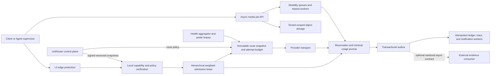

# PRD6 Batch 0B Scalability And Anti-Pattern Audit

> Date: 2026-07-11
> Repository baseline: `d5a5249cc0337330f8ee9c547cdf3913b1efa29b`
> Evidence level: source verified, focused-test verified, and documentation CI
> verified by Draft PR #139 through final evidence head `6c8c192`; no remediation, 100x, target, or
> production capacity claim
> Scope: UniRouter only. External observability products are boundary consumers,
> not PRD6 feature owners or request-path dependencies.

## 1. Executive Verdict

UniRouter is not simply a static point-to-point proxy. It already has routing,
failover, Redis rate limiting, process admission, billing reservations, traces,
provider adapters, and streaming support. The principal 100x risk is that these
functions currently share the synchronous request path and mutable PostgreSQL
rows.

The highest-risk failure chain is:

```text
Agent fan-out
  -> one PostgreSQL authentication lookup per invocation
  -> more governance and route queries
  -> one transaction plus a second pooled price query per reservation
  -> one organization wallet row locked by every invocation
  -> several synchronous trace/log/ledger writes
  -> per-request notification goroutines and budget scans
```

Adding gateway replicas does not remove these bottlenecks. Some limits multiply
per replica, while the database, wallet row, Redis hot key, and upstream channel
remain shared.

This audit also found source-confirmed P0 security and financial correctness
risks. They are not evidence of a production incident, because no production
execution was performed. They must nevertheless precede a 100x claim or broad
Agent capability rollout.

## 2. Evidence Discipline

### 2.1 Confirmed Findings

Confirmed means the behavior or missing invariant is directly visible in the
current source/schema and, where practical, the affected packages passed focused
tests on the exact baseline. It does not mean the failure was reproduced on a
production topology.

Focused read-only verification passed:

```text
go test ./internal/auth ./internal/middleware ./internal/admin ./internal/billing -count=1
go test ./internal/gateway ./internal/middleware ./internal/billing ./internal/circuitbreaker -count=1
go test -race ./internal/gateway ./internal/middleware ./internal/circuitbreaker -count=1
```

The race result covers in-process tests. It does not prove PostgreSQL, Redis, or
multi-replica state-machine safety.

### 2.2 Hypotheses

- The first component to saturate at 100x is unknown. It depends on admitted RPS,
  tenant skew, stream duration, upstream latency, channel/key count, replicas,
  and actual PostgreSQL/Redis topology.
- The current per-organization concurrency of ten may be an intentional safety
  default. Its process-local and unweighted semantics are confirmed; whether the
  product should admit 100 same-tenant Agents concurrently is a product choice.
- Kafka, NATS JetStream, Redis Streams, or a PostgreSQL outbox cannot be selected
  from source inspection alone. Required loss, ordering, replay, latency, and
  operating constraints are not yet accepted.
- The frequency of SSE events larger than 64 KiB and the future distribution of
  image/video payload sizes are not measured.

### 2.3 New Requirements, Not Current Capabilities

The following are proposals produced by this audit and must not be described as
implemented:

- short-lived, attenuating Agent capability tokens;
- hierarchical Agent/workflow/project/organization budgets;
- versioned local auth, policy, and routing snapshots with bounded staleness;
- distributed weighted admission leases;
- circuit epochs, compare-and-swap transitions, and bounded probe leases;
- durable settlement-pending and transactional outbox processing;
- per-shard credit/escrow leases for a measured wallet hotspot;
- an asynchronous multimodal/video job plane.

## 3. Four Quadrants

| Quadrant | Current classification | Consequence |
|----------|------------------------|-------------|
| Known Knowns | Every gateway invocation authenticates through PostgreSQL; admission is process-local; rate limit is a shared Redis sliding window; routing/circuit state and billing are PostgreSQL-backed; traces are synchronously inserted; streams have a 120-second server write timeout and a 64-KiB Scanner limit | These are source facts and define the first redesign boundaries |
| Known Unknowns | Real baseline/100x load model, tenant skew, Agent depth/fan-out, stream duration, replica topology, Redis mode, DB IOPS, revocation SLO, acceptable audit lag, allowed quota grace, video roadmap | No credible RPS or production-HA claim can be made until these are selected and measured |
| Unknown Knowns | Existing project/key ownership, trace/span/session fields, adapter boundary, Redis Lua atomicity, PostgreSQL transactions, settlement retry helper, and sanitized evidence hashes are useful building blocks | PRD6 does not require a wholesale IAM, gateway, or observability rewrite |
| Unknown Unknowns | synchronized token refresh after a supervisor restart, stale circuit successes reopening a failed channel, retry amplification across Agent branches, control-snapshot split brain, slow-client socket pressure, provider usage-schema drift, duplicate/reordered outbox events | Design must include epochs, jitter, bounded retries, idempotency, leases, replay, and fault injection rather than assume happy paths |

## 4. Confirmed P0 Findings

### P6-AP-01: Organization-Admin Operations Are Not Consistently Tenant Scoped

`AdminAuth` injects the JWT organization and role but does not enforce target
object ownership (`internal/middleware/auth.go:291-315`). The route helper grants
an organization administrator by role (`cmd/uniroute/main.go:222-230`). Project
helpers then return true for any organization administrator without comparing
the target organization (`internal/admin/rbac_helpers.go:24-72`). Key and user
handlers include global listings and ID-based operations without a consistent
`target.org_id = actor.org_id` predicate (`internal/admin/key_handlers.go:18-60`,
`100-225`, `480-558`; `internal/admin/user_handlers.go:14-24`, `94-168`).

Impact: an organization administrator can reach objects outside the claimed
tenant on affected endpoints. This is a multi-tenant release blocker, independent
of 100x load.

Required change:

- require tenant predicates for every non-platform-admin object operation;
- centralize tenant-aware repositories/authorization and add PostgreSQL RLS as a
  defense-in-depth option;
- cover every handler with same-tenant success, cross-tenant 403, and explicit
  platform-admin exception tests.

### P6-AP-02: Client Correlation ID Is Also the Global Financial Idempotency ID

The gateway accepts `X-Request-ID` from the client unchanged
(`internal/middleware/auth.go:255-266`). The billing table uses `request_id` as a
global primary key (`migrations/000001_init_schema.up.sql:245-254`); migration
`000006` adds `org_id` but does not change that key. Freeze, lookup, Settle, and
Cancel find a reservation only by request ID
(`internal/billing/billing.go:142-209`, `227-232`, `249-291`, `316-349`).

Impact: two tenants, retries, or Agent descendants that reuse a correlation ID
can collide in financial state. A child trace ID is not a safe charge identity.

Required change:

- generate an unoverrideable server `operation_id` such as UUIDv7;
- keep `client_request_id`, `trace_id`, `span_id`, and financial idempotency as
  separate fields;
- scope client idempotency by organization/key and bind it to a request-body
  fingerprint;
- require every child invocation to have a unique operation ID and a parent
  trace/span relationship.

Acceptance: 100 descendants may share one trace but settle exactly once each;
same tenant/key/idempotency plus same fingerprint replays safely; a different
fingerprint returns 409; cross-tenant values never collide.

### P6-AP-03: Billing Freeze Can Exhaust Its Own Connection Pool

`Freeze` begins a PostgreSQL transaction first and then calls
`EstimateFreezeAmount` (`internal/billing/billing.go:129-139`). The production
price provider performs another query through the same pool
(`internal/billing/price_provider.go:19-45`). The default pool has 25 connections
(`internal/config/config.go:212-214`).

At approximately pool-size concurrent freezes, every request can hold a
transaction connection while waiting for an additional price-query connection.
This is a source-confirmed pool re-entry condition; the precise timeout requires
a live-pool concurrency test.

Required change: perform the versioned price lookup before `Begin`, or use the
same transaction connection. The reservation must record the effective price and
organization multiplier version so reserve and settle semantics cannot drift.

Acceptance: barrier tests at pool sizes 2, 5, and 25 with at least two times the
pool concurrency must finish under a hard deadline without idle transactions or
pool starvation.

### P6-AP-04: Financial Terminal States Are Not Mutually Exclusive

Settle reads the frozen row without locking it and later updates the wallet and
status (`internal/billing/billing.go:249-291`). Cancel follows the same read-then-
write pattern (`internal/billing/billing.go:316-349`). The transaction ledger does
not have a unique terminal-event key for a request. Concurrent Settle/Cancel or
duplicate Settle calls can therefore race.

Required change:

- lock or atomically compare-and-swap the reservation state;
- allow only `frozen -> settled` or `frozen -> cancelled` once;
- add a unique ledger event identity and invariant checks for wallet, frozen,
  spent, and refund totals.

Acceptance: in 100 concurrent mixed Settle/Cancel attempts, exactly one terminal
transition and one ledger terminal event succeed.

### P6-AP-05: Delivered Output Can Be Made Free After a Transient Settle Failure

The relay retries settlement three times and then cancels the reservation
(`internal/gateway/relay.go:209-244`). Streaming output is already delivered
before post-stream settlement (`internal/gateway/relay.go:703-867`, `886-917`).

Impact: a transient database failure after delivery can release the frozen funds
even though provider cost and customer value already occurred.

Required change: any request that produced billable output must become durable
`settlement_pending`; it must never automatically refund solely because immediate
settlement failed. A bounded worker retries idempotently and alerts on age.

Acceptance: inject a database failure after the last provider chunk; the
reservation remains held, recovers to one settlement after restart, and never
becomes a free or double-charged request.

### P6-AP-06: Revocation Is Not a Versioned Cross-Replica Invariant

Admin JWTs contain user, organization, role, expiry, issue time, and issuer, but
no token version/epoch (`internal/auth/auth.go:103-145`). `AdminAuth` does not read
current user/organization state (`internal/middleware/auth.go:291-315`). Project
disable and user disable do not consistently invalidate all already-issued
personal/project credentials. Gateway keys do query key and organization status,
but not every owner/project status (`internal/middleware/auth.go:178-208`).

The schema permits the same username in different organizations, while login
selects `WHERE username = $1 LIMIT 1`
(`migrations/000001_init_schema.up.sql:27-36`;
`internal/admin/auth_handlers.go:35-40`). Tenant-qualified login identity is
therefore not deterministic when usernames overlap.

Impact: disabling a user, role, or project does not define a bounded all-replica
revocation SLO. Agent fan-out makes the stale authorization window much larger.

Required change: short admin access sessions, refresh-session control, and a
versioned `auth_epoch` for organization/project/root principal. Push invalidation
to replicas and retain an emergency denylist for high-risk revocation.

Acceptance: user/project/key/role revocation is enforced by every replica within
the accepted SLO; password change invalidates old sessions; cache/Redis outage
behavior follows the accepted failure strategy.

## 5. Confirmed P1 Scalability Anti-Patterns

### P6-AP-07: Authentication And Policy Are Synchronous Database Dependencies

Every gateway request hashes the key and queries PostgreSQL before admission or
Redis rate limiting (`internal/middleware/auth.go:178-269`;
`cmd/uniroute/main.go:205-215`). Model governance adds more synchronous queries.
Invalid-key storms and requests ultimately rejected for capacity still consume
database work.

Change: an unauthenticated L0 edge limiter before the database; bounded local
auth/policy snapshots with negative caching and pushed invalidation; offline
verification for short Agent capabilities. Expensive governance queries become
one versioned policy snapshot.

### P6-AP-08: Agent Identity Has No Delegation Or Ancestor Budget

Current API-key rate limits are keyed only by API key ID
(`internal/middleware/ratelimit.go:40-75`). A shared key becomes one Redis hot key
and loses child attribution. One key per child multiplies rows and independent
quotas. API keys do not provide a decreasing delegation chain, and the stored
display prefix contains only four random hexadecimal characters after the fixed
organization portion (`internal/auth/auth.go:43-54`).

Change: retain long-lived keys only at an Agent supervisor/broker. Exchange them
for 5-15 minute signed capabilities containing organization, project, root
principal, workflow, agent, parent token, maximum depth/fan-out, model/endpoint
scope, cost/token/rate/concurrency caps, expiry, unique ID, and policy version.
Delegation may only reduce authority. Refresh once per supervisor with
singleflight and random jitter; children never receive the root secret.

Trusted trace actor/delegation fields should be derived from the verified
capability rather than a caller-held shared evidence header. Trusted proxy CIDRs
must also be explicit before forwarded client IP becomes an authorization input.

### P6-AP-09: Admission Is Per Process And Counts Every Request As One Unit

The controller is an in-memory map and channel semaphore
(`internal/middleware/admission.go:8-19`, `41-93`). The main program always uses
the default 100 global/10 organization configuration
(`cmd/uniroute/main.go:83-89`; `internal/middleware/admission.go:126-129`). A
replica therefore adds another independent allowance. A 50-ms embedding and a
10-minute stream each consume one slot for their full lifetime.

Change: retain a small local overload fuse but enforce shared, lease-backed,
weighted admission by organization/project/root workflow/model/workload class.
Separate short interactive, long stream, embedding, batch, and media pools; use
bounded waiting and fair queues.

### P6-AP-10: One Organization Wallet Row Serializes All Its Invocations

Every Freeze locks `wallets[org_id] FOR UPDATE`
(`internal/billing/billing.go:151-186`), and Settle updates the same row
(`267-296`). A large Agent fleet under one enterprise remains serialized even if
gateway replicas are added.

Change in two steps:

1. First make the single-row state machine correct and remove unnecessary
   round-trips.
2. Only after measurement, lease bounded credit/escrow to a gateway shard or
   workload partition. Spend cannot exceed the lease; refill and settlement are
   idempotent; hard budget remains fail-closed near exhaustion.

### P6-AP-11: Routing Reads Mutable Control State Per Request And Probes By Percent

The route query joins channel keys, evaluates a comma-separated model list with
`LIKE`, and reads full candidates per request (`internal/gateway/router.go:33-45`,
`91-133`). Half-open traffic is a random 10 percent on every replica
(`71-73`, `116-118`), so probe traffic grows with total load. Success
unconditionally resets a channel to healthy (`136-145`), while failure uses a
separate increment and state update (`147-170`). A late success can overwrite a
newer failure epoch.

The relay marks a channel successful after response headers but before consuming
and validating its body or stream (`internal/gateway/relay.go:487-497`). A
truncated or malformed HTTP 200 can therefore be classified as healthy.

`RouteAll` gives concurrent requests the same ordered candidate snapshot and the
relay tries candidates sequentially (`internal/gateway/relay.go:379-404`). This
can stampede the first key and multiply upstream attempts during an outage.

Change: normalize channel/model relations; distribute an immutable versioned
route snapshot; aggregate health separately; use state epochs and CAS; grant at
most K probe leases per channel/window; reserve key capacity before dispatch;
enforce a chain/request retry budget.

### P6-AP-12: The Redis Limiter Is Atomic But Still A Hot Event Log

PR #139 made the two windows atomic. Each request still removes old members,
counts, adds one member to each sorted set, and refreshes TTL
(`internal/middleware/ratelimit.go:17-38`, `63-75`). One shared Agent key
serializes work on one Redis hot key and stores O(events/window) members. The two
keys lack a shared Redis Cluster hash tag, and every Redis error currently allows
the request (`76-80`). The configured client is a single endpoint with a default
pool of ten (`internal/redisx/redis.go:16-35`;
`internal/config/config.go:216-219`).

Change: version the key schema, use cluster-compatible hash tags, and benchmark a
fixed-state GCRA/token bucket or bounded bucket counters. Make errors observable
and apply the accepted policy-specific failure posture.

### P6-AP-13: Evidence And Notifications Can Self-DDoS The Primary Database

Trace recording performs a synchronous insert for each event
(`internal/gateway/trace.go:74-193`), and trace sampling defaults to all events
(`internal/config/config.go:232-234`). Call-log insertion is also synchronous and
then emits another synchronous trace (`internal/gateway/relay.go:1009-1082`).
Every completed request can start unbounded budget-check goroutines
(`1436-1451`), and project checks scan period usage.

At high throughput, the evidence intended to explain an outage can contribute to
the outage.

Change: financial reservation/terminal state remains strongly consistent. A
minimal decision/usage envelope is committed transactionally to a durable
outbox. Bounded workers batch trace, call-log, notification, and webhook work.
Error/financial evidence gets priority; ordinary information traces can be
deterministically sampled. Incremental spend counters replace per-request period
scans.

### P6-AP-14: Streaming Couples Socket Lifetime, Balance Polling, Billing, And Audit

The HTTP server configures a 120-second write timeout while the upstream client
permits 300 seconds (`cmd/uniroute/main.go:494-502`;
`internal/gateway/relay.go:391`). This is a confirmed timeout-policy conflict;
the exact truncation point by HTTP protocol requires integration evidence. Each
stream starts balance and heartbeat
goroutines (`631-686`), polls the wallet every 30 seconds and every 100 output
tokens (`631-660`, `768-782`, `852-866`), and uses a Scanner with a 64-KiB event
limit without handling `scanner.Err()` (`688-703`, `867-990`). The balance query
does not account for the request's already-reserved funds, so concurrent valid
streams can terminate each other after reservations reduce available balance.

Main-loop flushes may occur outside the same lock used by the heartbeat writer,
and final log/trace writes use the client request context; a disconnect can lose
non-financial evidence even though settlement uses a background context.

Change: one writer goroutine with a bounded queue and backpressure; a real SSE
parser with explicit frame limits and errors; request-reservation-aware usage
leases; idle and maximum-duration policies instead of a conflicting absolute
write timeout; server-owned finalization context; durable final usage/outbox.

Acceptance includes 64 KiB+1 and 1 MiB frames, slow clients, ten-minute streams,
disconnect cancellation, DB/Redis failure after the last chunk, and exactly-one
terminal financial state.

### P6-AP-15: Retention Uses Large Deletes And Every Replica Can Run Workers

Cleanup issues unbounded deletes on call logs, audit logs, transactions, and
trace events (`internal/admin/audit_handlers.go:263-300`). At 100x retention
volume this causes WAL, bloat, lock, and replica-lag risk. Multi-instance retry
and cleanup loops also need explicit claim/leader semantics.

Change: time partition high-volume evidence; drop expired partitions; use bounded
deletes during migration; claim work with a lease, advisory lock, or queue
consumer group.

## 6. Three Non-Obvious Future Blind Spots

### 6.1 The Unit Of Capacity Is Work, Not Requests

The current unit is one HTTP request. Future inputs have radically different
costs: embedding, short chat, reasoning stream, tool loop, image, and video.
Counting each as one creates head-of-line blocking and lets long work starve short
work.

Architecture response: define a `workload envelope` before admission with
modality, reserved tokens/cost, expected duration, stream/batch class, workflow
root, deadline, and cancelability. Use weighted permits, per-class fair queues,
and separate worker/connection pools. This belongs in the MVP contract even if
video execution remains advanced.

### 6.2 Identity Cardinality Becomes A Financial Consistency Problem

Agent identity is not only authentication. It determines idempotency, ancestor
budget, audit causality, revocation, and retry ownership. Shared keys collapse
identity; per-child keys multiply secrets and quotas.

Architecture response: capability-based delegation plus distinct operation,
idempotency, trace, span, workflow, and agent identities. Ancestor budgets are
reserved once and attenuated down the tree. UniRouter validates and enforces the
envelope; it does not schedule or own the Agent DAG.

### 6.3 Observability Can Become A Second Synchronous Product

At 100x, writing every trace stage to the primary database is another workload
with more writes than the customer request itself. A slow evidence database then
slows the service it is observing.

Architecture response: transactional outbox plus bounded, prioritized consumers.
Financial and authorization decisions are durable before acknowledgement;
verbose traces are asynchronous, replayable, sampled, and backpressure-isolated.
An external investigation system may consume the sanitized versioned contract,
but it cannot be required for request success or UniRouter correctness.

### 6.4 Failure Feedback Multiplies Across A Tree

If A Agents each receive R routes and independently retry, one provider outage can
create approximately A x R upstream attempts plus health updates. Percent-based
half-open sampling grows with traffic, so recovery traffic can recreate the
outage.

Architecture response: a retry budget shared by the workflow, route attempt
leases, circuit epochs, bounded probes, and a health aggregator. A child cannot
mint a new full retry budget.

### 6.5 Large Media Must Not Be A Chat JSON Variant

The request model accepts string content only
(`internal/gateway/relay.go:247-259`), adapter capabilities cover Chat and
Embeddings, and the request path reads and transforms whole JSON bodies. Passing
large base64 image/video content through the synchronous gateway multiplies
memory copies and ties storage lifetime to a socket.

Architecture response: small multimodal chat content uses a bounded typed union
and signed object references. Video and long media use `POST job -> 202 job_id`,
tenant-scoped object storage, a modality queue, leased workers, status/cancel,
idempotent completion, retention, and final usage settlement. This is an advanced
job plane, not an MVP video implementation promise.

## 7. Recommended Target Boundaries



Ownership boundary:

- UniRouter owns request identity, authorization, admission, routing, dispatch,
  reservation, usage normalization, billing truth, gateway audit creation, and
  the local/operator status needed to run those functions.
- An external system may consume sanitized, versioned evidence asynchronously.
  It does not decide authorization/routing/billing, does not block the request
  path, and is not a PRD6 feature dependency.
- Agent orchestration owns DAG scheduling, child lifecycle, tool planning, and
  workflow checkpoints. UniRouter owns capability validation, ancestor budgets,
  deadlines, attempt limits, and per-invocation evidence.

## 8. Recommended Failure Strategy In Plain Terms

| Door | When dependency state is uncertain | Why |
|------|------------------------------------|-----|
| Identity, tenant boundary, capability signature, or hard budget | Fail closed: do not call the provider | An unverified customer or budget can leak data or spend another tenant's money |
| A safety rule explicitly configured as mandatory blocking | Fail closed for that policy | A detector outage must not silently disable a contractual block |
| Optional audit-only classifier or analytics | Continue only if a minimal durable degraded event/outbox record can be made | The customer request need not fail because optional analysis is slow, but the gap must be visible and replayable |
| Rate/capacity store unavailable | Use only a small, time- and amount-bounded last-known-safe lease, then reject with `Retry-After` | Unlimited fail-open creates runaway cost; immediate universal fail-closed turns a short Redis fault into a total outage |
| Route control plane unavailable | Use a signed last-known-good snapshot until its TTL expires; then return 503 | Existing safe routes may continue briefly, but stale configuration must not live forever |
| Financial finalization delayed after billable output | Keep `settlement_pending` and retry; never auto-refund merely because immediate settle failed | The provider cost already occurred |

This is a hybrid strategy by policy class. “Always open” is cheaper to keep
available but unsafe for money, identity, and mandatory policy. “Always closed”
is safe but allows one Redis or optional-detector fault to stop every customer.

## 9. Updated Priority Matrix

| Tier | Recommended contents | Explicit exclusions |
|------|----------------------|---------------------|
| MVP / P0 foundation | tenant isolation; server operation/idempotency separation; terminal billing CAS; settlement-pending; Freeze pool re-entry fix; revocation semantics; existing retry/config/multiplier correctness | no deployment, IAM rewrite, public commerce, or external investigation features |
| MVP / P1 scale core | short Agent capability and ancestor budgets; shared weighted admission; route epochs/probe leases/bounded attempts; reservation-aware stream finalization; durable minimal usage/outbox; cache-aware billing; Guardrail/stream hook foundation | no semantic response cache, adaptive Scheduler V2, or full media job implementation |
| Advanced / P2 | measured credit/escrow sharding; async image/video job plane; evidence partitioning; selected secret backend; exact response cache; adaptive routing after trustworthy telemetry | each item needs a separate design and acceptance row |
| Long-tail / P3 | multi-region active-active ledger/policy plane; macaroons or a full external STS; public SDK suite; plugin marketplace; global SLA/IaC product | deferred unless a concrete customer/topology requires it |

Accepting the recommended MVP means authorizing repository design and
implementation PRs for the P0 foundation and P1 scale core. It does not authorize
deployment, paid provider calls, credentials, target mutation, data export, or
every competitor feature.

## 10. Executable Batches And Acceptance Evidence

1. **Batch 0B — Tenant and financial identity integrity.** Fix P6-AP-01 through
   P6-AP-06 in reviewable PRs. Prove tenant-negative tests, operation/idempotency
   isolation, terminal-state concurrency, post-delivery failure recovery, and
   pool-starvation barriers.
2. **Batch 0C — Existing gateway correctness.** Retry classification, Embeddings
   parity, effective configuration, multiplier freeze correctness, Scanner errors,
   response-body lifecycle, and stream writer serialization.
3. **Batch 1 — Agent capability and distributed policy.** Freeze the token claims,
   delegation attenuation, hierarchy, weighted admission, Redis failure posture,
   revocation SLO, and multi-instance test harness before implementation.
4. **Batch 2 — Routing Policy V1.** Add normalized route snapshots, bounded retry,
   state epochs, CAS, probe leases, key capacity, and Chat/Embeddings parity.
5. **Batch 3 — Usage, settlement, and evidence durability.** Add reservation-aware
   streaming, `settlement_pending`, minimal transactional outbox, bounded workers,
   incremental budget alerts, and cache-aware provider usage.
6. **Batch 4/5 — Guardrail then streaming interception.** Preserve the accepted
   failure classes, bound pre-flush disclosure, and prove cancel/settle behavior.
7. **Batch 6 — One separately accepted advanced capability.** The asynchronous
   media job plane is the recommended choice only if image/video is a near-term
   product requirement.
8. **Capacity gate.** Define the current admitted 2xx baseline and a workload
   mix. A 100x test must measure admitted RPS, p95/p99, DB/Redis pool wait, locks,
   Redis memory/latency, goroutines, sockets, upstream amplification, ledger
   invariants, trace lag, and failure recovery. The current k6 scenario uses only
   10 virtual users/50 peak RPS and treats 429 as successful
   (`infra/loadtest/k6-chat-completions.js:10-35`, `68-75`); it is smoke/policy
   input, not 100x capacity evidence.

## 11. Minimum User Decisions

Only two decisions are required to continue safely:

1. Accept or edit the updated MVP boundary in Section 9, including the P0 tenant
   and financial integrity foundation and the P1 Agent/scale core.
2. Accept or edit the policy-specific failure strategy in Section 8.

The exact 100x workload, revocation SLO, capability TTL, queue technology, and
whether the media job plane enters P2 can be fixed during their design batches;
they do not need to block the two current decisions.
