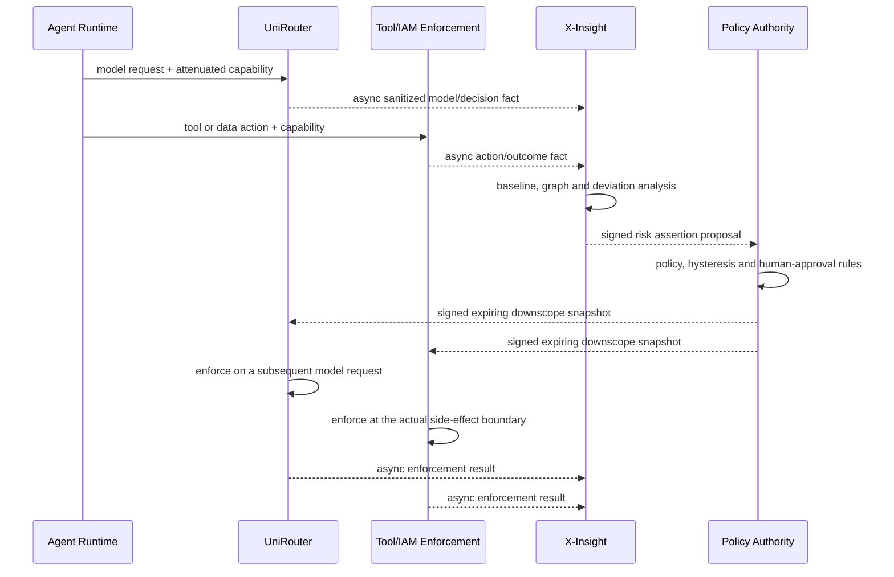
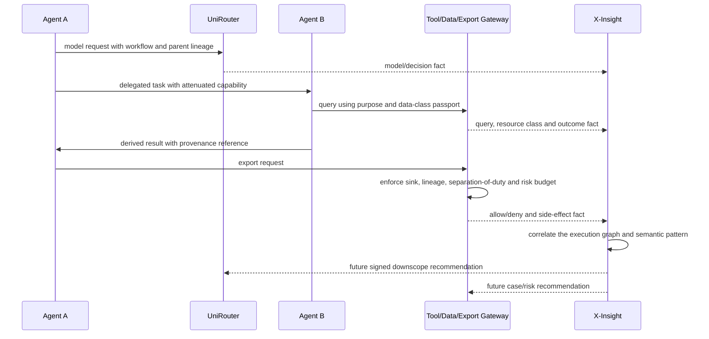

# PRD6 Adaptive Trust And MaaS Innovation Audit

> Date: 2026-07-11
> Status: research complete; boundary recommendation proposed; new P2/P3 rows are not accepted implementation scope
> UniRouter source baseline: `6c8c192d8610662e4c1a4f852ec15d6fb4bb836f`
> X-Insight source baseline: `e43add8e0184ba1eb059484053bc5e9d9f4cf6ed`

## 1. Executive Conclusion

UniRouter should not become a second observability product, and X-Insight should
not become a synchronous authorization dependency. The defensible product split
is a **dual-speed evidence-to-control loop**:

- UniRouter is the real-time policy-enforcement point for model requests,
  provider routing, budgets, output delivery, and gateway-owned evidence.
- A Tool Gateway, IAM service, data proxy, or export service is the real-time
  enforcement point for the side effect it actually owns. UniRouter cannot
  honestly claim to stop a database export it never receives.
- X-Insight is the asynchronous or near-real-time evidence, investigation,
  graph, drift, evaluation, and risk-recommendation plane. It may enforce access
  to its own UI and APIs, but it must not sit on UniRouter's request hot path.
- A future model-training or lifecycle service owns fine-tuning jobs, artifacts,
  model registration, and promotion. Neither the gateway nor the investigation
  store should quietly acquire that responsibility.

The recommended flagship is not one detector. It is an **Evidence-to-Control
Flywheel** combining attenuating Agent capabilities, locally enforced signed
policy, verifiable decision receipts, failure-to-evaluation workflows, and
risk-adjusted routing. This can exceed ordinary API gateways without pretending
that semantic detectors can prove truth or intent.

## 2. Evidence Classes

### 2.1 Confirmed Findings

1. UniRouter's live model request order is API-key authentication, process-local
   admission, Redis rate limiting, model governance, relay parsing, billing
   freeze, routing, provider dispatch, response handling, settlement, and
   evidence. The middleware order is visible in
   `cmd/uniroute/main.go:205-215`; gateway normalization is in
   `cmd/uniroute/gateway_handlers.go:39-114`.
2. UniRouter currently exposes Chat, Embeddings, and Models gateway routes. It
   has no general Tool Gateway or Agent Runtime, so it cannot observe every MCP,
   database, SaaS, file, or export action.
3. The current content check scans Chat `messages[].content` strings before
   billing freeze (`internal/gateway/relay.go:289-348`). It does not establish a
   complete semantic, multimodal, tool-argument, or streaming security boundary.
4. Anthropic streaming is normalized before client write, but the
   OpenAI-compatible fallback can flush before semantic parsing
   (`internal/gateway/relay.go:718-835`). Reliable cross-provider stream
   interception therefore does not exist yet.
5. UniRouter already records trace/session/actor/on-behalf-of fields, policy
   decisions, usage, and capture gaps. The trusted evidence context uses one
   shared secret and lacks capability-token properties such as audience,
   expiry, unique token ID, subject epoch, and monotonic delegation
   (`internal/traceutil/evidence_context.go:10-75`).
6. X-Insight Phase 1 currently supports controlled sanitized snapshot import,
   validation, hash/idempotency, persistence, readback, capture gaps, and a
   sidecar receipt. It does not currently implement continuous ingestion,
   tenant/RBAC, trust scoring, policy publication, shadow evaluation,
   fine-tuning orchestration, or semantic collusion analysis.
7. The accepted cross-project v1 contract remains operator-mediated
   `xinsight.import-receipt.v1`. No current evidence supports putting X-Insight
   in UniRouter's synchronous request path.

### 2.2 Architecture Hypotheses To Validate

- A signed, short-lived risk assertion can be verified locally within the
  request-path latency budget. This is proposed, not measured.
- Metadata-first lineage can detect useful collusion/cascade patterns before
  customers opt into content-level analysis. Its precision is unknown.
- Historical failures can become representative evaluation cases without
  leaking restricted content or amplifying data poisoning. This requires a
  provenance and approval experiment.
- Risk-adjusted routing will improve safety-adjusted task success enough to
  justify added policy complexity. No production workload evidence exists yet.

### 2.3 User-Introduced PRD6 Candidate Requirements

- CARTA-style continuous adaptive trust assessment.
- Automated shadow testing and weakness evaluation from evidenced failures.
- Cross-Agent semantic collusion and policy-bypass analysis.
- Additional disruptive MaaS capabilities with explicit ownership and
  acceptance evidence.

These are candidate inputs. They do not become accepted merely because D6-01
and D6-02 were accepted.

## 3. Boundary Decision Standard

Use the following questions in order. The first component that owns the
irreversible side effect is the final enforcement point.

| Test | Real-time UniRouter or action owner | X-Insight |
|------|-------------------------------------|-----------|
| What can be stopped now? | A model dispatch, route, budget reservation, stream flush, tool call, write, or export owned by that component | Only X-Insight's own read/write/UI action |
| What evidence is sufficient? | Current request, authenticated identity, local policy snapshot, capability, bounded local state | Cross-request/Agent/system history, graph, drift, clustering, human labels |
| What latency is allowed? | Deterministic bounded latency; no remote investigation dependency | Seconds to hours, replay and recomputation allowed |
| What happens during outage? | Mandatory local controls remain enforceable; no privilege increase | Analysis may lag and must emit an observable gap |
| Who states facts? | Each source emits authoritative facts about its own action | Aggregates facts and produces derived assessments |
| Who grants authority? | The policy authority and the component owning the action | Produces recommendations or risk assertions, not universal grants |
| Can the decision be undone? | Block, downscope, cancel before delivery, or require approval | Recommend later revocation, quarantine, rollback, or policy change |

This produces five durable principles:

1. **Complete mediation at the sink.** A semantic warning is not enforcement
   unless the component controlling the provider, tool, database, file, or
   export checks it before the side effect.
2. **Facts, inference, and decisions remain separate.** UniRouter and tool
   systems emit observed facts; X-Insight derives risk; the action owner makes
   and records the final allow/deny/degrade/approval decision.
3. **No synchronous X-Insight dependency.** Future rules may be compiled into a
   signed, versioned, expiring local bundle or risk assertion. UniRouter never
   waits for a central X-Insight query on each request.
4. **Risk may attenuate, never elevate.** A X-Insight risk assertion may reduce
   an existing permission. It cannot create a model, data, tool, budget, or
   export permission the subject did not already possess.
5. **Uncertainty is visible.** Missing events, expired assertions, detector
   errors, classifier disagreement, and unsupported modalities are recorded as
   gaps. They are not converted into a false `safe` result.

## 4. Four Quadrants

### Known Knowns

- The current products have a useful evidence spine but no production-grade
  real-time cross-project policy channel.
- UniRouter can enforce only actions that pass through its gateway.
- Cross-request baselines, drift, failure clustering, and Agent graphs belong
  outside the request hot path.
- Prompt-injection filtering cannot be treated as a perfect authorization
  boundary. Least privilege and source-to-sink constraints remain necessary.
- D6-01 accepts the recommended MVP foundation; D6-02 accepts policy-specific
  failure behavior. Neither decision authorizes deployment, real/paid shadow
  traffic, raw-payload expansion, or a new cross-project runtime contract.

### Known Unknowns

- Acceptable risk-signal delay, TTL, revocation SLO, and out-of-order window.
- False-positive budgets for automatic downscope versus human review.
- Which customers permit content-level analysis rather than metadata/hash only.
- Representative workload, quality labels, and budget for shadow evaluation.
- Whether downstream Agent runtimes can propagate non-forgeable delegation and
  data-lineage fields.
- The latency and accuracy envelope of any local semantic classifier.

### Unknown Knowns

- Existing trace, session, actor, on-behalf-of, decision, usage, provenance,
  capture-gap, and idempotent evidence structures can bootstrap a metadata-only
  flight recorder. A replacement telemetry model is unnecessary for the first
  iteration.
- Current model capability tags and data-residency fields can become routing
  constraints after their semantics and acceptance tests are defined.
- Existing local DFA filtering is suitable as a deterministic first stage; it
  is not proof of semantic protection.
- The sidecar receipt and hash discipline show how to distinguish a verifiable
  statement from an unverified claim, even though the v1 receipt is not an
  authenticated online control channel.

### Unknown Unknowns

- Adaptive attackers may split one prohibited goal across many benign-looking
  calls, identities, models, or modalities.
- A compromised event emitter may forge low-risk telemetry; the current sidecar
  receipt does not authenticate an online producer.
- Risk-score feedback can oscillate, creating retry, refresh, identity-switch,
  or revocation storms.
- A common classifier or grader can fail in a correlated way across routing,
  evaluation, and promotion.
- Production failure cases may contain poisoned or privacy-restricted examples,
  causing an automated training loop to install attacker-selected behavior.
- Fine-grained semantic fingerprints may enable re-identification even when raw
  prompts are not stored.

Controls for this quadrant include source authentication, monotonic epochs,
short expiry, hysteresis, bounded retries, local revocation caches, out-of-order
watermarks, explicit capture gaps, independent red-team sets, human override,
and default metadata minimization.

## 5. Innovation A — Continuous Adaptive Trust Assessment

### Ownership

| Responsibility | Owner |
|----------------|-------|
| Tool/model/data/action facts | UniRouter and each Tool Gateway/data/export execution point |
| Historical baseline, deviation, graph risk, explanation | X-Insight |
| UniRouter model/budget/concurrency downscope | UniRouter local enforcement |
| Tool/data/export permission downscope | IAM or the Tool Gateway/data/export service |
| X-Insight UI/API access | X-Insight's own future RBAC |

### Proposed Sequence



An advisory risk assertion should identify issuer/key, audience, tenant/project, actor,
subject epoch, trust tier, reason codes, observation cutoff, issued/not-before/
expiry times, unique ID, policy version, and evidence references. It may only
remove authority. An invalid, wrong-audience/tenant, replayed, or stale advisory
assertion is rejected and recorded as a gap; ordinary model access then uses an
unexpired last-known-safe policy or the static UniRouter baseline. Only an
action explicitly configured to require fresh risk proof fails closed after the
proof expires. Invalid capability, baseline authorization, tenant boundary, or
mandatory policy always fails closed.

To avoid punishment loops, start with `observe -> restrict write/export ->
require approval -> quarantine`, with minimum dwell times and manual override.
Do not let one anomaly score automatically revoke unrelated privileges.

## 6. Innovation B — Automated Shadow Testing And Weakness Evaluation

### Ownership

- X-Insight owns failure clustering, provenance, privacy classification,
  evaluation-set manifests, experiment comparison, and recommendations.
- UniRouter owns authorized live traffic sampling and shadow provider dispatch,
  because it holds routing, credential, budget, rate, and data-residency context.
- A dedicated offline evaluation runner may replay fixtures with no external
  side effects.
- A separate model-lifecycle/training system owns fine-tuning jobs, artifacts,
  registries, and promotion candidates.
- A human or explicitly authorized promotion policy owns production activation.

### Proposed Sequence

```mermaid
sequenceDiagram
    participant U as UniRouter
    participant X as X-Insight
    participant E as Eval/Training Service
    participant H as Human/Promotion Gate
    U-->>X: sanitized failure evidence
    X->>X: deduplicate, classify, license and approve cases
    X->>E: versioned evaluation manifest
    E-->>X: candidate model/guardrail results
    X-->>U: signed shadow experiment manifest
    U->>U: enforce tenant, budget, residency and sampling limits
    U->>U: primary request
    U->>U: optional authorized shadow request; never return shadow output
    U-->>X: paired primary/shadow evidence
    X->>X: compare safety, quality, cost and latency
    X-->>H: evidence-backed promotion recommendation
    H-->>U: approved versioned routing change
```

The safe first slice is fixture/offline **Policy Digital Twin**, not live shadow
traffic and not automatic fine-tuning. Live shadowing is separately gated
because it can double cost, transmit customer data to a second provider, and
create additional retention. Raw production failures must never flow directly
into fine-tuning; poisoning, consent, licensing, and privacy review are explicit
gates.

## 7. Innovation C — Semantic Collusion And Cascade Audit

### Ownership

- X-Insight owns cross-Agent/cross-session graph construction, semantic
  clustering, anomaly scoring, explanations, and investigation cases.
- UniRouter propagates authenticated workflow/Agent/delegation identity and
  enforces model/budget/output rules on requests it sees.
- Tool, database, file, and export execution points propagate data class and
  side-effect facts and enforce the final sink-bound permission.
- IAM/approval owns time-bound grants, separation of duties, and high-impact
  approval.

### Proposed Sequence



The first version should use identity, delegation, resource class, action,
side-effect, purpose, and provenance metadata. With raw payload disabled, it
cannot claim complete semantic detection. Collusion similarity must begin in
shadow/alert mode because collaboration and malicious coordination can look
alike. High-confidence findings may later shrink capabilities or require
approval, but a score alone must not become an irreversible sanction.

## 8. Killer Feature Portfolio

| Tier | Feature | Customer pain solved | Boundary | Scope disposition |
|------|---------|----------------------|----------|-------------------|
| MVP foundation | Agent Trust Firewall | Root keys and per-child quotas amplify blast radius | UniRouter capability exchange and ancestor budget; Tool/IAM enforces its own actions | Accepted through D6-01 / P6-F19, detailed design still gated by batch review |
| MVP foundation | Dual-Speed Safety Plane | Deep safety analysis either adds latency or arrives too late | Small local enforcement kernel plus bounded async evidence workers | Accepted through P6-F10/F11/F20; X-Insight is not a request dependency |
| MVP foundation | Policy Decision Receipt | Operators cannot prove which policy/model/price governed a request | UniRouter records operation, capability/policy version, route, usage, cost and payload mode | Minimal evidence accepted; cryptographic public receipt remains P2 |
| P2 | Governance Digital Twin / Failure-to-Eval | Model and policy changes make customers the test environment | X-Insight prepares evidence-backed fixtures; isolated runner compares versions | Proposed; offline/fixture slice recommended first |
| P2 | Adaptive Capability Passport | Long-lived Agent authority ignores changing risk | X-Insight recommends risk; UniRouter/Tool/IAM enforce signed downscope | Proposed |
| P2 | Semantic Data-Lineage Passport | Agents can paraphrase restricted data across boundaries | Source systems label data class/purpose; sinks verify allowed destination and transform | Proposed; requires Tool/data owners |
| P2 | Risk-Adjusted Routing | Price/latency-only routing sends high-risk work to unsuitable paths | X-Insight calibrates scorecard; UniRouter applies local route constraints | Proposed after Routing Policy V1 |
| P2 | Claim Assurance Router | High-stakes outputs lack evidence or calibrated abstention | UniRouter selects verifier/evidence-required path; X-Insight calibrates observed failure | Proposed; never market as a truth detector |
| P2 | Verifiable MaaS Trust Receipt | Logs are mutable assertions customers cannot independently verify | UniRouter signs a bounded receipt; external systems may verify asynchronously | Proposed |
| P2/P3 | Action Escrow | High-impact exports/writes are irreversible before review | Tool/export owner holds the action pending second signal or human approval | External/action-owner feature; UniRouter only carries context |
| P3 research | Collusion And Cascade Radar | Multi-Agent workflows split policy bypass across benign-looking steps | X-Insight graph/semantic analysis; execution points enforce later decisions | Shadow-only candidate |
| P3 research | Multimodal Content Passport | Image/audio/video provenance and policy history are opaque | Media job plane validates/emits signed provenance metadata | Separate media-roadmap decision |
| P3 deferred | Automated Fine-Tuning Loop | Teams want production failures to improve weak models | X-Insight proposes cases; external lifecycle service trains; human promotes | Reject fully automatic raw-case loop |

The most coherent differentiator is the combination:

```text
attenuating Agent authority
  + locally enforced signed policy
  + verifiable request and decision receipts
  + side-effect-free continuous evaluation
  + risk-adjusted routing and approval
```

This is stronger than adding more adapters because it gives an enterprise a
testable answer to four questions: who acted, with whose authority, under which
policy, and what actually happened.

## 9. Candidate Acceptance Rows

These rows are proposed only. They require an explicit decision before
implementation.

| ID | Candidate | Priority | Primary owner | Minimum acceptance evidence |
|----|-----------|----------|---------------|-----------------------------|
| P6-F23 | Signed, expiring, attenuation-only risk assertion and local enforcement snapshot | P2 | X-Insight signal; UniRouter/Tool/IAM enforcement | signature/audience/tenant/epoch/replay tests; outage and stale-TTL tests; no privilege increase |
| P6-F24 | Offline Governance Digital Twin and failure-to-eval manifest | P2 | X-Insight plus isolated eval runner | provenance/privacy approval; deterministic replay; false-positive/negative, quality, cost and latency diff; zero side effects |
| P6-F25 | Authorized live shadow routing | P2 | UniRouter | explicit tenant/provider/data/cost authorization; separate request IDs; paired experiment ID; shadow output never reaches client; independent settlement |
| P6-F26 | Authenticated data-lineage passport and sink-bound enforcement | P2 | UniRouter context propagation plus Tool/data sink enforcement | authenticated lineage; cross-tenant/forgery/delegation tests; metadata-only baseline; deterministic sink denial |
| P6-F27 | Verifiable MaaS trust receipt | P2 | UniRouter | canonical format; key/version/rotation; signature verification; tamper/replay tests; bounded metadata; statement-not-truth disclaimer |
| P6-F28 | Claim assurance and risk-adjusted routing | P2 | UniRouter enforcement; X-Insight calibration | domain fixtures; source-coverage/abstention metrics; route/cost/latency evidence; no unsupported truth claim |
| P6-F29 | Fine-tuning feedback workflow | P3 | External model lifecycle | data rights, poisoning screen, holdout set, reproducible artifact, human promotion and rollback |
| P6-F30 | Multimodal provenance passport | P3 | UniRouter media plane plus provenance standard owner | signed provenance validation, unknown-provenance semantics, modality conformance and retention tests |
| P6-F31 | Semantic collusion/cascade radar | P3 | X-Insight analysis; action owners enforce only a separately accepted policy | ground-truthed multi-Agent fixtures; gaps/reorder/semantic rewrites; precision/recall/abstention; no score-only hard denial |

## 10. Recommended Product Sequence

1. Complete the accepted P0 tenant, identity, and financial-integrity work. An
   adaptive trust layer on a cross-tenant or double-settlement foundation would
   magnify risk.
2. Implement the accepted P1 Agent capability, shared policy, Routing V1,
   durable finalization, Guardrail Kernel, and normalized streaming hooks.
3. Select P6-F24 as the first innovation experiment: fixture-only Governance
   Digital Twin and failure-to-eval manifest. It can measure value without paid
   calls, customer data expansion, or new production authority.
4. Add P6-F27 receipts and P6-F23 signed attenuation-only assertions after the
   identity/policy versions are stable.
5. Add P6-F25 live shadow only after explicit data/cost/provider authorization.
6. Keep P6-F31 collusion in shadow mode until measured precision and downstream
   sink coverage justify constrained enforcement.
7. Keep P6-F29 training outside UniRouter and require a human promotion gate.

## 11. Failure And Safety Contract

- Invalid capability, baseline authorization, tenant boundary, or mandatory
  policy signature/audience/epoch/replay state: fail closed; do not call the
  provider or sink.
- Invalid or expired advisory risk assertion: reject that signal, record a gap,
  and use an unexpired last-known-safe policy or the static UniRouter baseline.
  Only actions explicitly configured to require fresh risk proof fail closed
  when that proof expires.
- X-Insight unavailable: no synchronous call occurs. Use an unexpired local
  policy/risk snapshot; after expiry, fall back to UniRouter baseline for
  ordinary model access and fail closed for privileged tools/exports.
- New policy bundle invalid: retain the last-known-good unexpired version; never
  turn parse failure into an empty policy.
- Mandatory detector unavailable: fail closed. Advisory detector unavailable:
  continue only with durable degraded evidence.
- Streaming violation: drop unsent buffer, cancel upstream, terminate the
  protocol explicitly, and settle the usage already incurred.
- Missing or delayed evidence: record a capture gap; never infer `safe`.
- Shadow experiment: no client delivery and no external side effect. Real or
  paid shadowing remains separately authorization-gated.
- Fine-tuning: no direct automatic path from production failure to training or
  production promotion.

## 12. Decisions Still Needed

The minimum next product decisions are deliberately narrow:

1. Whether to adopt the Evidence-to-Control Flywheel as PRD6's post-MVP
   differentiating direction. Recommendation: yes, while keeping each P2 row
   separately accepted.
2. Which first P2 experiment to authorize. Recommendation: P6-F24 fixture-only
   Governance Digital Twin before CARTA enforcement or live shadow traffic.
3. Whether content-level analysis is ever allowed. Recommendation: metadata-only
   by default; tenant opt-in, explicit retention, purpose, and deletion controls
   before any content-level mode.

No answer is required to continue the already accepted D6-01/D6-02 P0 and P1
work. These decisions gate only the new innovation rows above.

## 13. External Research Basis

- NIST AI RMF Generative AI Profile and post-deployment monitoring guidance:
  lifecycle risk, continuous monitoring, drift, evidence quality, and human
  validation.
- NIST software and AI Agent identity concept paper: agent identification,
  authorization, accountability, non-repudiation, and prompt-injection risk.
- OWASP LLM06 Excessive Agency and LLM01 Prompt Injection: least privilege,
  complete mediation, user approval for high-impact actions, and the absence of
  a perfect prompt-injection filter.
- Google DeepMind AI Control: treat a potentially compromised Agent as an
  insider, with synchronous prevention for high-risk actions and asynchronous
  monitoring/remediation for lower-risk trajectories.
- OpenAI prompt-injection design guidance: constrain source-to-sink effects and
  require confirmation or blocking before sensitive transmission rather than
  relying on input classification alone.
- NIST GenAI evaluation, MITRE ATLAS, AgentDojo, W3C PROV, SLSA, C2PA, and SCITT
  provide evaluation, threat, provenance, and signed-statement concepts. Their
  presence does not prove a UniRouter implementation or production guarantee.
