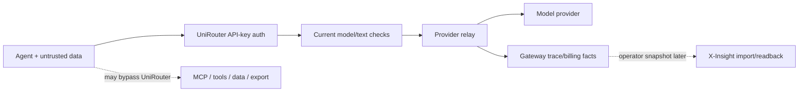
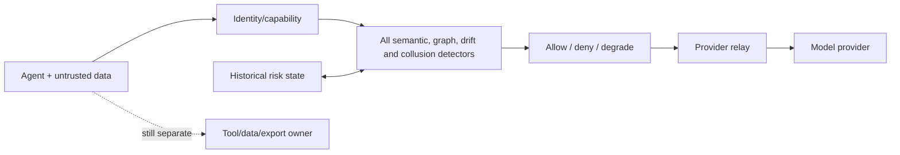
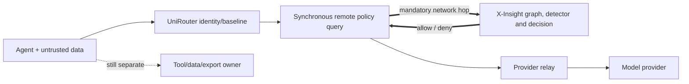
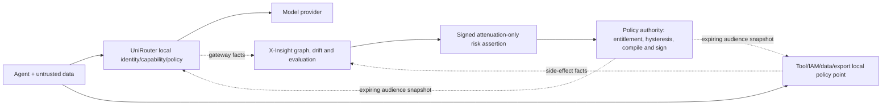

# Security Hardening Proposal: Split Adaptive Trust Analysis From Local Enforcement

## Decision

Choose where future CARTA, semantic-risk, drift, shadow-evaluation, and
collusion signals are computed, who converts them into authority, and where the
result is enforced. The decision must preserve UniRouter's request availability,
keep X-Insight's statements distinct from authorization, and mediate side
effects at the component that owns them.

This proposal does not accept a new runtime contract. It compares three design
directions so the User can select one before implementation planning:

- **Option 1 — Gateway monolith:** put analysis, state, and enforcement inside
  UniRouter.
- **Option 2 — Synchronous X-Insight decision service:** ask a central X-Insight
  policy service on each request.
- **Option 3 — Split plane with signed local enforcement:** analyze history in
  X-Insight, compile attenuation-only decisions, and enforce locally in
  UniRouter and each action owner.

## Executive Recommendation

I recommend **Option 3 — Split plane with signed local enforcement** under the
current constraints. It is the only option that keeps historical analysis out
of the hot path while preserving a truthful enforcement boundary. X-Insight
would state derived risk; a policy authority would combine that risk with
existing entitlement and sign an audience-specific, expiring downscope;
UniRouter and Tool/IAM/data services would make the final local decision for
the actions they own.

Option 1 is attractive for a small single-appliance deployment because it avoids
a cross-project protocol, but graph analysis, semantic models, and historical
state would enlarge the gateway's failure and resource surface. Option 2 gives
one central policy view and rapid rule changes, but it contradicts the accepted
availability boundary and creates a remote control-plane outage path. If future
measurements prove that all necessary analysis is deterministic, local, and
bounded, Option 1 becomes more competitive. Option 2 should win only if the
product deliberately accepts a central policy service as a hard request
dependency with a production SLA and a separately designed outage contract.

## Evidence

I inspected both code and the current contract documents. The source evidence
shows a live gateway with useful local seams, an asynchronous evidence spine,
and no component that currently mediates every Agent tool side effect. That
combination is what most strongly supports the split-plane diagnosis.

| Evidence | Finding or document | What it establishes |
| --- | --- | --- |
| `E01` | UniRouter middleware and gateway handler order (`cmd/uniroute/main.go:205-215`, `cmd/uniroute/gateway_handlers.go:39-114`) | UniRouter owns live model authentication, admission, model governance, and relay; it does not expose a general Tool Gateway route. |
| `E02` | UniRouter relay and stream paths (`internal/gateway/relay.go:289-348`, `379-440`, `516-613`, `718-835`) | Local input, route, non-stream output, and stream seams exist, but the OpenAI-compatible path can flush before parsing and is not yet a uniform enforcement hook. |
| `E03` | Evidence-context contract (`internal/traceutil/evidence_context.go:10-75`) | Current actor/delegation metadata uses a shared trust secret and lacks audience, expiry, replay, epoch, and monotonic delegation semantics. |
| `E04` | [PRD5 X-Insight runtime reconciliation](../../../ops/evidence/PRD5-XINSIGHT-runtime-contract-reconciliation-20260711.md) | The accepted cross-project contract is operator-mediated sidecar reconciliation, not a synchronous policy channel. |
| `E05` | [PRD6 scalability and anti-pattern audit](../../../ops/evidence/PRD6-B0B-scalability-antipattern-audit-20260711.md) | Cross-tenant, identity, billing, stream, revocation, and fan-out correctness must precede adaptive enforcement. |
| `E06` | X-Insight Runtime Contract Capability Status at revision `e43add8e` | Phase 1 has controlled import, persistence, idempotency, capture gaps, and request readback; it does not have continuous ingestion, tenant/RBAC, risk scoring, policy publication, or evaluation orchestration. |
| `E07` | X-Insight UniRouter Integration Boundary at revision `e43add8e` | The existing design keeps settlement, failover, and request success independent of X-Insight availability. |
| `E08` | [NIST GenAI Profile](https://doi.org/10.6028/NIST.AI.600-1), [NIST Agent Identity](https://www.nccoe.nist.gov/sites/default/files/2026-02/accelerating-the-adoption-of-software-and-ai-agent-identity-and-authorization-concept-paper.pdf), [OWASP Excessive Agency](https://genai.owasp.org/llmrisk/llm062025-excessive-agency/), [DeepMind AI Control](https://deepmind.google/blog/securing-the-future-of-ai-agents/), and [OpenAI prompt-injection design guidance](https://openai.com/index/designing-agents-to-resist-prompt-injection/) | These sources support risk-based monitoring, accountable Agent authority, least privilege, complete mediation, dual-speed control, and source-to-sink constraints. They do not prove this proposed implementation. |

The following are **observed**: the request ordering and code seams in E01-E03;
the accepted sidecar-only boundary in E04/E07; the current capability gaps in
E06; and the source defects in E05. The following is **inferred**: because
historical risk needs cross-request state while irreversible actions require
local complete mediation, the analysis boundary and enforcement boundary should
be separate. The components, token contracts, and rollout below are
**proposed**, not implemented.

## Current Design And Failure Mode

Today an Agent can call UniRouter with an API key and receive a model response.
UniRouter emits gateway facts, and an operator may later move a controlled
sanitized snapshot into X-Insight. A subsequent MCP, database, SaaS, file, or
export action can occur outside UniRouter. This architecture is honest for its
current scope, but it cannot support the claim that one central semantic layer
already governs the complete Agent trajectory.

The structural risk is authority ambiguity. If we put every detector into the
gateway, historical analysis and model inference expand the gateway's latency,
memory, state, and outage surface. If we instead ask X-Insight remotely on every
request, the investigation plane becomes a request and billing dependency. In
both cases, a tool side effect remains uncontrolled unless the actual tool or
data owner checks the decision. A third problem appears if a risk score is
treated as a grant: a compromised or mistaken analyzer could create authority
instead of merely reducing it.

These are distinct from classifier accuracy. Even a perfect detector would not
stop a side effect at a boundary it cannot mediate, and a fallible detector
must not silently turn an ordinary collaboration pattern into an irreversible
sanction.

## Desired Invariants

1. UniRouter never requires a synchronous X-Insight call to authenticate,
   route, settle, terminate a stream, or return a model response.
2. A risk assertion can only reduce authority already granted by the subject's
   baseline identity, role, capability, budget, and policy.
3. Every irreversible action is checked at the provider, Tool Gateway, IAM,
   data, write, or export boundary that owns it.
4. Observed facts, derived risk, compiled policy, and final enforcement decision
   have different issuers, schemas, versions, and evidence records.
5. Invalid signature, wrong audience/tenant, replay, rollback, expired epoch, or
   unsupported policy version cannot become an `allow` result.
6. X-Insight outage or event lag cannot increase privilege. Missing evidence is
   represented as a gap rather than inferred safety.
7. Broad automatic downscope is bounded by scope, rate, dwell time, hysteresis,
   rollback, and human override.
8. Raw content remains off by default; semantic fingerprints and embeddings are
   treated as potentially sensitive data.
9. Streaming bytes are inspected before flush when a mandatory stream policy
   applies, and incurred upstream usage still reaches one settlement outcome.
10. Every policy/risk version can be replayed against fixtures and rolled back
    without editing historical evidence.

## Constraints And Non-Goals

- The current v1 receipt sidecar remains the only accepted cross-project
  runtime contract until a separate decision accepts another contract.
- This proposal does not add continuous ingestion, a message queue, target
  deployment, credentials, paid shadow calls, raw-payload capture, or an
  X-Insight production SLA.
- It does not make X-Insight the IAM authority or make UniRouter a general Agent
  orchestrator.
- It does not promise perfect prompt-injection, hallucination, drift, or
  collusion detection.
- It does not design the full P6-F19 capability format or the Tool Gateway
  product; it records the interface invariants they must satisfy.
- Exact latency, event-lag, false-positive, memory, and revocation thresholds
  remain measurement gates rather than invented facts.

## Before Architecture

The current path below is intentionally sparse. It shows the boundary that is
implemented today and the side effects that may bypass it. The dotted snapshot
edge is evidence transport, not a real-time control link.

Diagram source: [current architecture](../diagrams/adaptive-trust-control-loop-before.mmd).

The important edge is the bypass to tool and data systems. It means the design
cannot be evaluated only as “UniRouter or X-Insight.” We need to preserve the
actual action owner as a first-class enforcement point.

## Options

### Option 1: Gateway Monolith

This option puts capability validation, semantic classifiers, historical risk
state, graph/collusion analysis, policy decisions, and model enforcement inside
UniRouter. Its strongest case is deployment simplicity: a single appliance can
make a decision without a new cross-project protocol, and local data need not be
sent to another service. For a small installation with bounded deterministic
rules, this is a credible baseline.

The difficulty appears when “adaptive trust” actually needs history and deep
analysis. The gateway would retain or query more state, execute classifiers,
manage graph indexes, and absorb detector upgrades on the same process that
must keep streaming and billing correct. Queueing or memory pressure from one
analysis mode could reduce all model availability. A detector compromise would
also share a process and operational blast radius with provider credentials and
billing. Tool and export actions would still require separate local mediation,
so the monolith is not truly complete.

Operationally, we could introduce this option incrementally by keeping only
deterministic checks in the gateway and feature-flagging heavier modules.
Rollback is straightforward while state remains optional: disable the modules
and retain the baseline policy. Once historical state and graph behavior become
required for authorization, rollback becomes harder because an older binary may
not understand the newer decision state.

Diagram source: [gateway monolith](../diagrams/adaptive-trust-control-loop-gateway-monolith-after.mmd).

| Change | Before | After | Security consequence | Cost |
| --- | --- | --- | --- | --- |
| Analysis ownership | No adaptive analyzer in request path | UniRouter owns all analysis | One local decision boundary, but analyzer compromise shares gateway blast radius | More code, models, indexes, upgrades, and credentials in the gateway |
| Historical state | Gateway uses request and billing state | Gateway retains/queries behavior and graph state | More context is available, but stale/corrupt analysis state can deny live traffic | Memory, storage, cache invalidation, and migration load |
| Availability | X-Insight is not required | Heavy analysis becomes locally mandatory when enabled | No network dependency, but detector stalls can block requests | CPU/GPU contention and tail-latency risk |
| Side effects | Tool actions may bypass UniRouter | Still require separate action-owner checks | Does not solve complete mediation by itself | Duplicate policy integration remains |

The security improvement is real only for model actions passing through
UniRouter. The residual risk is concentrated failure: a resource-heavy or
compromised analyzer is colocated with the system it protects.

### Option 2: Synchronous Central X-Insight Decision Service

This option centralizes evidence graphs, detectors, policy evaluation, and the
final allow/deny response in X-Insight. UniRouter sends a decision request before
provider dispatch and waits. The attractive part is consistency: a central
service sees the latest risk state, can update policies rapidly, and avoids
duplicating analysis code across execution points.

What gives me pause is the new authority and availability edge. The current
X-Insight baseline has no authenticated tenant-aware policy API or production
SLA, and the accepted contract explicitly keeps it out of request, settlement,
and failover paths. Even after those capabilities exist, a network partition,
slow graph query, detector overload, or deployment error would either block all
requests or pressure the gateway into an unsafe unlimited fail-open. A central
`allow` response would also make X-Insight an authority amplifier unless the
execution point rechecks baseline entitlement.

This design could be rolled out in shadow mode first, comparing central
decisions with local outcomes. A production rollout would require per-tenant
timeouts, circuit behavior, regional topology, authenticated requests,
anti-replay, request coalescing, capacity isolation, and an explicit choice
between fail-closed and stale decisions for every action class. Rollback would
disable the remote call and return to a known local policy, but only if the
local policy remains complete and compatible throughout migration.

Diagram source: [synchronous X-Insight](../diagrams/adaptive-trust-control-loop-sync-xinsight-after.mmd).

| Change | Before | After | Security consequence | Cost |
| --- | --- | --- | --- | --- |
| Request dependency | No X-Insight call | Every governed request waits for X-Insight | Central state is fresh, but X-Insight compromise/outage affects authorization | Network hop, timeout, retry, regional and SLA work |
| Authority | UniRouter decides model actions | X-Insight returns central allow/deny | Policy consistency improves; a broad bad decision has large blast radius | Strong authentication, tenant isolation, dual control, rollback required |
| Resource isolation | Gateway and evidence importer are independent | Analysis load is remote | Gateway CPU is isolated, but service queueing becomes request latency | Separate production service, capacity and incident operation |
| Side effects | Tool actions may bypass UniRouter | Tool owners must also call or consume the service | Central policy can be shared, but every sink gains a dependency | Broad integration and correlated outage risk |

The option is operable only after a substantial production platform exists.
Until then, it turns a roadmap assumption into a hard dependency and conflicts
with E04, E06, and E07.

### Option 3: Split Plane With Signed Local Enforcement

This option separates four roles. Source systems emit authoritative facts;
X-Insight aggregates history and derives risk; a policy authority validates the
risk, applies entitlement, hysteresis, scope, and approval rules, then signs an
audience-specific downscope; UniRouter and each Tool/IAM/data owner enforce the
result locally. A X-Insight statement is therefore not a universal capability
and cannot grant access.

The control mechanism is a pair of explicit objects rather than one magic
token. A future `xinsight.risk-assertion.v1` would carry subject, scope,
observation cutoff, confidence, reason codes, evidence references, issuer/key,
audience, tenant, subject epoch, issued/not-before/expiry time, unique ID, and
signature. A separately owned enforcement snapshot would intersect that
assertion with the existing role, capability, budget, and action policy. The
execution point records its own final `allow`, `deny`, `degrade`, or `approval`
decision and reason.

This adds protocol, key lifecycle, local cache, version, expiry, revocation, and
out-of-order complexity. It also means risk may be stale until the next bounded
update. Those costs are visible and measurable. In return, X-Insight can evolve
its graph and classifiers without adding a request network hop, and an outage
cannot increase authority. Mandatory deterministic rules remain local; advisory
semantic risk can begin in observe mode. Tool/data/export enforcement remains
with the system that can actually stop the action.

Migration should start after P6-F16/F17/F18 and the P6-F19 identity/capability
foundation. The first slice should use fixed metadata-only fixtures and one
model-route downscope audience. We would compare unsigned shadow suggestions,
then signed shadow assertions, then bounded local enforcement for a narrow
action. Rollback stops publishing a generation, invalidates it by epoch, and
returns the audience to its baseline policy; it does not delete evidence or
rewrite historical decisions.

Diagram source: [split signed policy](../diagrams/adaptive-trust-control-loop-split-signed-policy-after.mmd).

| Change | Before | After | Security consequence | Cost |
| --- | --- | --- | --- | --- |
| Analysis and enforcement | No online adaptive loop | Async analysis plus local audience-specific enforcement | Analyzer cannot grant authority; sinks retain complete mediation | New schemas, signing, cache, epoch and replay logic |
| Availability | X-Insight is independent | X-Insight remains off hot path | Outage cannot add privilege; unexpired bounded policy continues | Staleness must be bounded and observed |
| Authority blast radius | No risk publisher | Risk publisher plus separate policy authority | Separation narrows a compromised analyzer; broad downscope still needs rate/approval limits | More keys, roles, audits and operational controls |
| Data posture | Controlled sanitized snapshot | Metadata-first bounded facts; optional later content mode | Preserves minimization and capture-gap semantics | Continuous evidence contract is separate future work |
| Side effects | Some actions bypass UniRouter | Each action owner consumes its own snapshot | Enforcement occurs before the irreversible sink | Multiple integrations and conformance tests |
| Rollback | Remove local change through PR | Stop generation, bump epoch, retain last valid baseline | No history rewrite; rollback is explicit | Compatibility across generations is required |

The option does not eliminate risk. A forged event source can bias analysis; a
compromised policy authority can still cause denial; stale snapshots leave a
bounded revocation window; and semantic false positives can disrupt legitimate
collaboration. Source authentication, monotonic epochs, scope/rate limits,
hysteresis, human override, and capture-gap evidence are therefore part of the
design, not optional polish.

## Comparison

| Dimension | Option 1: Gateway monolith | Option 2: Synchronous X-Insight | Option 3: Split signed local enforcement |
| --- | --- | --- | --- |
| Security | Improves model-path checks but colocates analyzer, provider credentials, billing, and enforcement; tool sinks remain separate | Central consistency, but central compromise or bad policy can affect all callers; local entitlement recheck still required | Separates facts, risk, policy, and enforcement; risk cannot elevate; sink owners mediate actions |
| Performance | No network hop; classifier/state work adds CPU, locks, cache misses, and tail latency | Adds serialization, network, queue, and detector latency to every governed request | Local signature/cache checks add bounded work; analysis runs asynchronously; update lag must be measured |
| Memory | Gateway owns models, buffers, history, graph/cache state | Gateway smaller; X-Insight service needs graph/model queues and caches | Execution points need bounded policy/replay caches; X-Insight owns analysis indexes and queues |
| Reliability | One deployable, but analysis failure shares gateway process and capacity | Central service/partition becomes a correlated request outage or unsafe fail-open pressure | Hot path survives analysis outage with unexpired local state; stale and revocation windows remain |
| Operability | Fewer services, but one binary has broad tuning, rollout, and incident surface | Requires production multi-tenant PDP SLA, regional capacity, auth, and coordinated incidents | Requires schema/key/version lifecycle and conformance across audiences, but failures are better isolated |
| Migration | Easy for deterministic local checks; difficult once historical state is mandatory | Shadow comparison possible, but production cutover changes request availability contract | Incremental observe -> signed shadow -> narrow enforce; needs P6-F19 and compatibility across generations |

No composite score is assigned because the decision depends on availability and
authority priorities. Option 1 minimizes distributed-system work; Option 2
maximizes central freshness; Option 3 best preserves the current boundary while
allowing deeper future analysis.

## Recommendation

I recommend Option 3, beginning with a metadata-only, model-route downscope
experiment after the accepted tenant, identity, financial, and capability
foundations are complete. The first production-capable contract should expose
only attenuation. It should not include tool grants, automatic promotion,
content retention, live shadow traffic, or a central synchronous decision.

This recommendation is conditional. Option 1 should replace it for a deliberately
single-process deployment if measured deterministic controls cover the required
use cases and historical graph analysis is not a hard requirement. Option 2
becomes reasonable only if the User explicitly accepts X-Insight as a production
authorization service, funds its independent availability/security program, and
changes the current no-request-dependency contract. Nothing in the current
evidence supports that change.

## Evidence Coverage And Residual Risk

| Evidence | Option 1 effect | Option 2 effect | Option 3 effect | Residual risk |
| --- | --- | --- | --- | --- |
| `E01` — request ownership and no Tool Gateway | Addresses model-path enforcement locally | Centralizes model decisions but not tool mediation | Preserves UniRouter model ownership and adds action-owner enforcement | Tool owners must implement and test their policy points |
| `E02` — incomplete uniform stream seam | Does not remove the tactical stream-normalization work | Does not remove pre-flush local enforcement need | Requires the same tactical stream-normalization work before mandatory streaming policy | Bytes already flushed cannot be recalled; strict mode adds buffering |
| `E03` — evidence context is not a capability | Requires a new local capability contract | Requires authenticated remote subject context | Requires P6-F19 plus signed audience/epoch/replay semantics | Key lifecycle and clock/revocation mistakes remain possible |
| `E04` — accepted sidecar-only boundary | Preserves it | Conflicts with it | Preserves it until a separate async contract is accepted | No automatic risk feed exists today |
| `E05` — P0 integrity prerequisites | Adaptive logic could magnify unresolved defects | Central decisions could magnify unresolved defects | Explicitly gates enforcement on their remediation | New implementation can introduce fresh authorization or billing defects |
| `E06` — X-Insight current capability gaps | Avoids dependency but duplicates future analysis | Requires capabilities that do not exist | Lets X-Insight evolve asynchronously before production enforcement | Analysis quality and tenant isolation still need independent acceptance |
| `E07` — no request/settlement dependency | Preserves it | Violates it | Preserves it | Expired local state needs policy-specific behavior |
| `E08` — identity, least privilege, dual-speed guidance | Partially applies locally | Applies complete mediation only if every sink calls the service | Encodes least privilege and dual-speed separation at each sink | Guidance is not implementation evidence; adversarial validation remains required |

Option 3 mitigates the structural ownership risk; it does not prove detector
accuracy, event authenticity, throughput, or revocation timing. Semantic
collusion must remain an advisory/shadow signal until ground-truthed fixtures
and false-positive limits exist. Claim assurance must report evidence coverage
and uncertainty, not “truth.”

## Migration And Rollout

The migration must preserve tactical correctness work and never make a proposed
future service silently mandatory.

1. Complete P6-F16, P6-F17, P6-F18, revocation, and P6-F19 capability identity
   prerequisites through their own reviewed PRs.
2. Define schemas and test vectors for observed facts, risk assertions, policy
   snapshots, and enforcement decisions. Keep issuers and audiences distinct.
3. Build a fixture-only conformance harness. Include wrong tenant/audience,
   expired/not-yet-valid time, replay, epoch rollback, duplicate/reordered facts,
   unknown fields, unsupported version, and key rotation.
4. Run metadata-only offline risk computation against fixed fixtures. No
   exporter, target connection, paid request, or raw-payload expansion is
   implied.
5. Add signed assertions in `observe` mode; compare recommendations with the
   baseline policy and measure lag, precision, and blast radius.
6. Enable a single audience and a single reversible downscope, with maximum
   scope/rate, hysteresis, minimum dwell time, manual override, and rollback.
7. Expand only after action-owner conformance, multi-instance load, outage,
   stale-state, rotation, and incident drills pass at the required evidence
   level.

Rollback disables the newest generation, increments the subject or policy
epoch where necessary, and restores the prior reviewed baseline. It does not
fall back to unlimited access, delete evidence, or reinterpret prior decisions.

## Validation Plan

- **Security conformance:** signatures, issuer/key, audience, tenant/project,
  subject, action, epoch, issued/not-before/expiry, unique ID, replay, downgrade,
  and privilege-non-increase properties.
- **Authorization bypass review:** try cross-tenant assertion reuse, parent-to-
  child authority increase, missing baseline entitlement, stale policy, unknown
  algorithm/key, cache poisoning, and analyzer compromise scenarios.
- **Failure injection:** X-Insight outage, delayed/reordered/duplicated facts,
  policy publisher outage, invalid bundle, clock skew, key rotation, cache loss,
  Redis latency, and broad bad-risk burst.
- **Streaming safety:** unify provider normalization before policy, test
  cross-chunk attacks, bounded buffer disclosure, cancel, termination, client
  disconnect, and exactly-one settlement.
- **Performance:** compare baseline and candidate on short Chat, long stream,
  Embeddings, and 100-child workloads. Measure p50/p95/p99 added latency, CPU,
  allocation, policy-cache hit, and update lag. Proposed targets are not accepted
  until measured.
- **Memory/backpressure:** bound policy generations, replay IDs, event queues,
  graph indexes, and per-stream buffers; test overload without unbounded
  goroutines or retention.
- **Analysis quality:** ground-truthed metadata fixtures, semantic paraphrases,
  legitimate collaboration, selection bias, poisoned cases, multi-language and
  unsupported modality gaps. Record precision, recall, abstention, and human
  override rates by action class.
- **Evidence:** local tests, race tests, CI, and separately authorized target
  evidence remain distinct. No target or production status is inferred from a
  fixture result.

Acceptance for the first narrow slice requires zero privilege elevation, local
enforcement during X-Insight outage, deterministic rollback, bounded storage and
latency, complete negative tenant/audience/replay coverage, and no raw content
or external side effect.

## Implementation Work Packages

These are design handoff candidates, not authorized implementation tasks:

- WP1: P6-F19 identity/capability and revocation prerequisites.
- WP2: schema registry and canonical signing/test vectors for facts, risk,
  policy, and final decisions.
- WP3: metadata-only fixture generator and capture-gap coverage.
- WP4: policy compiler/publisher with attenuation proof, scope/rate guard,
  hysteresis, approval, and rollback.
- WP5: UniRouter local verifier/cache and one model-route downscope audience.
- WP6: action-owner conformance contract for future Tool/IAM/data/export sinks.
- WP7: X-Insight offline risk/evaluation prototype after its own tenant, auth,
  ingestion, and evidence-level decisions.
- WP8: multi-instance security, load, rotation, outage, and incident validation.

No `implementation/` plan should be written until the User selects an option and
the source revisions are refreshed for drift.

## Open Questions

1. Which first action may be automatically downscoped: model tier, concurrency,
   budget, or route? The recommendation is model-route restriction only.
2. What are the maximum assertion TTL, event-lag budget, revocation SLO, clock
   skew, and last-known-safe window by action class?
3. Which broad downscope scopes require two-person approval, and what rate limit
   contains an analyzer or policy-authority failure?
4. Does the first version remain metadata-only, or may any tenant authorize
   transient scanning or controlled content storage?
5. Who owns the future policy authority and signing keys? It should not be an
   implicit side effect of the X-Insight database.
6. How will downstream Tool/IAM/data owners attest that every irreversible sink
   is mediated?
7. What ground truth and false-positive threshold would permit collusion risk to
   move beyond shadow mode?
8. What event order, duplicate, gap, and retention semantics are required before
   risk recommendations can affect live authority?
