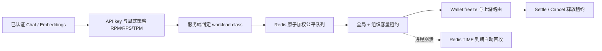

# Admission Control（准入控制/并发治理）

> **版本**：v2.0
> **日期**：2026-07-12
> **当前范围**：Chat、Streaming Chat 与 Embeddings 的跨副本加权准入；
> `/v1/models` 的旧进程内保护仅是辅助过载熔丝，不代表模型调用配额。

## 一、用户能感知到什么

UniRouter 不再把每个请求都当成同样大小的“一个并发”。默认情况下：

| 工作类型 | 服务端分类 | 容量权重 | 最长公平等待 |
|---------|------------|---------:|-------------:|
| 普通对话 | `interactive` | 1 | 50 ms |
| 流式对话 | `stream` | 4 | 250 ms |
| Embeddings | `embedding` | 1 | 50 ms |

全平台默认共有 100 个容量单位，每个组织最多使用 10 个。流式请求更长，
因此占用更多单位。平台和组织分别为短请求保留至少 10 / 2 个单位，防止长流
占满全部容量。等待超过上限后返回 HTTP 429、稳定错误码
`workload_admission.capacity_exceeded` 和 `Retry-After: 1`，不会形成无界队列。

这些数字由所有 UniRouter 副本共享。增加副本不会把客户或平台容量成倍放大。

## 二、当前架构

执行顺序是有意固定的：

1. API-key 请求频率先计数，防止大量容量拒绝绕过调用方自己的速率边界；
2. 显式 selector policy 预留 Token/并发；
3. 加权队列同时检查平台和组织容量；
4. 任一准入失败都会在调用 provider 前回滚可回滚的 Token/并发预留，RPM/RPS
   尝试仍保留；
5. 正常 Settle 或 Cancel 释放加权租约；进程死亡时由 Redis 时间和租约 TTL 回收。

## 三、公平性与隔离

- 每个工作类型拥有单调 virtual-finish 序列。短请求可以快速轮转，长请求在轮到
  自己时会等待足够单位聚合，而不是被持续的小请求永久插队。
- 流式请求不能占用短请求保留区；只有短请求可以使用该区域。
- 某个组织容量已满时，调度器可以跳过该组织的队首，继续服务容量尚未耗尽的
  其他组织，避免跨 tenant 队首阻塞。
- 队列总量与每次 Redis 扫描数量都有硬上限；不把请求、模型、组织或 operation ID
  放入 Prometheus label。
- operation ID、组织、工作类型和权重共同绑定租约指纹；同一操作可幂等 readback，
  不能换组织或换工作类型复用。

## 四、Redis 故障语义

Redis 是共享容量真值。所有脚本键使用同一个 Redis Cluster hash tag，使全局与组织
容量、队列、租约和 operation 状态在一个原子脚本内更新。

Post-PRD6 V1 安全修正于 2026-07-17 获批：Redis 无法证明全局与组织剩余容量时，
所有新工作负载在 provider dispatch 前返回 503；已经取得共享租约的在途工作继续。
原先的进程本地 last-known-safe 许可未绑定组织、工作类别、权重或共享预留容量，已被
移除。所有 Redis 调用仍尊重调用方 context deadline，避免 20-100 ms 的准入边界被
socket 默认超时拉长到数秒。

此修正收紧而不改写历史 D6-02 接受记录。若真实客户证据要求 Redis 短故障期间继续
接纳新工作，必须另行设计由健康 Redis 预扣、绑定组织/类别/权重/实例 generation 的
紧急额度；不得恢复进程本地无共享容量证明的许可。

## 五、配置

| 环境变量 | 默认值 | 含义 |
|----------|-------:|------|
| `WORKLOAD_GLOBAL_CAPACITY` | 100 | 所有副本共享的平台容量单位 |
| `WORKLOAD_ORG_CAPACITY` | 10 | 单组织共享容量单位 |
| `WORKLOAD_GLOBAL_SHORT_RESERVE` | 10 | 平台短请求保留单位 |
| `WORKLOAD_ORG_SHORT_RESERVE` | 2 | 组织短请求保留单位 |
| `WORKLOAD_INTERACTIVE_WEIGHT` | 1 | 普通对话权重 |
| `WORKLOAD_STREAM_WEIGHT` | 4 | 流式对话权重 |
| `WORKLOAD_EMBEDDING_WEIGHT` | 1 | Embeddings 权重 |
| `WORKLOAD_INTERACTIVE_MAX_WAIT_MS` | 50 | 普通对话最长排队时间 |
| `WORKLOAD_STREAM_MAX_WAIT_MS` | 250 | 流式对话最长排队时间 |
| `WORKLOAD_EMBEDDING_MAX_WAIT_MS` | 50 | Embeddings 最长排队时间 |

无效组合会拒绝启动。例如流式权重不能大于“组织容量减短请求保留值”。运行时
管理页面以非技术语言展示实际生效值。改变这些启动参数会改变
`X-UniRouter-Limit-Policy-Version` 指纹。

所有副本还会在 Redis 中核对同一个 workload 配置指纹。只要旧配置仍有活动租约或
排队请求，新配置副本就返回 503
`workload_admission.configuration_conflict`，而不是让两套权重同时修改同一容量池。未来经
授权的配置切换必须先 drain 旧模型请求，再整体启用新版本；本实现没有执行部署。

## 六、可观测与错误合同

成功或拒绝的模型请求都会记录 metadata-only `limit_policy.admission` 事件，并包含：

- `workload_class`、`workload_weight`；
- 实际公平等待毫秒数与有界队列深度；
- 共享 policy-set 指纹；
- `allowed`、`workload_capacity_exceeded` 或 `state_unavailable` 等工作负载
  低基数结果；组合的通用限流策略仍可独立记录其 `last_known_safe` 结果，不能据此
  推断工作负载容量获得了降级租约。

响应可暴露 `X-UniRouter-Workload-Class` 和
`X-UniRouter-Limit-Policy-Version`；原始 prompt、response、密钥和租约内部成员不会
进入这些证据。

## 七、代码与测试入口

| 入口 | 责任 |
|------|------|
| `internal/workloadadmission/` | Redis 原子租约、公平队列、短请求保留、故障边界 |
| `internal/limitpolicy/` | API-key/selector policy 与加权准入的组合、终态释放 |
| `internal/policybilling/` | 在 wallet/upstream 前执行组合准入 |
| `internal/gateway/relay.go` | 服务端分类普通对话、流式对话、Embeddings |
| `internal/config/config.go` | 启动参数、校验与默认值 |
| `frontend/src/pages/LimitPoliciesPage.tsx` | 非技术解释与实际参数展示 |

P6-F21 回归至少覆盖：

- 两/三副本并发下全局和组织容量不按副本放大；
- 流式权重与短请求保留；
- 持续短请求竞争下长请求获得公平轮次；
- 一个组织饱和不阻塞另一组织；
- holder 崩溃后的租约到期回收；
- Redis 延迟、完全故障、一次短时许可和随后 fail-closed；
- operation 冲突、Redis Cluster hash tag、429/503/Retry-After；
- UI、OpenAPI、race test 与真实 Redis required CI。

## 八、明确非目标

- 本实现不是微服务拆分，不创建独立 Scheduler 服务；
- 不实现视频/图片异步 job plane，只为当前三个同步入口定义工作类型；
- 不承诺生产 QPS、100 倍容量或多区域 HA；这些仍需要目标拓扑和固定 workload 的
  授权压测；
- 不替代客户自定义 selector concurrency policy，也不扩大任何身份、Tool、数据库或
  导出权限；
- 旧 `middleware.AdmissionController` 仍可保护轻量本地入口，但不得再作为 Chat/
  Embeddings 的共享容量证据。
